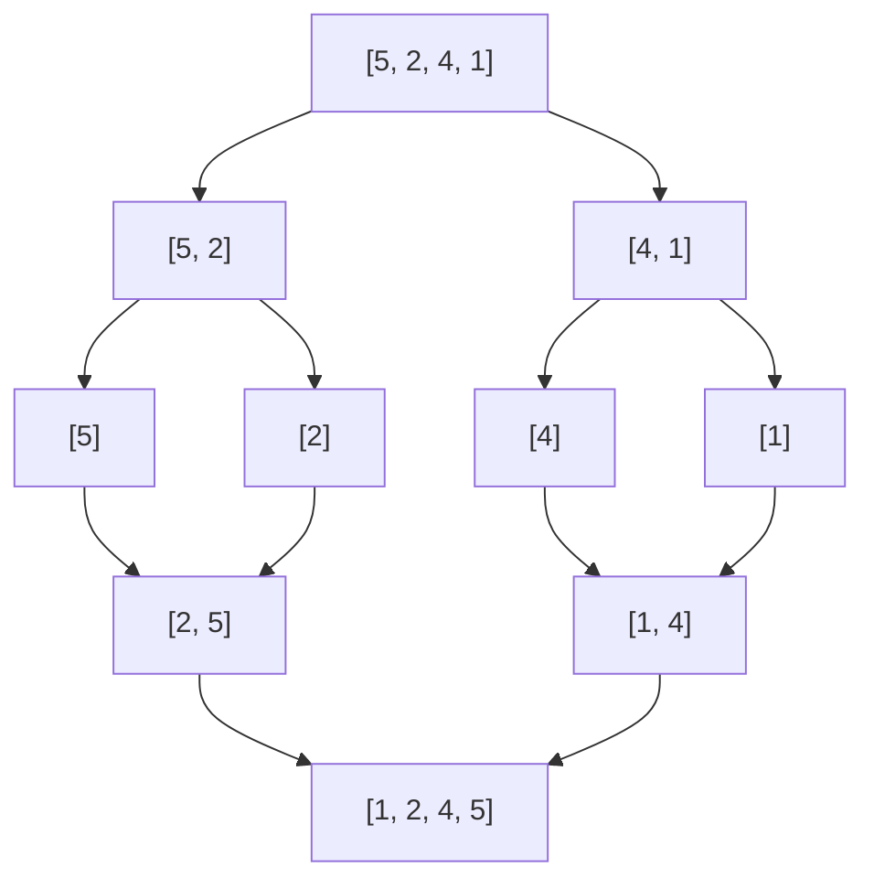
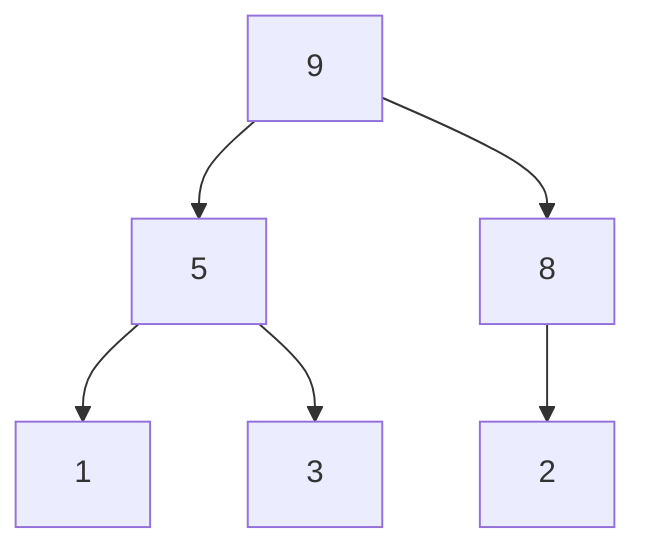
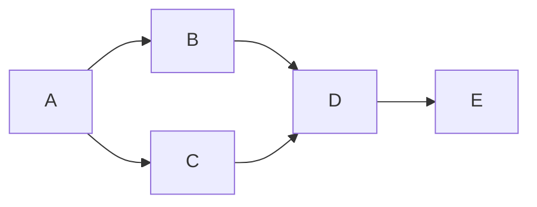
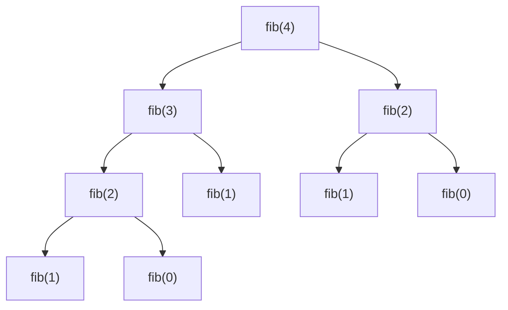
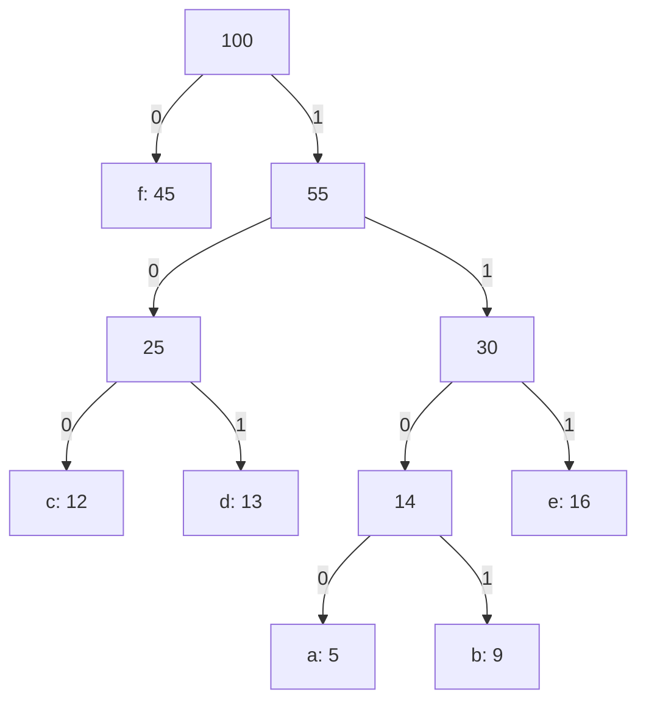
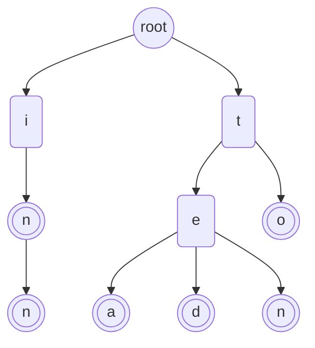
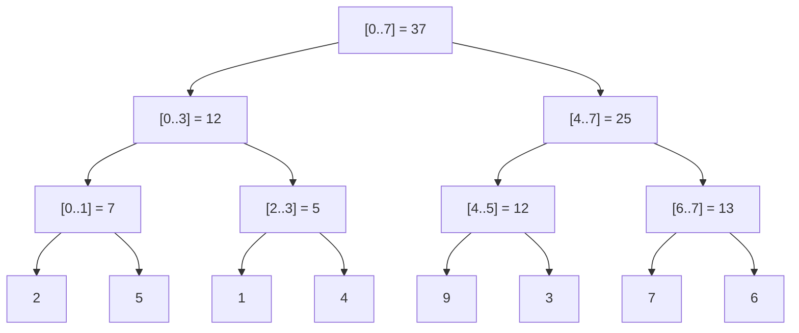

**Notation:**  
`n` = input size  
`m` = pattern/secondary input size  
`V` = vertices  
`E` = edges  
`k` = range of input values  
`d` = number of digits  
`W` = knapsack capacity 

## Sorting Algorithms

| Algorithm | Best | Average | Worst | Space | Stable | In-Place |
|-----------|------|---------|-------|-------|--------|----------|
| Bubble Sort | O(n) | O(n^2) | O(n^2) | O(1) | Yes | Yes |
| Selection Sort | O(n^2) | O(n^2) | O(n^2) | O(1) | No | Yes |
| Insertion Sort | O(n) | O(n^2) | O(n^2) | O(1) | Yes | Yes |
| Merge Sort | O(n log n) | O(n log n) | O(n log n) | O(n) | Yes | No |
| Quick Sort | O(n log n) | O(n log n) | O(n^2) | O(log n) | No | Yes |
| Heap Sort | O(n log n) | O(n log n) | O(n log n) | O(1) | No | Yes |
| Counting Sort | O(n + k) | O(n + k) | O(n + k) | O(k) | Yes | No |
| Radix Sort | O(d(n + k)) | O(d(n + k)) | O(d(n + k)) | O(n + k) | Yes | No |
| Bucket Sort | O(n + k) | O(n + k) | O(n^2) | O(n) | Yes | No |

### Bubble Sort

Repeatedly swaps adjacent elements if they are in the wrong order. Each pass "bubbles" the largest unsorted element to its correct position.

Trace on `[5, 1, 4, 2, 8]` (each pass bubbles the largest unsorted value to the end):

```plaintext
start     5  1  4  2  8
pass 1    1  4  2  5  8    sorted tail: 8
pass 2    1  2  4  5  8    sorted tail: 5 8
pass 3    1  2  4  5  8    no swaps, done
```

**When to use:** Educational purposes. Useful when data is nearly sorted (best case O(n) with early termination).

### Selection Sort

Finds the minimum element from the unsorted portion and places it at the beginning. Always performs O(n^2) comparisons regardless of input.

Trace on `[64, 25, 12, 22, 11]` (one swap per step):

```plaintext
start    64 25 12 22 11
step 1   11 25 12 22 64    min = 11 at index 4, swap with index 0
step 2   11 12 25 22 64    min = 12 at index 2, swap with index 1
step 3   11 12 22 25 64    min = 22 at index 3, swap with index 2
step 4   11 12 22 25 64    min = 25 is already at index 3
```

**When to use:** When memory writes are expensive (makes at most O(n) swaps). Simple to implement.

### Insertion Sort

Builds the sorted array one element at a time by inserting each element into its correct position among the previously sorted elements.

Trace on `[5, 2, 4, 6, 1, 3]`:

```plaintext
start     5  2  4  6  1  3
i = 1     2  5  4  6  1  3    insert 2, sorted prefix = [2, 5]
i = 2     2  4  5  6  1  3    insert 4, sorted prefix = [2, 4, 5]
i = 3     2  4  5  6  1  3    insert 6, sorted prefix = [2, 4, 5, 6]
i = 4     1  2  4  5  6  3    insert 1, sorted prefix = [1, 2, 4, 5, 6]
i = 5     1  2  3  4  5  6    insert 3, sorted prefix = [1, 2, 3, 4, 5, 6]
```

**When to use:** Small datasets (n < 50), nearly sorted data, or as the base case for hybrid sorts like Timsort. Online algorithm (can sort as data arrives).

### Merge Sort

Divides the array in half, recursively sorts each half, then merges the two sorted halves.



The array is split down to single elements, then merged back up in sorted order.

**When to use:** When stable sort is needed with guaranteed O(n log n). Preferred for linked lists (no extra space needed). Good for external sorting (large files).

### Quick Sort

Picks a pivot, partitions the array so elements less than the pivot come before it and elements greater come after, then recursively sorts the partitions.

```plaintext
start  pivot=5, i=-1        [8, 3, 7, 2, 5]

j=0  8 > 5, skip            [8, 3, 7, 2, 5]
j=1  3 <= 5, i=0, swap      [3, 8, 7, 2, 5]
j=2  7 > 5, skip            [3, 8, 7, 2, 5]
j=3  2 <= 5, i=1, swap      [3, 2, 7, 8, 5]
end  swap pivot into i+1    [3, 2, 5, 8, 7]
                                   ^ pivot in its final place

left of pivot: [3, 2]    right of pivot: [8, 7]    sort each side recursively
```

**When to use:** General-purpose sorting. Fastest in practice for most inputs. Use randomized pivot or median-of-three to avoid worst case. Not stable.

### Heap Sort

Builds a max-heap from the array, then repeatedly extracts the maximum element to build the sorted array from the end.

A max-heap is stored in a plain array, and every parent is at least as large as its children:



```plaintext
index    0  1  2  3  4  5
array    9  5  8  1  3  2

children of i: 2i + 1 and 2i + 2      parent of i: (i - 1) // 2
```

**When to use:** When guaranteed O(n log n) is needed with O(1) extra space. Not stable. Poor cache performance compared to quicksort.

### Counting Sort

Counts occurrences of each value, then calculates positions. Works only on non-negative integers (or values that can be mapped to them).

Counting sort on `[3, 1, 4, 1, 3, 2]`, values in `1..4`:

```plaintext
input     3  1  4  1  3  2

value     1  2  3  4
count     2  1  2  1          occurrences of each value
prefix    2  3  5  6          last output slot (1-based) for each value

output    1  1  2  3  3  4    filled from the right, so equal keys keep their order
```

**When to use:** When the range of input values `k` is not significantly greater than `n`. Linear time.

### Radix Sort

Sorts numbers digit by digit, from least significant to most significant (LSD) or vice versa (MSD), using a stable sort (usually counting sort) as a subroutine.

LSD radix sort, one stable pass per digit:

```plaintext
input     170  45  75  90 802  24   2  66
by 1s     170  90 802   2  24  45  75  66    stable sort on the 1s digit
by 10s    802   2  24  45  66 170  75  90    stable sort on the 10s digit
by 100s     2  24  45  66  75  90 170 802    stable sort on the 100s digit
```

**When to use:** Fixed-length integers or strings. When `d` (digits) is constant, runs in O(n).

### Bucket Sort

Distributes elements into buckets, sorts each bucket individually (often with insertion sort), then concatenates results.

Values in `[0, 1)` go to bucket `int(x * 10)`:

```plaintext
input     0.78 0.17 0.39 0.26 0.72 0.94 0.21 0.12

bucket 1  0.17 0.12                                  sorted: 0.12 0.17
bucket 2  0.26 0.21                                  sorted: 0.21 0.26
bucket 3  0.39                                       sorted: 0.39
bucket 7  0.78 0.72                                  sorted: 0.72 0.78
bucket 9  0.94                                       sorted: 0.94
(buckets 0, 4, 5, 6, 8 are empty)

result    0.12 0.17 0.21 0.26 0.39 0.72 0.78 0.94    buckets joined in order
```

**When to use:** Uniformly distributed floating-point data over a known range. Average case O(n) when data is evenly distributed.

---

## Searching Algorithms

| Algorithm | Best | Average | Worst | Space | Prerequisite |
|-----------|------|---------|-------|-------|-------------|
| Linear Search | O(1) | O(n) | O(n) | O(1) | None |
| Binary Search | O(1) | O(log n) | O(log n) | O(1) | Sorted array |
| Interpolation Search | O(1) | O(log log n) | O(n) | O(1) | Sorted, uniform distribution |
| Jump Search | O(1) | O(sqrt(n)) | O(sqrt(n)) | O(1) | Sorted array |
| Exponential Search | O(1) | O(log n) | O(log n) | O(1) | Sorted array |

### Linear Search

Scans each element sequentially until the target is found or the end is reached. Works on any collection.

### Binary Search

Repeatedly divides the search interval in half. Compares the target to the middle element and eliminates one half.

```
low, high = 0, n-1
while low <= high:
    mid = (low + high) // 2
    if arr[mid] == target: return mid
    elif arr[mid] < target: low = mid + 1
    else: high = mid - 1
```

```plaintext
index      0   1   2   3   4   5   6   7
arr        2   5   8  12  16  23  38  56    target = 38

step 1     L           M               H    arr[3] = 12 < 38, so lo = 4
step 2                     L   M       H    arr[5] = 23 < 38, so lo = 6
step 3                            LM   H    arr[6] = 38, found at index 6

L = lo, M = mid, H = hi
```

### Interpolation Search

Like binary search but estimates the position of the target based on its value relative to the min/max of the current range. Probe position: `low + ((target - arr[low]) * (high - low)) // (arr[high] - arr[low])`.

**When to use:** Uniformly distributed sorted data. Degrades to O(n) on skewed distributions.

### Jump Search

Jumps ahead by fixed steps of size `sqrt(n)`, then performs a linear search within the identified block.

Searching for `21` in a sorted array of 16 values:

```plaintext
block 0      1   3   5   7    last = 7 < 21, jump
block 1      9  11  13  15    last = 15 < 21, jump
block 2     17  19  21  23    last = 23 >= 21, scan this block
block 3     25  27  29  31

n = 16, step = sqrt(n) = 4, target = 21
scan 17, 19, 21 -> found at index 10
```

**When to use:** Sorted array where jumping back is costly (e.g., linked lists with forward-only traversal).

### Exponential Search

Finds a range by doubling the index (1, 2, 4, 8, ...) until the target is exceeded, then performs binary search within that range.

Searching for `37` in a sorted array:

```plaintext
probe i = 1     arr[1] = 3 <= 37, double
probe i = 2     arr[2] = 5 <= 37, double
probe i = 4     arr[4] = 9 <= 37, double
probe i = 8     arr[8] = 17 <= 37, double
probe i = 16    arr[16] = 33 <= 37, double
probe i = 32    arr[32] = 65 > 37, stop

arr[i] = 2i + 1, n = 40, target = 37
binary search in [16, 32] -> found at index 18
```

**When to use:** Unbounded or infinite lists. Also efficient when the target is near the beginning.

---

## Graph Algorithms

| Algorithm | Time | Space | Use Case |
|-----------|------|-------|----------|
| BFS | O(V + E) | O(V) | Shortest path (unweighted) |
| DFS | O(V + E) | O(V) | Cycle detection, topological sort |
| Dijkstra | O((V + E) log V) | O(V) | Shortest path (non-negative weights) |
| Bellman-Ford | O(VE) | O(V) | Shortest path (handles negative weights) |
| Floyd-Warshall | O(V^3) | O(V^2) | All-pairs shortest paths |
| Kruskal | O(E log E) | O(V) | Minimum spanning tree (sparse graphs) |
| Prim | O((V + E) log V) | O(V) | Minimum spanning tree (dense graphs) |
| Topological Sort | O(V + E) | O(V) | Ordering DAG dependencies |
| A* | O(E) to O(b^d) | O(V) | Shortest path with heuristic |

### BFS (Breadth-First Search)

Explores all neighbors at the current depth before moving to the next depth level. Uses a queue. Guarantees shortest path in unweighted graphs.

### DFS (Depth-First Search)

Explores as far as possible along each branch before backtracking. Uses a stack (or recursion). Useful for cycle detection, connected components, and topological sorting.

Visit order on the same tree:

```plaintext
        A              Visit order
       / \
      B   C            BFS (queue):  A, B, C, D, E, F   (level by level)
     / \   \
    D   E   F          DFS (stack):  A, B, D, E, C, F   (deep first, then back up)
```

### Dijkstra's Algorithm

Greedy algorithm that finds the shortest path from a source to all other vertices. Uses a priority queue (min-heap). Does not work with negative edge weights.

Example on a small weighted graph, source `A` (the table shows the best known distance after each step):

```plaintext
A ---4--- B     step  visit     A    B    C    D
|       / |     init  -          0  inf  inf  inf
1     2   1     1     A          0    4    1  inf
|   /     |     2     C          0    3    1    6
C ---5--- D     3     B          0    3    1    4
                4     D          0    3    1    4

Shortest A -> D = 4, via A -> C -> B -> D
```

### Bellman-Ford Algorithm

Relaxes all edges `V-1` times. Can detect negative-weight cycles (if any edge can still be relaxed after `V-1` iterations). Slower than Dijkstra but handles negative weights.

Distances from `A` after each round (edges are relaxed in the order listed, at most `V-1` = 3 rounds):

```plaintext
edges: A->B (4), A->C (5), B->C (-2), B->D (6), C->D (3)

             A    B    C    D
init         0  inf  inf  inf
round 1      0    4    2    5
round 2      0    4    2    5    no change, stop early
```

### Floyd-Warshall Algorithm

Computes shortest paths between all pairs of vertices using dynamic programming. `dist[i][j] = min(dist[i][j], dist[i][k] + dist[k][j])` for each intermediate vertex `k`.

Distance matrix before and after allowing `B` as an intermediate vertex:

```plaintext
initial                 after k = B
          A    B    C             A    B    C
  A       0    3    7     A       0    3    4
  B     inf    0    1     B     inf    0    1
  C     inf  inf    0     C     inf  inf    0

dist[A][C] = min(7, dist[A][B] + dist[B][C]) = min(7, 3 + 1) = 4
```

### Kruskal's Algorithm

Builds MST by sorting all edges by weight, then adding edges that do not form a cycle (uses Union-Find/Disjoint Set). Best for sparse graphs.

Example graph (edge weights on the lines):

```plaintext
A ---1--- B
|       / |
4     3   5
|   /     |
C ---2--- D ---6--- E

edges sorted by weight:
A-B  1    take
C-D  2    take
B-C  3    take
A-C  4    skip (would form a cycle)
B-D  5    skip (would form a cycle)
D-E  6    take

MST weight = 12
```

### Prim's Algorithm

Builds MST by starting from any vertex and greedily adding the cheapest edge connecting the tree to a non-tree vertex. Uses a priority queue. Best for dense graphs.

Same graph as above:

```plaintext
A ---1--- B
|       / |
4     3   5
|   /     |
C ---2--- D ---6--- E

start at A, always take the cheapest edge leaving the tree:
add A-B  1    tree = {A, B}
add B-C  3    tree = {A, B, C}
add C-D  2    tree = {A, B, C, D}
add D-E  6    tree = {A, B, C, D, E}

MST weight = 12
```

### Topological Sort

Linear ordering of vertices in a DAG such that for every directed edge `u -> v`, `u` comes before `v`. Can be done via DFS (reverse post-order) or Kahn's algorithm (BFS with in-degree tracking).



Valid orders include `A B C D E` and `A C B D E`. Every edge points forward, so each vertex comes after all of its prerequisites.

### A* Search

Extension of Dijkstra that uses a heuristic `h(n)` to estimate distance to the goal. Evaluates nodes by `f(n) = g(n) + h(n)`. Optimal when the heuristic is admissible (never overestimates). Widely used in pathfinding.

Grid pathfinding with 4-way moves:

```plaintext
S * * # * * * *
. # * # * # # *
. # * * * # * *
. # . # # # * #
. . . . # . * G

S start, G goal, # wall, * shortest path
17 steps. f(n) = g(n) + h(n), h = Manhattan distance to G
```

---

## Dynamic Programming

Dynamic programming (DP) solves problems by breaking them into overlapping subproblems and storing results to avoid redundant computation.

### Memoization vs Tabulation

| Approach | Direction | Storage | When to Use |
|----------|-----------|---------|-------------|
| Memoization (top-down) | Recursive, stores results as computed | Hash map / array | When not all subproblems need solving |
| Tabulation (bottom-up) | Iterative, fills table from base case up | Array / table | When all subproblems are needed, avoids recursion overhead |

### Classic DP Problems

**Fibonacci Sequence** -- Each number is the sum of the two preceding ones. Naive recursion is O(2^n). DP reduces to O(n) time, O(1) space (only track last two values).

Naive recursion for `fib(4)`:



`fib(2)` is computed twice. Memoization (or tabulation) computes each value once, which is what turns O(2^n) into O(n).

**0/1 Knapsack** -- Given `n` items with weights and values, maximize total value without exceeding capacity `W`. Build a table `dp[i][w]` where each cell is `max(dp[i-1][w], dp[i-1][w - weight[i]] + value[i])`. Time: O(nW), Space: O(nW) (reducible to O(W)).

Items `(weight, value)`: `(1,1)`, `(3,4)`, `(4,5)`, `(5,7)`. Capacity 7:

```plaintext
capacity      0  1  2  3  4  5  6  7
no items      0  0  0  0  0  0  0  0
w=1 v=1       0  1  1  1  1  1  1  1
w=3 v=4       0  1  1  4  5  5  5  5
w=4 v=5       0  1  1  4  5  6  6  9
w=5 v=7       0  1  1  4  5  7  8  9

best value with capacity 7 = 9
dp[i][c] = max(dp[i-1][c], dp[i-1][c - w] + v)
```

**Longest Common Subsequence (LCS)** -- Find the longest subsequence common to two strings of lengths `m` and `n`. `dp[i][j] = dp[i-1][j-1] + 1` if characters match, else `max(dp[i-1][j], dp[i][j-1])`. Time: O(mn), Space: O(mn) (reducible to O(min(m,n))).

DP table for `AGCT` vs `GACT`:

```plaintext
        ""  G  A  C  T
  ""     0  0  0  0  0
  A      0  0  1  1  1
  G      0  1  1  1  1
  C      0  1  1  2  2
  T      0  1  1  2  3      LCS length = 3

match:    dp[i][j] = dp[i-1][j-1] + 1
no match: dp[i][j] = max(dp[i-1][j], dp[i][j-1])
```

**Longest Increasing Subsequence (LIS)** -- Find the longest strictly increasing subsequence. Classic DP is O(n^2). Patience sorting with binary search achieves O(n log n).

**Coin Change** -- Given coin denominations, find the minimum coins to make amount `A`. `dp[a] = min(dp[a], dp[a - coin] + 1)` for each coin. Time: O(nA) where `n` = number of denominations.

Minimum coins for each amount, with coins `[1, 3, 4]`:

```plaintext
amount       0  1  2  3  4  5  6
min coins    0  1  2  1  1  2  2

coins = [1, 3, 4], dp[6] = 2 (3 + 3). Greedy (largest coin first) would use 4 + 1 + 1 = 3 coins.
```

**Edit Distance (Levenshtein)** -- Minimum insertions, deletions, and substitutions to transform one string into another. `dp[i][j]` considers three operations. Time: O(mn), Space: O(mn) (reducible to O(min(m,n))).

DP table for `horse` -> `ros`:

```plaintext
       ""  r  o  s
  ""    0  1  2  3
  h     1  1  2  3
  o     2  2  1  2
  r     3  2  2  2
  s     4  3  3  2
  e     5  4  4  3

edit distance("horse", "ros") = 3

dp[i][j] = min(dp[i-1][j] + 1,         delete
               dp[i][j-1] + 1,         insert
               dp[i-1][j-1] + cost)    replace, cost = 0 if a[i] == b[j] else 1
```

---

## Greedy Algorithms

Greedy algorithms make the locally optimal choice at each step, hoping to find the global optimum. They work when the problem has **optimal substructure** and the **greedy choice property** (a locally optimal choice leads to a globally optimal solution).

**When to use:** Optimization problems where choosing the best option at each step yields the correct answer. Always verify the greedy choice property holds.

### Classic Greedy Problems

**Activity Selection** -- Given activities with start/end times, select the maximum number of non-overlapping activities. Sort by end time, greedily pick the earliest finishing activity. Time: O(n log n).

Eleven activities `(start, end)`:

```plaintext
            0     2     4     6     8     10    12    14    16
A1 (1,4)       #########
A2 (3,5)             ......
A3 (0,6)    ..................
A4 (5,7)                   ######
A5 (3,9)             ..................
A6 (5,9)                   ............
A7 (6,10)                     ............
A8 (8,11)                           #########
A9 (8,12)                           ............
A10 (2,14)        ....................................
A11 (12,16)                                     ############

sorted by end time; # = picked (starts after the last pick ends), . = skipped
picked: A1, A4, A8, A11  (4 activities)
```

**Huffman Coding** -- Build an optimal prefix-free binary code for data compression. Repeatedly merge the two lowest-frequency nodes into a new internal node. Uses a priority queue. Time: O(n log n).

Frequencies `a:5 b:9 c:12 d:13 e:16 f:45`. Each merge joins the two lowest weights; left edge `0`, right edge `1`:



```plaintext
char  freq  code
f       45  0
c       12  100
d       13  101
e       16  111
a        5  1100
b        9  1101
```

Frequent characters get short codes, and no code is a prefix of another.

**Fractional Knapsack** -- Unlike 0/1 knapsack, items can be divided. Sort by value/weight ratio, greedily take the highest ratio items. Time: O(n log n).

---

## Divide and Conquer

Divide the problem into smaller subproblems, solve each recursively, then combine results. Unlike DP, subproblems typically do not overlap.

**Merge Sort** -- Divide array in half, sort each half, merge. T(n) = 2T(n/2) + O(n) = O(n log n).

**Quick Sort** -- Partition around pivot, sort each side. Average T(n) = 2T(n/2) + O(n) = O(n log n). Worst case O(n^2).

**Binary Search** -- Divide search space in half each step. T(n) = T(n/2) + O(1) = O(log n).

**Closest Pair of Points** -- Find the two closest points in a 2D plane. Divide points by x-coordinate, solve each half, check the strip near the dividing line. Time: O(n log n).

**Karatsuba Multiplication** -- Multiply two n-digit numbers using 3 recursive multiplications instead of 4. T(n) = 3T(n/2) + O(n) = O(n^1.585), faster than the naive O(n^2).

---

## String Algorithms

| Algorithm | Time | Space | Description |
|-----------|------|-------|-------------|
| KMP | O(n + m) | O(m) | Pattern matching with failure function |
| Rabin-Karp | O(n + m) avg, O(nm) worst | O(1) | Rolling hash-based pattern matching |
| Trie Insert/Search | O(m) | O(alphabet * m * n) | Prefix tree operations |
| Longest Common Substring | O(mn) | O(mn) | DP-based string comparison |

### KMP (Knuth-Morris-Pratt)

Preprocesses the pattern to build a "failure function" (partial match table) that indicates how much of the pattern can be reused after a mismatch. Never backtracks in the text. Time: O(n + m).

Failure table for `ABABAC`, and how a mismatch is handled:

```plaintext
pattern   A  B  A  B  A  C
index     0  1  2  3  4  5
lps       0  0  1  2  3  0

text      A  B  A  B  A  B  A  C
pattern   A  B  A  B  A  C              mismatch at index 5 (B != C)
pattern         A  B  A  B  A  C        shift by 5 - lps[4] = 2, resume at pattern[3]
```

### Rabin-Karp

Uses a rolling hash to compare the hash of the pattern with hashes of substrings of the text. Only compares characters when hashes match. Efficient for multiple-pattern search. Average O(n + m), worst O(nm) due to hash collisions.

Pattern `590` in `2359023`:

```plaintext
text = 2359023, pattern = 590, hash = number mod 11, pattern hash = 7

i  window  hash
0  235     4
1  359     7       hash match, characters differ -> spurious hit
2  590     7       hash match, characters match -> found
3  902     0
4  023     1

rolling update: hash = ((hash - old_digit * 10^2) * 10 + new_digit) mod 11
```

### Trie Operations

A tree-like data structure where each node represents a character. Supports insert, search, and prefix search in O(m) time (m = key length). Used for autocomplete, spell checking, and IP routing. Space can be large: O(alphabet size * total characters stored).



Words stored: `to`, `tea`, `ted`, `ten`, `in`, `inn`. Double circles mark the end of a word.

### Longest Common Substring

Find the longest string that is a substring of two given strings. Build a DP table where `dp[i][j] = dp[i-1][j-1] + 1` if characters match, else 0. Track the maximum value. Time: O(mn). Can also be solved with suffix arrays in O(n log n).

---

## Tree Algorithms

### Traversals

| Traversal | Order | Use Case |
|-----------|-------|----------|
| In-order | Left, Root, Right | BST sorted output |
| Pre-order | Root, Left, Right | Copy/serialize tree |
| Post-order | Left, Right, Root | Delete tree, evaluate expressions |
| Level-order | BFS by level | Print level by level, find min depth |

All traversals visit every node once: **O(n) time, O(h) space** where `h` = tree height (O(n) worst case for skewed trees, O(log n) for balanced).

The same tree under each traversal:

```plaintext
        4
      /   \
     2     6
    / \   / \
   1   3 5   7

in-order    1 2 3 4 5 6 7
pre-order   4 2 1 3 6 5 7
post-order  1 3 2 5 7 6 4
level-order 4 2 6 1 3 5 7
```

### BST Operations

| Operation | Average | Worst (unbalanced) |
|-----------|---------|---------------------|
| Search | O(log n) | O(n) |
| Insert | O(log n) | O(n) |
| Delete | O(log n) | O(n) |

### AVL Trees

Self-balancing BST where the height difference between left and right subtrees of any node is at most 1. Rebalances using four rotations: **Left**, **Right**, **Left-Right**, and **Right-Left**. All operations guaranteed O(log n).

A rotation in action:

```plaintext
  1                               2
   \                             / \
    2             ==>           1   3
     \
      3

Insert 1, 2, 3 in order: the tree leans right (right-right case), node 1 is unbalanced.
Rotate left at 1: 2 becomes the root and the tree is balanced.
In-order is still 1, 2, 3.
```

### Segment Tree

A binary tree used for range queries (sum, min, max) and point/range updates on an array. Build: O(n). Query: O(log n). Update: O(log n). Space: O(n). Supports lazy propagation for efficient range updates.

Sum tree over `[2, 5, 1, 4, 9, 3, 7, 6]`:



Each node stores the sum of its range, so a range query combines at most O(log n) nodes.

### Fenwick Tree (Binary Indexed Tree)

A compact tree structure for prefix sum queries and point updates. Build: O(n log n). Query: O(log n). Update: O(log n). Space: O(n). Simpler and more memory-efficient than a segment tree but less versatile (primarily for prefix sums).

```plaintext
a = [3, 2, -1, 6, 5, 4, -3, 3] (1-indexed)

i    binary  covers   tree[i]
1    0001    1..1          3
2    0010    1..2          5
3    0011    3..3         -1
4    0100    1..4         10
5    0101    5..5          5
6    0110    5..6          9
7    0111    7..7         -3
8    1000    1..8         19

prefix_sum(7): tree[7] + tree[6] + tree[4] = 16    (i -= i & -i)
update(i, delta): i += i & -i until i > 8
```

---

## Master Complexity Table

| Algorithm | Best | Average | Worst | Space |
|-----------|------|---------|-------|-------|
| **Sorting** | | | | |
| Bubble Sort | O(n) | O(n^2) | O(n^2) | O(1) |
| Selection Sort | O(n^2) | O(n^2) | O(n^2) | O(1) |
| Insertion Sort | O(n) | O(n^2) | O(n^2) | O(1) |
| Merge Sort | O(n log n) | O(n log n) | O(n log n) | O(n) |
| Quick Sort | O(n log n) | O(n log n) | O(n^2) | O(log n) |
| Heap Sort | O(n log n) | O(n log n) | O(n log n) | O(1) |
| Counting Sort | O(n + k) | O(n + k) | O(n + k) | O(k) |
| Radix Sort | O(d(n + k)) | O(d(n + k)) | O(d(n + k)) | O(n + k) |
| Bucket Sort | O(n + k) | O(n + k) | O(n^2) | O(n) |
| **Searching** | | | | |
| Linear Search | O(1) | O(n) | O(n) | O(1) |
| Binary Search | O(1) | O(log n) | O(log n) | O(1) |
| Interpolation Search | O(1) | O(log log n) | O(n) | O(1) |
| Jump Search | O(1) | O(sqrt(n)) | O(sqrt(n)) | O(1) |
| Exponential Search | O(1) | O(log n) | O(log n) | O(1) |
| **Graph** | | | | |
| BFS | O(V + E) | O(V + E) | O(V + E) | O(V) |
| DFS | O(V + E) | O(V + E) | O(V + E) | O(V) |
| Dijkstra (min-heap) | -- | -- | O((V + E) log V) | O(V) |
| Bellman-Ford | -- | -- | O(VE) | O(V) |
| Floyd-Warshall | O(V^3) | O(V^3) | O(V^3) | O(V^2) |
| Kruskal | -- | -- | O(E log E) | O(V) |
| Prim (min-heap) | -- | -- | O((V + E) log V) | O(V) |
| Topological Sort | O(V + E) | O(V + E) | O(V + E) | O(V) |
| **String** | | | | |
| KMP | O(n + m) | O(n + m) | O(n + m) | O(m) |
| Rabin-Karp | -- | O(n + m) | O(nm) | O(1) |
| **Dynamic Programming** | | | | |
| Fibonacci (DP) | O(n) | O(n) | O(n) | O(1) |
| 0/1 Knapsack | -- | -- | O(nW) | O(nW) |
| LCS | -- | -- | O(mn) | O(mn) |
| LIS (optimal) | -- | -- | O(n log n) | O(n) |
| Coin Change | -- | -- | O(nA) | O(A) |
| Edit Distance | -- | -- | O(mn) | O(mn) |
| **Tree** | | | | |
| BST Search (balanced) | O(1) | O(log n) | O(log n) | O(1) |
| BST Search (unbalanced) | O(1) | O(log n) | O(n) | O(1) |
| Segment Tree Query | -- | -- | O(log n) | O(n) |
| Fenwick Tree Query | -- | -- | O(log n) | O(n) |
