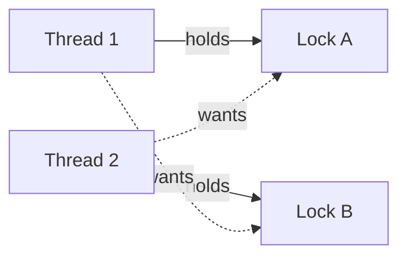
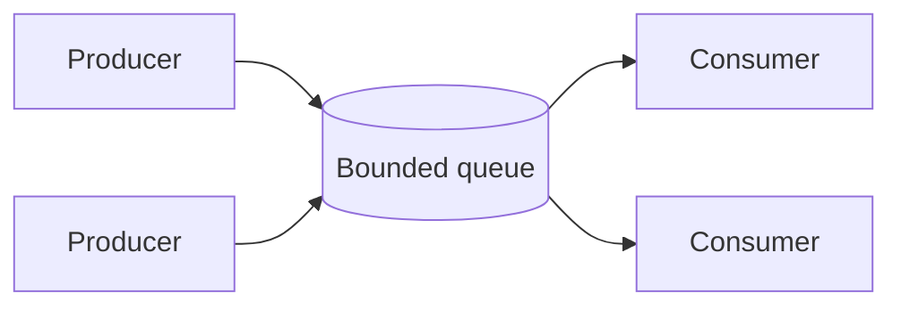

## Concurrency vs Parallelism

```plaintext
Concurrency (one core, tasks interleave)      Parallelism (many cores, truly at once)

Core 1:  A  B  A  B  A  B                      Core 1:  A  A  A  A  A
                                               Core 2:  B  B  B  B  B
```

| | Concurrency | Parallelism |
|---|-------------|-------------|
| Idea | Handle many tasks that overlap in time | Run many tasks at the same instant |
| Needs | A way to switch between tasks | Multiple cores or machines |
| Goal | Responsiveness, waiting efficiently | Speed on heavy computation |
| Example | A server handling 10,000 connections | Encoding video on 8 cores |

## Workload Types

| Workload | Bottleneck | Best tool |
|----------|------------|-----------|
| **I/O-bound** (network, disk, database) | Waiting | Async I/O, threads |
| **CPU-bound** (maths, compression, parsing) | The processor | Processes, native threads, more cores |

## Models of Concurrency

| Model | How it works | Examples |
|-------|--------------|----------|
| OS threads | The OS schedules threads, shared memory | Java, C++, Python `threading` |
| Processes | Isolated memory, communicate by messages | Python `multiprocessing`, Unix `fork` |
| Event loop and async/await | One thread, tasks yield at `await` | JavaScript, Python `asyncio`, Rust `tokio` |
| Green threads / coroutines | Lightweight tasks scheduled by the runtime | Go goroutines, Kotlin coroutines |
| Actors | Isolated objects that exchange messages | Erlang, Akka |
| Message passing (CSP) | Tasks communicate over channels | Go channels |

## Race Conditions

A race happens when the result depends on the order of unsynchronised accesses.

```python
counter = 0

def increment():
    global counter
    for _ in range(100_000):
        counter += 1          # read, add, write: three steps, not atomic

# Two threads can both read 5, both write 6, and one increment is lost.
```

```plaintext
Thread A:  read counter (5) ─────────► write 6
Thread B:        read counter (5) ───────────► write 6      (expected 7)
```

| Term | Meaning |
|------|---------|
| Data race | Two threads touch the same memory, at least one writes, with no ordering |
| Critical section | Code that must run by one thread at a time |
| Atomic | An operation that cannot be seen half done |
| Thread-safe | Correct when called from several threads |

## Locks and Synchronisation

| Primitive | Purpose |
|-----------|---------|
| Mutex (lock) | One thread at a time in a critical section |
| Read-write lock | Many readers or one writer |
| Semaphore | Allow up to N threads |
| Condition variable | Sleep until a condition becomes true |
| Barrier | Wait until N threads arrive |
| Latch / countdown | Wait until a count reaches zero |
| Spinlock | Busy-wait for a very short critical section |
| Atomic variables | Lock-free counters and flags |

```python
import threading

lock = threading.Lock()
counter = 0

def increment():
    global counter
    for _ in range(100_000):
        with lock:                   # always released, even on error
            counter += 1
```

Rules for locks:

- Keep critical sections **short**.
- Never call unknown code (callbacks) while holding a lock.
- Always release in a `finally` or with a context manager.
- Lock in a **fixed global order** when you need several locks.

## Deadlock, Livelock, Starvation



| Problem | What happens | Fix |
|---------|--------------|-----|
| Deadlock | Threads wait for each other forever | Lock ordering, timeouts, `try_lock`, fewer locks |
| Livelock | Threads keep reacting to each other and make no progress | Random backoff |
| Starvation | A thread never gets the resource | Fair locks, priorities with aging |
| Priority inversion | A low-priority thread holds a lock a high-priority one needs | Priority inheritance |

## Producer and Consumer



```python
import queue, threading

q = queue.Queue(maxsize=10)          # bounded: producers wait when full

def producer():
    for i in range(100):
        q.put(i)                     # blocks if the queue is full
    q.put(None)                      # sentinel: no more work

def consumer():
    while (item := q.get()) is not None:
        handle(item)
        q.task_done()
```

A **bounded** queue gives **backpressure**: slow consumers slow the producers instead of
filling memory.

## Async and Await

One thread runs many tasks. A task gives up control at each `await`, so no locks are needed
for plain variables between awaits.

```python
import asyncio

async def fetch(url):
    await asyncio.sleep(1)           # stands in for network I/O
    return f"done {url}"

async def main():
    results = await asyncio.gather(fetch("a"), fetch("b"), fetch("c"))
    print(results)                   # all three take about 1 second in total

asyncio.run(main())
```

```javascript
async function main() {
  const [a, b] = await Promise.all([fetchJson("/a"), fetchJson("/b")]);
  console.log(a, b);
}
```

| Do | Avoid |
|----|-------|
| `await` I/O so other tasks run | Blocking calls (`time.sleep`, heavy loops) inside async code |
| Run tasks together with `gather` or `Promise.all` | Awaiting one by one when they are independent |
| Move CPU work to a thread or process pool | CPU-heavy work on the event loop |
| Set timeouts and handle cancellation | Tasks that can hang forever |

## Python Specifics

| Tool | Use |
|------|-----|
| `threading` | I/O-bound work. The **GIL** stops threads from running Python code in parallel |
| `multiprocessing`, `ProcessPoolExecutor` | CPU-bound work on several cores |
| `asyncio` | Many network connections |
| `concurrent.futures` | Simple pools for threads or processes |

```python
from concurrent.futures import ThreadPoolExecutor, ProcessPoolExecutor

with ThreadPoolExecutor(max_workers=8) as pool:
    pages = list(pool.map(download, urls))         # I/O-bound

with ProcessPoolExecutor() as pool:
    results = list(pool.map(crunch, chunks))       # CPU-bound
```

## Thread Pools

Creating a thread per task is costly. A pool keeps a fixed number of workers.

| Sizing hint | Workers |
|-------------|---------|
| CPU-bound | About the number of cores |
| I/O-bound | Many more than cores (depends on wait time) |

## Memory Model Basics

| Concept | Meaning |
|---------|---------|
| Visibility | A write by one thread may not be seen by another without synchronisation |
| Reordering | Compilers and CPUs may reorder instructions |
| Happens-before | A guaranteed ordering, created by locks, atomics, and thread start or join |
| `volatile` (Java, C#) | Reads and writes go to main memory, with ordering. Not enough for compound operations |
| Compare-and-swap (CAS) | Atomically set a value only if it still equals the expected one |

```plaintext
CAS(address, expected, new):   if *address == expected: *address = new; return true
                               else: return false          (retry in a loop)
```

## Safer Design Patterns

| Pattern | Idea |
|---------|------|
| **Immutability** | Data that never changes needs no locks |
| **Confinement** | Keep data owned by one thread |
| **Message passing** | Share by communicating, not by sharing memory |
| **Copy on write** | Readers use a snapshot while writers copy |
| **Thread-local storage** | A separate copy per thread |
| **Idempotency** | Safe to repeat, so retries do not harm |
| **Structured concurrency** | Child tasks cannot outlive their parent scope |

## Go-Style Channels

```go
jobs := make(chan int, 100)
results := make(chan int, 100)

for w := 0; w < 4; w++ {
    go func() {
        for j := range jobs {
            results <- j * 2
        }
    }()
}
```

See the [Go cheatsheet]({{ '/go' | relative_url }}) for goroutines, channels, and `select`.

## Testing and Debugging

| Tool | Finds |
|------|-------|
| ThreadSanitizer (`-fsanitize=thread`, `go test -race`) | Data races |
| Stress and repeat tests | Timing bugs that appear rarely |
| Thread dumps (`jstack`, `py-spy dump`) | Deadlocks and stuck threads |
| Logging with thread or task IDs | Interleaving problems |
| Deterministic schedulers and fuzzing | Reproducing bad interleavings |

## Checklist

1. Do you really need concurrency? Measure first.
2. Is the work I/O-bound (async or threads) or CPU-bound (processes or cores)?
3. Share as little mutable state as possible.
4. Guard shared state with one clear lock, and keep locks short.
5. Lock in a fixed order. Use timeouts.
6. Bound queues and pools, and handle shutdown and cancellation.
7. Run with a race detector, and test under load.
