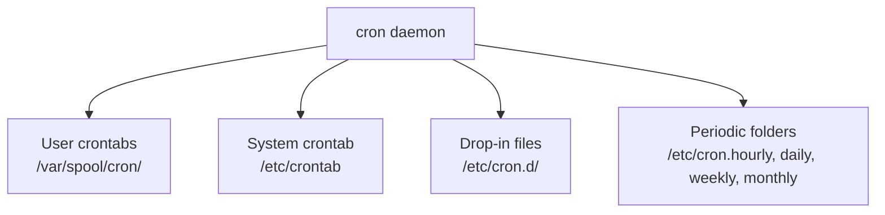

## Cron Expression Format

A standard cron entry has five time fields, then the command.

```plaintext
┌───────────── minute        (0 - 59)
│ ┌─────────── hour          (0 - 23)
│ │ ┌───────── day of month  (1 - 31)
│ │ │ ┌─────── month         (1 - 12 or JAN-DEC)
│ │ │ │ ┌───── day of week   (0 - 7 or SUN-SAT, 0 and 7 are Sunday)
│ │ │ │ │
* * * * *  command to run
```

| Field | Allowed values | Special characters |
|-------|----------------|--------------------|
| Minute | `0-59` | `*` `,` `-` `/` |
| Hour | `0-23` | `*` `,` `-` `/` |
| Day of month | `1-31` | `*` `,` `-` `/` |
| Month | `1-12` or `JAN-DEC` | `*` `,` `-` `/` |
| Day of week | `0-7` or `SUN-SAT` | `*` `,` `-` `/` |

## Special Characters

| Character | Meaning | Example | Runs |
|-----------|---------|---------|------|
| `*` | Every value | `* * * * *` | Every minute |
| `,` | List of values | `0 9,17 * * *` | At 09:00 and 17:00 |
| `-` | Range | `0 9-17 * * *` | Every hour from 09:00 to 17:00 |
| `/` | Step | `*/15 * * * *` | Every 15 minutes |
| `-` with `/` | Step within a range | `0 9-17/2 * * *` | Every 2 hours from 09:00 to 17:00 |

If both day of month and day of week are set (not `*`), the job runs when **either**
matches, not both.

## Common Schedules

| Schedule | Expression |
|----------|------------|
| Every minute | `* * * * *` |
| Every 5 minutes | `*/5 * * * *` |
| Every hour, on the hour | `0 * * * *` |
| Every day at midnight | `0 0 * * *` |
| Every day at 02:30 | `30 2 * * *` |
| Weekdays at 09:00 | `0 9 * * 1-5` |
| Every Sunday at 03:00 | `0 3 * * 0` |
| First day of each month at 00:00 | `0 0 1 * *` |
| 15th of each month at 00:00 | `0 0 15 * *` |
| Every quarter (Jan, Apr, Jul, Oct 1st) | `0 0 1 1,4,7,10 *` |
| Once a year (1 Jan at 00:00) | `0 0 1 1 *` |
| Every 6 hours | `0 */6 * * *` |

## Special Strings

Many cron implementations accept these shortcuts instead of five fields.

| String | Equivalent | Meaning |
|--------|------------|---------|
| `@reboot` | | Once at startup |
| `@hourly` | `0 * * * *` | Every hour |
| `@daily` or `@midnight` | `0 0 * * *` | Every day at midnight |
| `@weekly` | `0 0 * * 0` | Every Sunday at midnight |
| `@monthly` | `0 0 1 * *` | First of the month |
| `@yearly` or `@annually` | `0 0 1 1 *` | 1 January |

## crontab Commands

| Command | Description |
|---------|-------------|
| `crontab -e` | Edit your crontab |
| `crontab -l` | List your crontab |
| `crontab -r` | Remove your crontab (no confirmation) |
| `crontab -i -r` | Remove, but ask first |
| `crontab file.txt` | Replace your crontab with a file |
| `sudo crontab -u alice -e` | Edit another user's crontab |
| `crontab -l > backup.txt` | Back up your crontab |

## Where Jobs Live



| Location | Has a user field | Notes |
|----------|:----------------:|-------|
| `crontab -e` (per user) | No | Runs as that user |
| `/etc/crontab` | Yes | `* * * * * root command` |
| `/etc/cron.d/*` | Yes | One file per application |
| `/etc/cron.daily/` and friends | | Drop in an executable script, no schedule needed |

## A Good Crontab

```bash
# Environment for every job below
SHELL=/bin/bash
PATH=/usr/local/bin:/usr/bin:/bin
MAILTO=ops@example.com

# m   h  dom mon dow  command
0     2  *   *   *    /opt/scripts/backup.sh >> /var/log/backup.log 2>&1
*/5   *  *   *   *    /opt/scripts/health-check.sh
0     9  *   *   1-5  /usr/bin/python3 /opt/report.py
@reboot               /opt/scripts/start-worker.sh
```

## Environment Pitfalls

Cron runs jobs with a **minimal environment**, not your login shell. Most "works in the
terminal but not in cron" bugs come from this.

| Problem | Fix |
|---------|-----|
| Command not found | Use absolute paths (`/usr/bin/python3`) or set `PATH` at the top |
| Wrong shell features | Cron uses `/bin/sh`. Set `SHELL=/bin/bash` if you need bash |
| Missing variables | Set them in the crontab, or `source` a file in the script |
| Wrong working directory | Jobs start in `$HOME`. Use `cd /path && command` or absolute paths |
| `%` breaks the command | `%` means newline in a crontab. Escape it as `\%` (common in `date +\%F`) |
| No output anywhere | Redirect output yourself (see below) |
| Different timezone | Cron uses the server's timezone. Check `date` and `timedatectl` |

## Output and Logging

By default cron emails output to the user (when mail is set up). Redirect it instead.

```bash
0 2 * * * /opt/backup.sh >> /var/log/backup.log 2>&1    # append stdout and stderr
0 2 * * * /opt/backup.sh > /dev/null 2>&1                # discard everything
0 2 * * * /opt/backup.sh > /dev/null                     # keep emails for errors only
```

| Where to look | Command |
|---------------|---------|
| Debian and Ubuntu | `grep CRON /var/log/syslog` |
| RHEL and Fedora | `sudo tail /var/log/cron` |
| systemd | `journalctl -u cron` (or `crond`) |

## Prevent Overlapping Runs

If a job can run longer than its interval, two copies may run at once. Use `flock`.

```bash
*/5 * * * * flock -n /tmp/sync.lock /opt/scripts/sync.sh
```

`-n` makes the second copy exit instead of waiting.

## Debugging Checklist

1. Run the exact command by hand with `env -i /bin/sh -c '<command>'` to mimic cron.
2. Make sure the script is executable (`chmod +x`) and has a shebang line.
3. Check the schedule with a tool such as [crontab.guru](https://crontab.guru).
4. Confirm the daemon is running: `systemctl status cron` (or `crond`).
5. Look at the log for the time the job should have run.
6. Add `>> /tmp/job.log 2>&1` to capture errors.

## cron vs systemd Timers

| | cron | systemd timer |
|---|------|---------------|
| Setup | One line | A `.timer` and a `.service` file |
| Logging | DIY | Built into `journalctl` |
| Missed runs (machine off) | Skipped (use `anacron`) | `Persistent=true` catches up |
| Dependencies and ordering | No | Yes |
| Random delay | No | `RandomizedDelaySec=` |
| Seconds resolution | No | Yes |

```ini
# /etc/systemd/system/backup.timer
[Timer]
OnCalendar=*-*-* 02:00:00
Persistent=true

[Install]
WantedBy=timers.target
```

```bash
sudo systemctl enable --now backup.timer
systemctl list-timers
```
