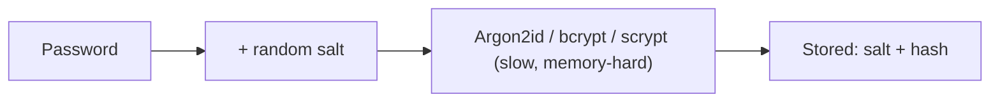
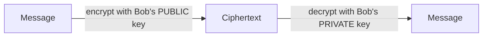
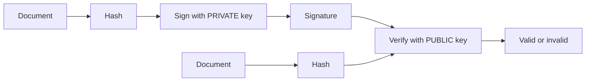
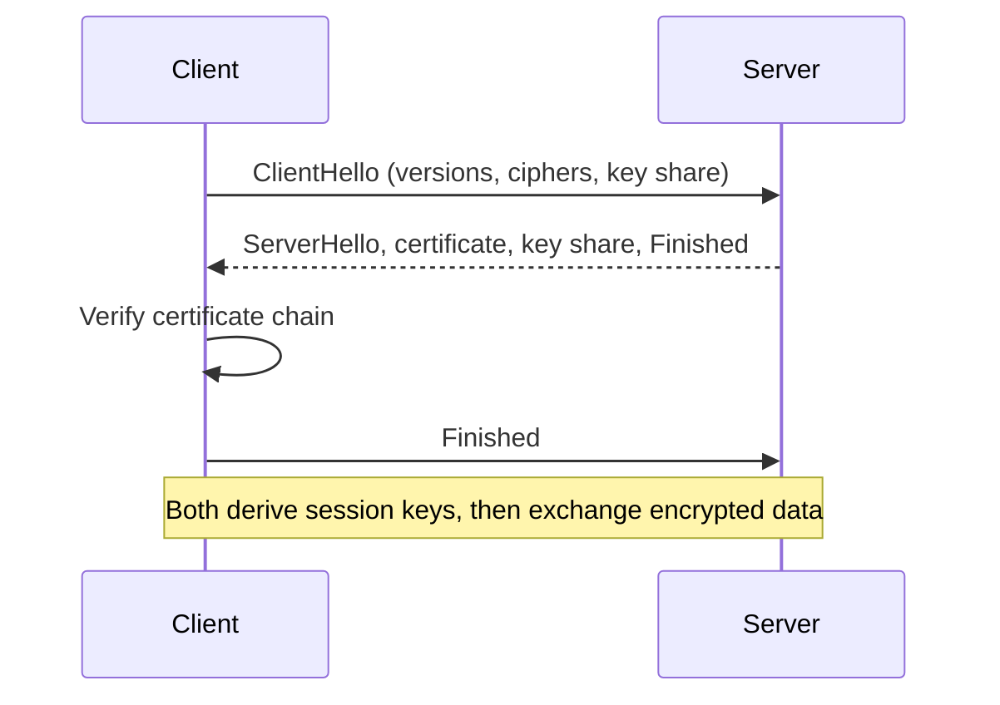
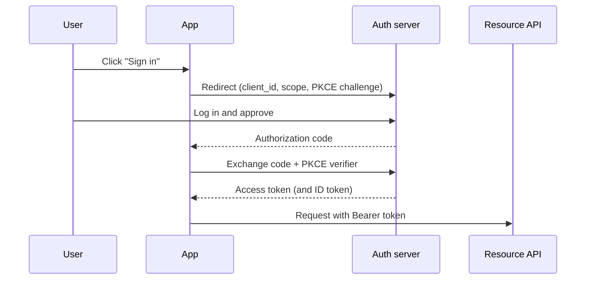

## Security Goals (CIA)

| Goal | Meaning | Tool |
|------|---------|------|
| Confidentiality | Only the right people can read data | Encryption |
| Integrity | Data has not been changed | Hashes, MACs, signatures |
| Availability | The system works when needed | Redundancy, rate limits |
| Authentication | You are who you claim to be | Passwords, keys, MFA |
| Non-repudiation | A signer cannot deny signing | Digital signatures |

**Never invent your own cryptography.** Use well-reviewed libraries and standard algorithms.

## Building Blocks at a Glance

| Primitive | Key | Output | Use |
|-----------|-----|--------|-----|
| Hash | None | Fixed-size digest | Integrity, fingerprints |
| MAC / HMAC | Shared secret | Tag | Integrity and authenticity |
| Symmetric encryption | One shared key | Ciphertext | Fast bulk encryption |
| Asymmetric encryption | Public and private key pair | Ciphertext | Key exchange, small data |
| Digital signature | Private key signs, public key verifies | Signature | Authenticity, non-repudiation |
| KDF | Password and salt | Key | Derive keys, store passwords |

## Hash Functions

A hash maps any input to a fixed-size output. It is one-way, and tiny changes in the
input change the output completely.

```plaintext
SHA-256("hello")   = 2cf24dba5fb0a30e26e83b2ac5b9e29e1b161e5c1fa7425e73043362938b9824
SHA-256("hellp")   = (a completely different value)
```

| Property | Meaning |
|----------|---------|
| Deterministic | Same input gives the same output |
| Pre-image resistance | Cannot recover the input from the hash |
| Collision resistance | Hard to find two inputs with the same hash |
| Avalanche effect | A one-bit change flips about half the output |

| Algorithm | Output | Status |
|-----------|--------|--------|
| MD5 | 128 bits | Broken, never use for security |
| SHA-1 | 160 bits | Broken, avoid |
| SHA-256, SHA-512 (SHA-2) | 256 or 512 bits | Safe |
| SHA-3, BLAKE2, BLAKE3 | Variable | Safe, modern |

```bash
echo -n "hello" | shasum -a 256
openssl dgst -sha256 file.txt
```

## Passwords

Never store passwords in plain text, or with a plain fast hash. Use a slow, salted,
password-specific function.



| Term | Meaning |
|------|---------|
| Salt | Random value per password. Defeats rainbow tables and shows identical passwords as different hashes |
| Pepper | A secret added to every password, stored outside the database |
| Work factor | Cost setting that makes each guess slow |
| Argon2id, bcrypt, scrypt, PBKDF2 | Recommended functions, in roughly that order |

Add rate limiting, breach checks, and **multi-factor authentication** (MFA).

## Symmetric Encryption

One shared secret key encrypts and decrypts. It is fast.

```plaintext
plaintext ──[ AES-256-GCM + key + nonce ]──► ciphertext + auth tag
```

| Algorithm | Notes |
|-----------|-------|
| AES (128, 192, 256-bit) | The standard block cipher |
| ChaCha20-Poly1305 | Fast stream cipher, good without AES hardware |
| 3DES, DES, RC4 | Obsolete, do not use |

| Mode | Notes |
|------|-------|
| **GCM** (AEAD) | Encrypts and authenticates. Use this |
| CBC | Needs a separate MAC. Easy to misuse |
| ECB | Leaks patterns. Never use |
| CTR | Stream-like, needs authentication added |

- A **nonce or IV** must be unique per encryption. Reusing one with the same key can destroy security.
- Use **AEAD** (authenticated encryption) so tampering is detected.

## Asymmetric (Public-Key) Cryptography

A key pair: the **public** key can be shared, the **private** key stays secret.



| Algorithm | Based on | Typical use |
|-----------|----------|-------------|
| RSA (2048+ bits) | Factoring large numbers | Signatures, key transport |
| ECDSA, EdDSA (Ed25519) | Elliptic curves | Signatures, small and fast keys |
| Diffie-Hellman, ECDH (X25519) | Key agreement | Agree a shared secret over an open channel |

Public-key operations are slow, so they usually set up a **symmetric session key** and the
bulk data is encrypted with that.

## Digital Signatures



A valid signature proves the data came from the key holder and was not changed.

## HMAC

A hash combined with a secret key. It proves integrity and that the sender knows the key.

```python
import hmac, hashlib

tag = hmac.new(b"secret-key", b"message", hashlib.sha256).hexdigest()
ok = hmac.compare_digest(tag, received_tag)    # constant-time comparison
```

Always compare secrets and tags with a **constant-time** function.

## TLS (HTTPS)



| Concept | Meaning |
|---------|---------|
| Certificate | Binds a domain to a public key, signed by a CA |
| CA (certificate authority) | Trusted issuer. Browsers ship a list of root CAs |
| Chain of trust | Server cert, intermediate CA, root CA |
| Forward secrecy | Ephemeral keys, so old traffic stays safe if the server key leaks |
| HSTS | Header telling browsers to use HTTPS only |
| mTLS | Both sides present certificates |

Use **TLS 1.2 or 1.3**. Turn off SSL and TLS 1.0 and 1.1.

```bash
openssl s_client -connect example.com:443 -servername example.com
curl -vI https://example.com
```

## Authentication vs Authorisation

| | Authentication | Authorisation |
|---|----------------|---------------|
| Question | Who are you? | What may you do? |
| Examples | Password, passkey, MFA | Roles, permissions, scopes |
| Failure code | `401` | `403` |

Factors: something you **know** (password), **have** (phone, key), **are** (biometric).
**Passkeys** (WebAuthn) replace passwords with public-key credentials and resist phishing.

## JWT (JSON Web Token)

```plaintext
header.payload.signature

eyJhbGciOiJIUzI1NiJ9 . eyJzdWIiOiIxMjMiLCJleHAiOjE3MDAwMDAwMDB9 . 9f2c...
{"alg":"HS256"}        {"sub":"123","exp":1700000000}               HMAC or signature
```

| Claim | Meaning |
|-------|---------|
| `iss` | Issuer |
| `sub` | Subject (user ID) |
| `aud` | Audience |
| `exp` | Expiry time |
| `iat`, `nbf` | Issued at, not before |

- The payload is only **encoded**, not encrypted. Do not put secrets in it.
- Verify the signature, `exp`, `iss`, and `aud` on every request.
- Pin the allowed algorithm. Reject `alg: none`.
- Keep lifetimes short and use refresh tokens for longer sessions.

## OAuth 2.0 and OpenID Connect

OAuth 2.0 lets an app act for a user **without their password**. OpenID Connect (OIDC) adds
login (identity) on top.



| Term | Meaning |
|------|---------|
| Access token | Short-lived key to call an API |
| Refresh token | Gets new access tokens |
| ID token | OIDC proof of who the user is (a JWT) |
| Scope | Permission requested, like `read:email` |
| Authorization code + PKCE | The recommended flow for web, mobile, and SPAs |
| Client credentials | Machine-to-machine, no user |

## Common Web Vulnerabilities (OWASP)

| Attack | What happens | Defence |
|--------|--------------|---------|
| SQL injection | Input changes the SQL | Parameterised queries |
| XSS | Attacker script runs in the page | Escape output, CSP, `HttpOnly` cookies |
| CSRF | A site makes your browser send an action | `SameSite` cookies, CSRF tokens |
| Broken access control | Reading or changing another user's data | Check ownership on every request |
| SSRF | Server fetches an attacker-chosen URL | Allow-list hosts, block internal ranges |
| Insecure deserialisation | Untrusted data runs code | Avoid it, validate, use safe formats |
| Path traversal | `../../etc/passwd` | Normalise and restrict paths |
| Clickjacking | Page hidden in a frame | `X-Frame-Options`, CSP `frame-ancestors` |
| Weak secrets | Keys in the repo | Secret managers, rotation |
| Vulnerable dependencies | Known CVEs | Update and scan dependencies |

```python
# Unsafe: user input becomes part of the SQL
cur.execute(f"SELECT * FROM users WHERE name = '{name}'")

# Safe: the driver sends the value separately
cur.execute("SELECT * FROM users WHERE name = %s", (name,))
```

## Security Headers and Cookies

| Header or flag | Purpose |
|----------------|---------|
| `Strict-Transport-Security` | Force HTTPS |
| `Content-Security-Policy` | Limit where scripts and resources can load from |
| `X-Content-Type-Options: nosniff` | Stop MIME sniffing |
| `Referrer-Policy` | Control the referrer header |
| Cookie `HttpOnly` | JavaScript cannot read it |
| Cookie `Secure` | Sent over HTTPS only |
| Cookie `SameSite=Lax` or `Strict` | Limits cross-site sending |

## Secrets and Key Management

- Keep secrets out of source control. Use environment variables or a secret manager.
- Rotate keys, and give each one the least privilege it needs.
- Use separate keys per environment.
- Generate randomness with a **CSPRNG** (`secrets`, `crypto.randomBytes`, `/dev/urandom`),
  never `Math.random()` or `random`.
- Encrypt data **in transit** (TLS) and **at rest** (disk or field encryption).
- Log security events, but never log secrets or full tokens.

## SSH and GPG Commands

```bash
ssh-keygen -t ed25519 -C "you@example.com"     # create a key pair
ssh-copy-id user@host                          # install the public key
ssh -i ~/.ssh/id_ed25519 user@host

openssl rand -hex 32                            # 32 random bytes as hex
openssl genrsa -out key.pem 2048
openssl req -new -x509 -key key.pem -out cert.pem -days 365

gpg --full-generate-key
gpg --encrypt --recipient alice file.txt
gpg --verify file.txt.sig file.txt
```

## Quick Reminders

- Hash for integrity, **not** for passwords. Use Argon2id or bcrypt for passwords.
- Use AEAD encryption (AES-GCM or ChaCha20-Poly1305) and never reuse a nonce.
- Prefer TLS 1.3, strong cipher suites, and HSTS.
- Validate input, encode output, and check permissions on every request.
- Assume breach: layer defences, monitor, and keep dependencies current.
