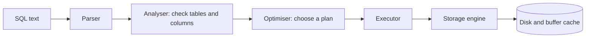
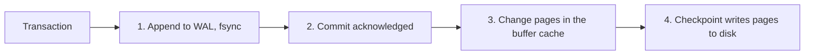
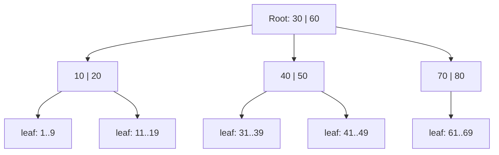

## How a Query Runs



The optimiser estimates the cost of several plans using table **statistics**, and picks the
cheapest. Stale statistics lead to bad plans, so run `ANALYZE` after big changes.

## ACID

| Letter | Property | Meaning |
|--------|----------|---------|
| **A** | Atomicity | A transaction happens fully or not at all |
| **C** | Consistency | It moves the database from one valid state to another |
| **I** | Isolation | Concurrent transactions do not see each other's partial work |
| **D** | Durability | Once committed, data survives a crash |

```sql
BEGIN;
UPDATE accounts SET balance = balance - 100 WHERE id = 1;
UPDATE accounts SET balance = balance + 100 WHERE id = 2;
COMMIT;                 -- or ROLLBACK; to undo both
```

## Isolation Levels and Anomalies

| Anomaly | What goes wrong |
|---------|-----------------|
| Dirty read | You read data another transaction has not committed |
| Non-repeatable read | Reading the same row twice gives different values |
| Phantom read | Re-running a range query returns new rows |
| Lost update | Two writers overwrite each other's change |
| Write skew | Two transactions each check a rule, then both write, breaking it |

| Level | Dirty read | Non-repeatable | Phantom |
|-------|:----------:|:--------------:|:-------:|
| Read uncommitted | Possible | Possible | Possible |
| Read committed | No | Possible | Possible |
| Repeatable read | No | No | Possible (not in some engines) |
| Serializable | No | No | No |

```sql
SET TRANSACTION ISOLATION LEVEL SERIALIZABLE;
```

Defaults: PostgreSQL uses **read committed**, MySQL InnoDB uses **repeatable read**.
Higher isolation means more safety and more conflicts or retries.

## Concurrency Control

| Approach | How | Trade-off |
|----------|-----|-----------|
| Locking (2PL) | Lock rows before use, release at the end | Blocking, deadlocks |
| MVCC | Keep several versions of a row. Readers use a snapshot | Readers never block writers. Needs cleanup of old versions |
| Optimistic | Do the work, check for conflict at commit | Good when conflicts are rare |

| Lock | Meaning |
|------|---------|
| Shared (S) | Read lock. Many allowed |
| Exclusive (X) | Write lock. One only |
| Row, page, table | Granularity: finer means more concurrency, more overhead |

```sql
SELECT * FROM jobs WHERE status = 'new' LIMIT 1 FOR UPDATE SKIP LOCKED;   -- work queue
```

A **deadlock** happens when two transactions each wait for the other's lock. The database
detects it and aborts one. Lock tables and rows in a consistent order to avoid it.

## Write-Ahead Logging (WAL)

Changes are written to a sequential **log first**, then to the data files later. After a
crash the database replays the log.



| Term | Meaning |
|------|---------|
| WAL / redo log | Sequential record of changes |
| Checkpoint | Flush dirty pages so the log can be trimmed |
| Buffer pool | Cache of disk pages in memory |
| `fsync` | Force data to durable storage |
| Replication | Ship the WAL to replicas |

## Indexes

An index is a separate, sorted structure that lets the database find rows without scanning
the whole table.

| Type | Good for | Notes |
|------|----------|-------|
| **B-tree** | Equality, ranges, sorting, prefix | The default almost everywhere |
| Hash | Equality only | Fast lookups, no ranges |
| GIN / inverted | Full-text, arrays, JSON | Many keys per row |
| GiST, R-tree | Geometry, ranges | Spatial queries |
| Bitmap | Low-cardinality columns | Data warehouses |
| LSM tree | Heavy writes | RocksDB, Cassandra |

### B-tree



A B-tree keeps keys sorted in wide nodes, so a lookup takes a few page reads even for
billions of rows: `O(log n)` with a large base. Leaves are linked, which makes range scans fast.

### Index Rules

```sql
CREATE INDEX idx_orders_user_date ON orders (user_id, created_at);
CREATE UNIQUE INDEX idx_users_email ON users (email);
CREATE INDEX idx_active ON users (email) WHERE active;        -- partial index
```

| Rule | Detail |
|------|--------|
| Leftmost prefix | `(a, b, c)` helps filters on `a`, `a,b`, `a,b,c`, not `b` alone |
| Put equality columns first, then range columns | `WHERE user_id = ? AND created_at > ?` |
| Covering index | Includes every column the query needs, so no table lookup |
| Functions break indexes | `WHERE LOWER(email) = ...` needs an index on `LOWER(email)` |
| Leading wildcard | `LIKE '%abc'` cannot use a B-tree |
| Type mismatch | Comparing a string column to a number can skip the index |
| Cost | Every index slows writes and takes space |
| Low selectivity | An index on a boolean rarely helps |

| Term | Meaning |
|------|---------|
| Clustered index | Table rows are stored in index order (one per table) |
| Secondary index | Points to the row (by primary key or row ID) |
| Selectivity | Share of rows a filter removes. Higher is better |
| Cardinality | Number of distinct values |

## Reading a Query Plan

```sql
EXPLAIN ANALYZE
SELECT * FROM orders WHERE user_id = 42 ORDER BY created_at DESC LIMIT 10;
```

| Plan node | Meaning |
|-----------|---------|
| Seq Scan | Reads the whole table |
| Index Scan | Walks an index, then fetches rows |
| Index Only Scan | Answers from the index alone |
| Bitmap Heap Scan | Combines several index results |
| Nested Loop | For each outer row, look up the inner side |
| Hash Join | Build a hash table on one side, probe with the other |
| Merge Join | Join two sorted inputs |
| Sort, Aggregate | Ordering and grouping |

What to look for: a big gap between **estimated** and **actual** rows, sequential scans
on large tables, sorts spilling to disk, and loops running thousands of times.

## Join Algorithms

| Algorithm | Best when | Cost idea |
|-----------|-----------|-----------|
| Nested loop | One side is small, or the inner side is indexed | `n * (index lookup)` |
| Hash join | Large, unsorted inputs with equality conditions | `n + m` |
| Merge join | Both inputs already sorted (or have an index) | `n + m` after sorting |

## Normalisation

```plaintext
Unnormalised order row:
 order_id | customer | email        | items
 1        | Ada      | ada@x.com    | "pen, ink"

After normalisation:
 customers(id, name, email)
 orders(id, customer_id)
 order_items(order_id, product_id, qty)
 products(id, name, price)
```

| Form | Rule | Fixes |
|------|------|-------|
| 1NF | Each cell holds one value, no repeating groups | Lists in a column |
| 2NF | 1NF, and every non-key column depends on the **whole** key | Partial dependency |
| 3NF | 2NF, and non-key columns depend **only** on the key | Transitive dependency |
| BCNF | Every determinant is a candidate key | Remaining anomalies |

Normalise to avoid duplicated data and update anomalies. **Denormalise** on purpose for
read speed (copied columns, summary tables), and accept the extra work to keep it in sync.

## Keys and Constraints

| Constraint | Purpose |
|------------|---------|
| `PRIMARY KEY` | Unique, not null row identifier |
| `FOREIGN KEY` | Links to a row in another table |
| `UNIQUE` | No duplicates |
| `NOT NULL` | Value required |
| `CHECK` | Custom rule |
| `DEFAULT` | Value when none is given |

Surrogate keys (auto-increment, UUID) are stable. Natural keys (email, ISBN) carry meaning
but can change. Random UUIDs scatter inserts across a B-tree, while time-ordered IDs
(UUIDv7, ULID) keep them together.

## Storage Layout

| Concept | Meaning |
|---------|---------|
| Page / block | Unit of disk I/O, often 8 KB or 16 KB |
| Heap file | Unordered pages of rows |
| Row store | Stores each row together. Good for transactions (OLTP) |
| Column store | Stores each column together. Good for analytics (OLAP), compresses well |
| TOAST / overflow | Big values stored outside the main page |
| Vacuum / compaction | Reclaim space from old versions and deletes |

### B-tree vs LSM Tree

| | B-tree | LSM tree |
|---|--------|----------|
| Writes | In place, random I/O | Append to memory, flush sorted files |
| Reads | Fast, one structure | May check several files (use Bloom filters) |
| Space | Some wasted space | Needs compaction |
| Examples | PostgreSQL, MySQL InnoDB | RocksDB, Cassandra, LevelDB |

## Replication and Scaling

| Approach | Description |
|----------|-------------|
| Read replicas | Copies for read traffic. May lag |
| Failover | Promote a replica when the primary fails |
| Sharding | Split rows across servers by a key |
| Partitioning | Split a big table into parts inside one server |
| Connection pooling | Reuse connections (PgBouncer) |
| Caching | Keep hot data in Redis or memory |

## OLTP vs OLAP

| | OLTP | OLAP |
|---|------|------|
| Workload | Many small reads and writes | Few large scans and aggregates |
| Storage | Row-oriented | Column-oriented |
| Examples | PostgreSQL, MySQL | BigQuery, Snowflake, ClickHouse |
| Data | Current | Historical |

## Quick Checklist for a Slow Query

1. Run `EXPLAIN ANALYZE` and find the slowest node.
2. Is the right index there, and does the filter match its column order?
3. Do the estimated and actual row counts agree? If not, update statistics.
4. Select only the columns you need, and add `LIMIT`.
5. Avoid functions on indexed columns, and avoid `SELECT *`.
6. Look for N+1 queries from the application.
7. Check locks and long-running transactions.
