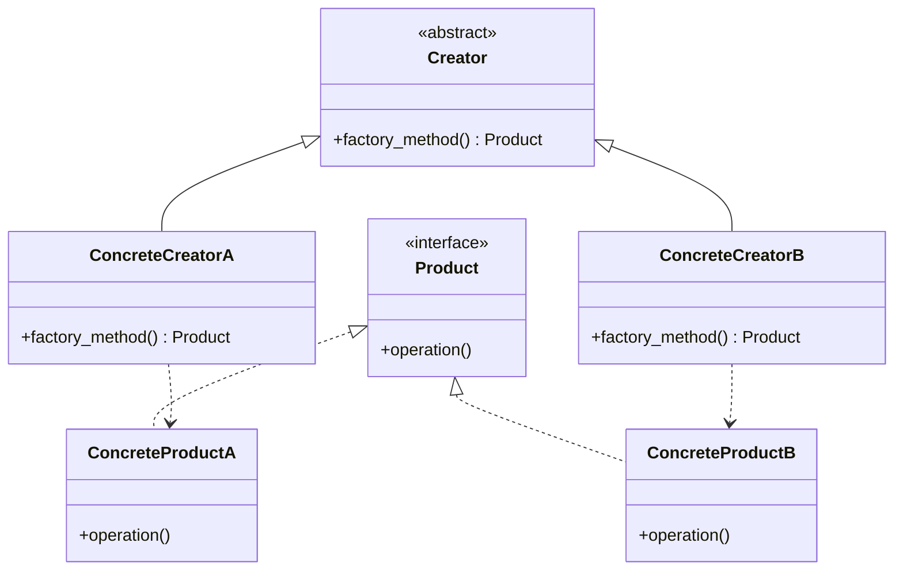
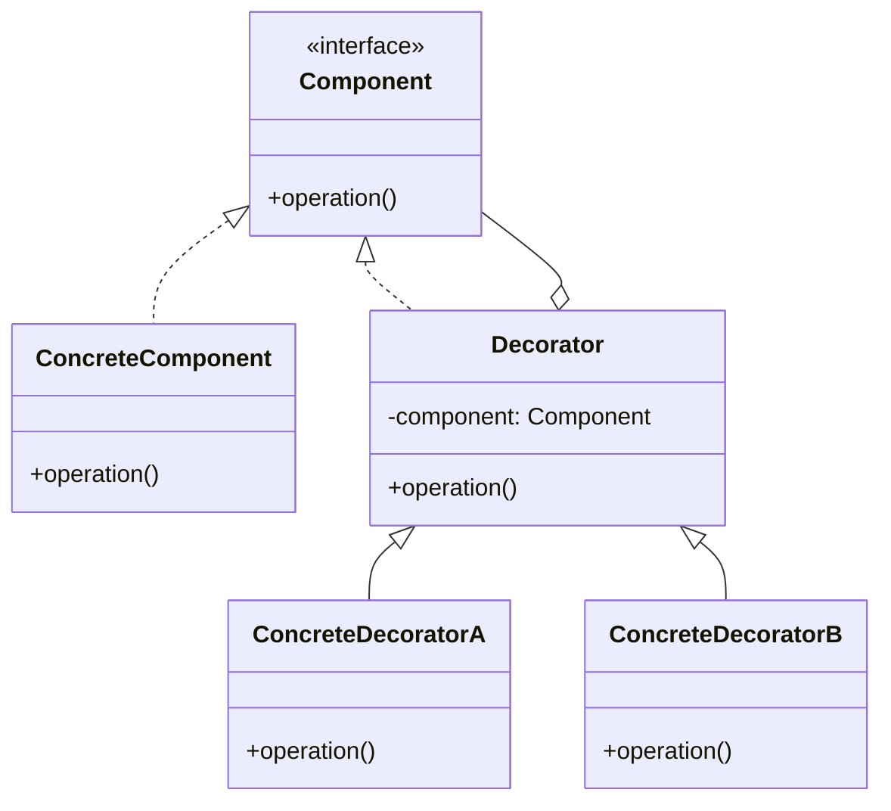
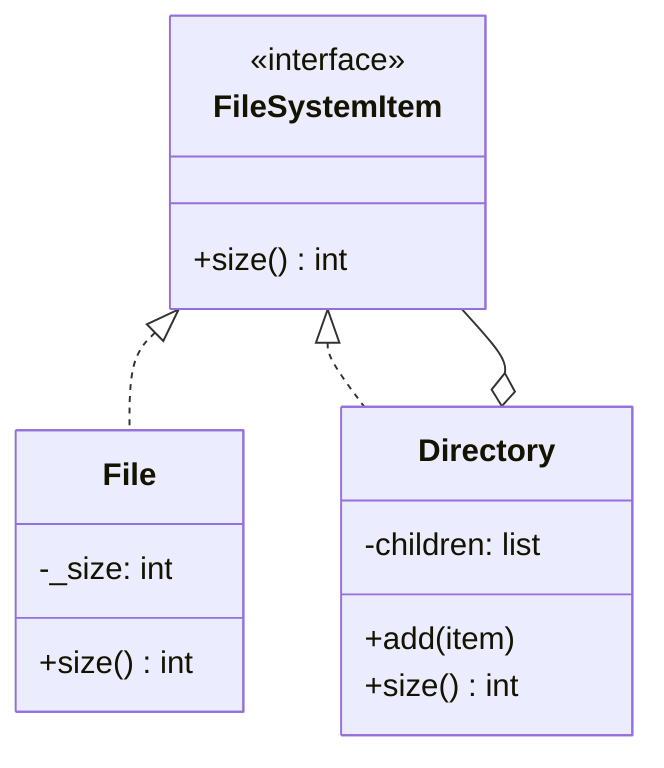
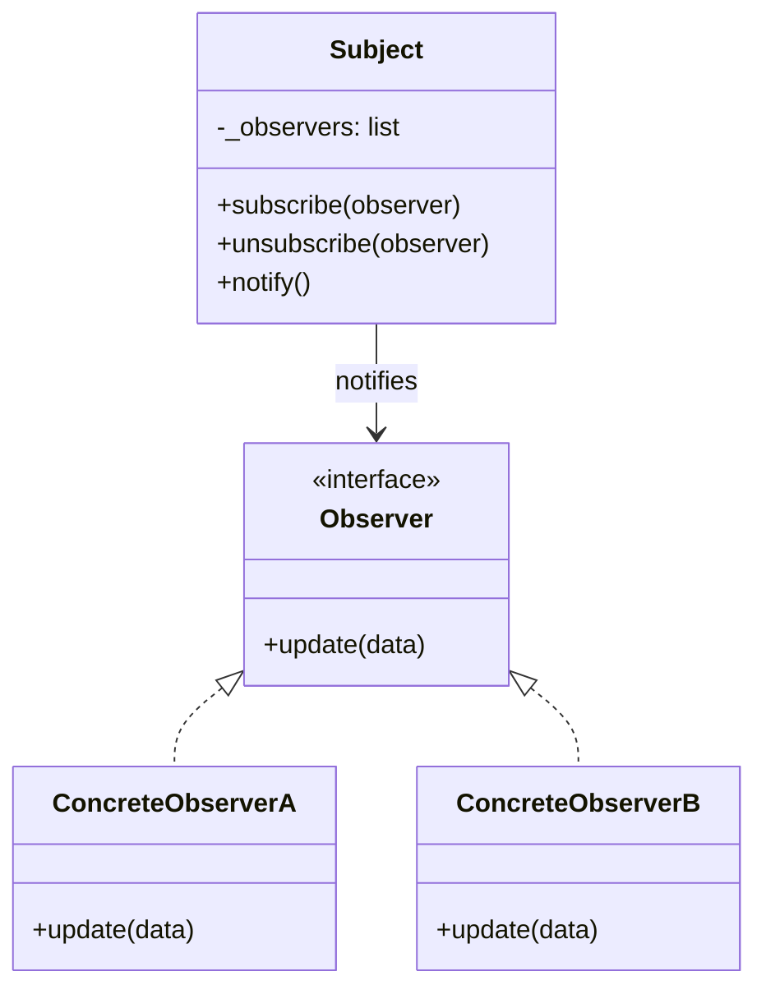

## Creational Patterns

Creational patterns deal with object creation mechanisms, providing flexibility in *what* gets created, *how* it's created, and *when*.



### Singleton

**Intent**: Ensure a class has only one instance and provide a global point of access to it.

**When to use**: When exactly one object is needed to coordinate actions across the system (e.g., config manager, connection pool).

```python
class Singleton:
    _instance = None
    def __new__(cls):
        if cls._instance is None:
            cls._instance = super().__new__(cls)
        return cls._instance
```

### Factory Method

**Intent**: Define an interface for creating an object, but let subclasses decide which class to instantiate.

**When to use**: When a class can't anticipate the type of objects it needs to create, or wants subclasses to specify them.

```python
class Notification:
    def send(self, msg): raise NotImplementedError

class Email(Notification):
    def send(self, msg): print(f"Email: {msg}")

class SMS(Notification):
    def send(self, msg): print(f"SMS: {msg}")

def create_notification(channel):
    return {"email": Email, "sms": SMS}[channel]()
```

### Abstract Factory

**Intent**: Provide an interface for creating families of related objects without specifying their concrete classes.

**When to use**: When the system needs to be independent of how its products are created, and products come in families (e.g., UI themes).

```python
class DarkTheme:
    def button(self): return DarkButton()
    def checkbox(self): return DarkCheckbox()

class LightTheme:
    def button(self): return LightButton()
    def checkbox(self): return LightCheckbox()

def build_ui(factory):
    return factory.button(), factory.checkbox()
```

### Builder

**Intent**: Separate the construction of a complex object from its representation so the same process can create different representations.

**When to use**: When an object requires many optional parameters or multi-step construction.

```python
class QueryBuilder:
    def __init__(self):
        self._parts = {"select": "*", "where": None, "limit": None}
    def select(self, cols):  self._parts["select"] = cols; return self
    def where(self, cond):   self._parts["where"] = cond; return self
    def limit(self, n):      self._parts["limit"] = n; return self
    def build(self):         return self._parts.copy()

query = QueryBuilder().select("name").where("age > 21").limit(10).build()
```

### Prototype

**Intent**: Create new objects by cloning an existing instance rather than constructing from scratch.

**When to use**: When object creation is expensive and similar objects already exist (e.g., game entities, document templates).

```python
import copy

class Prototype:
    def __init__(self, config):
        self.config = config
    def clone(self):
        return copy.deepcopy(self)

template = Prototype({"color": "red", "size": 10})
obj = template.clone()
```

---

## Structural Patterns

Structural patterns deal with object composition — how classes and objects are assembled to form larger structures.



### Adapter

**Intent**: Convert the interface of a class into another interface that clients expect.

**When to use**: When you want to use an existing class but its interface doesn't match what you need (e.g., wrapping a third-party library).

```python
class LegacyPrinter:
    def print_old(self, text): print(f"[OLD] {text}")

class PrinterAdapter:
    def __init__(self, legacy):
        self._legacy = legacy
    def print(self, text):
        self._legacy.print_old(text)
```

### Decorator

**Intent**: Attach additional responsibilities to an object dynamically, providing a flexible alternative to subclassing.

**When to use**: When you need to add behavior to objects without modifying their class (e.g., logging, caching, auth).

```python
def log_calls(func):
    def wrapper(*args, **kwargs):
        print(f"Calling {func.__name__}")
        return func(*args, **kwargs)
    return wrapper

@log_calls
def process(data):
    return data.upper()
```

### Facade

**Intent**: Provide a simplified interface to a complex subsystem.

**When to use**: When you want to hide complexity behind a single, easy-to-use entry point.

```python
class OrderFacade:
    def __init__(self):
        self.inventory = InventoryService()
        self.payment = PaymentService()
        self.shipping = ShippingService()

    def place_order(self, item, card, address):
        self.inventory.reserve(item)
        self.payment.charge(card, item.price)
        self.shipping.ship(item, address)
```

### Proxy

**Intent**: Provide a surrogate or placeholder to control access to another object.

**When to use**: When you need lazy initialization, access control, logging, or caching around an object.

```python
class CachedAPI:
    def __init__(self, api):
        self._api = api
        self._cache = {}
    def fetch(self, url):
        if url not in self._cache:
            self._cache[url] = self._api.fetch(url)
        return self._cache[url]
```

### Composite

**Intent**: Compose objects into tree structures to represent part-whole hierarchies, treating individual objects and compositions uniformly.

**When to use**: When you need tree-like structures where leaves and containers share the same interface (e.g., file systems, UI components).



```python
class File:
    def __init__(self, size): self._size = size
    def size(self): return self._size

class Directory:
    def __init__(self): self.children = []
    def add(self, item): self.children.append(item)
    def size(self): return sum(c.size() for c in self.children)
```

### Bridge

**Intent**: Decouple an abstraction from its implementation so that the two can vary independently.

**When to use**: When you want to avoid a cartesian product of classes from combining multiple dimensions of variation (e.g., shapes x renderers).

```python
class CircleShape:
    def __init__(self, renderer):
        self.renderer = renderer
    def draw(self):
        self.renderer.render_circle(self)

class SVGRenderer:
    def render_circle(self, c): print("SVG circle")

class CanvasRenderer:
    def render_circle(self, c): print("Canvas circle")
```

---

## Behavioral Patterns

Behavioral patterns deal with communication between objects — how they interact and distribute responsibility.

### Observer

**Intent**: Define a one-to-many dependency so that when one object changes state, all dependents are notified automatically.

**When to use**: When changes to one object require updating others, and you don't want tight coupling (e.g., event systems, UI data binding).



```python
class EventEmitter:
    def __init__(self): self._listeners = {}
    def on(self, event, fn):
        self._listeners.setdefault(event, []).append(fn)
    def emit(self, event, data=None):
        for fn in self._listeners.get(event, []):
            fn(data)

bus = EventEmitter()
bus.on("save", lambda d: print(f"Saved: {d}"))
bus.emit("save", "doc.txt")
```

### Strategy

**Intent**: Define a family of algorithms, encapsulate each one, and make them interchangeable.

**When to use**: When you need to switch between different algorithms at runtime (e.g., sorting, compression, pricing rules).

```python
def quick_sort(data): return sorted(data)   # simplified
def bubble_sort(data): return sorted(data)  # simplified

class Sorter:
    def __init__(self, strategy=quick_sort):
        self.strategy = strategy
    def sort(self, data):
        return self.strategy(data)
```

### Command

**Intent**: Encapsulate a request as an object, allowing parameterization, queuing, and undo/redo.

**When to use**: When you need to decouple the sender of a request from the object that executes it (e.g., undo systems, task queues, macros).

```python
class Command:
    def __init__(self, receiver, action, *args):
        self.execute = lambda: getattr(receiver, action)(*args)

class History:
    def __init__(self): self._cmds = []
    def run(self, cmd):
        cmd.execute()
        self._cmds.append(cmd)
```

### State

**Intent**: Allow an object to alter its behavior when its internal state changes — the object appears to change its class.

**When to use**: When an object's behavior depends on its state and it must change behavior at runtime (e.g., order statuses, UI modes).

```python
class DraftState:
    def publish(self, doc): doc.state = ReviewState()

class ReviewState:
    def publish(self, doc): doc.state = PublishedState()

class PublishedState:
    def publish(self, doc): print("Already published")

class Document:
    def __init__(self): self.state = DraftState()
    def publish(self): self.state.publish(self)
```

### Iterator

**Intent**: Provide a way to access elements of a collection sequentially without exposing its underlying representation.

**When to use**: When you need a uniform way to traverse different data structures.

```python
class RangeIterator:
    def __init__(self, start, end):
        self._current, self._end = start, end
    def __iter__(self): return self
    def __next__(self):
        if self._current >= self._end: raise StopIteration
        val = self._current
        self._current += 1
        return val
```

### Template Method

**Intent**: Define the skeleton of an algorithm in a base class, letting subclasses override specific steps without changing the structure.

**When to use**: When multiple classes share the same algorithm structure but differ in specific steps (e.g., data pipelines, report generators).

```python
class DataPipeline:
    def run(self):
        data = self.extract()
        data = self.transform(data)
        self.load(data)
    def extract(self): raise NotImplementedError
    def transform(self, data): return data
    def load(self, data): raise NotImplementedError
```

### Chain of Responsibility

**Intent**: Pass a request along a chain of handlers, where each handler decides either to process it or to pass it along.

**When to use**: When more than one object may handle a request and the handler isn't known a priori (e.g., middleware, logging levels, approval chains).

```python
class Handler:
    def __init__(self, next_handler=None):
        self._next = next_handler
    def handle(self, request):
        if self.can_handle(request): return self.process(request)
        if self._next: return self._next.handle(request)
    def can_handle(self, req): return False
    def process(self, req): pass
```

### Mediator

**Intent**: Define an object that encapsulates how a set of objects interact, promoting loose coupling.

**When to use**: When a set of objects communicate in complex ways and you want to centralize the interaction logic (e.g., chat rooms, air traffic control, form validation).

```python
class ChatRoom:
    def __init__(self): self._users = []
    def join(self, user):
        self._users.append(user)
        user.room = self
    def send(self, msg, sender):
        for u in self._users:
            if u != sender: u.receive(msg)
```

---

## Concurrency Patterns

### Producer-Consumer

**Intent**: Decouple data production from data consumption using a shared buffer.

**When to use**: When producers and consumers operate at different speeds and you need to balance throughput. Common in message queues, data pipelines, and event processing. A thread-safe queue sits between producers (which add work) and consumers (which process it), allowing both sides to operate independently.

### Thread Pool

**Intent**: Maintain a pool of reusable threads to execute tasks, avoiding the overhead of creating and destroying threads repeatedly.

**When to use**: When you have many short-lived tasks and thread creation cost is significant. The pool pre-creates a fixed number of worker threads that pull tasks from a shared queue. This controls resource usage, prevents thread exhaustion, and provides natural backpressure when the queue is full. Python's `concurrent.futures.ThreadPoolExecutor` is a standard implementation.

---

## Architectural Patterns

### MVC (Model-View-Controller)

Separates an application into three components: **Model** (data/logic), **View** (presentation), and **Controller** (input handling). The controller updates the model, which notifies the view. Common in web frameworks like Django and Rails.

### MVP (Model-View-Presenter)

Similar to MVC but the **Presenter** acts as a middleman — the view is passive and delegates all logic to the presenter. The view and model never communicate directly. Common in Android development and Windows Forms.

### MVVM (Model-View-ViewModel)

The **ViewModel** exposes data streams that the view binds to declaratively. Changes in the ViewModel automatically reflect in the view via data binding. Common in WPF, SwiftUI, and modern frontend frameworks.

### Repository

Abstracts data access behind a collection-like interface. Business logic works with the repository without knowing whether data comes from a database, API, or cache. Simplifies testing and makes data source swapping trivial.

### Microservices

Decomposes an application into small, independently deployable services, each owning its own data and communicating via APIs or message queues. Enables independent scaling, deployment, and technology choices at the cost of operational complexity.

### Event-Driven Architecture

Components communicate by producing and consuming events through a message broker. Producers don't know about consumers. Enables high decoupling, scalability, and async processing. Common in systems using Kafka, RabbitMQ, or cloud event buses.

---

## Summary Table

| Pattern | Category | Problem it Solves |
|---|---|---|
| Singleton | Creational | Ensures only one instance of a class exists globally |
| Factory Method | Creational | Delegates object creation to subclasses |
| Abstract Factory | Creational | Creates families of related objects without concrete classes |
| Builder | Creational | Constructs complex objects step-by-step with many options |
| Prototype | Creational | Creates new objects by cloning existing ones |
| Adapter | Structural | Makes incompatible interfaces work together |
| Decorator | Structural | Adds behavior to objects dynamically without subclassing |
| Facade | Structural | Simplifies a complex subsystem behind one interface |
| Proxy | Structural | Controls access to an object (caching, auth, lazy loading) |
| Composite | Structural | Treats individual objects and groups uniformly in tree structures |
| Bridge | Structural | Separates abstraction from implementation to vary independently |
| Observer | Behavioral | Notifies dependents automatically when state changes |
| Strategy | Behavioral | Swaps algorithms at runtime without changing client code |
| Command | Behavioral | Encapsulates requests as objects for queuing, undo, logging |
| State | Behavioral | Changes object behavior when internal state changes |
| Iterator | Behavioral | Traverses collections without exposing internal structure |
| Template Method | Behavioral | Reuses algorithm structure while allowing step customization |
| Chain of Responsibility | Behavioral | Passes requests along a chain until one handles it |
| Mediator | Behavioral | Centralizes complex communication between objects |
| Producer-Consumer | Concurrency | Decouples data production from consumption via a buffer |
| Thread Pool | Concurrency | Reuses threads to efficiently execute many short-lived tasks |
| MVC | Architectural | Separates data, presentation, and input handling |
| MVP | Architectural | Isolates view from logic with a passive view and presenter |
| MVVM | Architectural | Binds view to data declaratively via a view model |
| Repository | Architectural | Abstracts data access behind a clean interface |
| Microservices | Architectural | Decomposes apps into independently deployable services |
| Event-Driven | Architectural | Decouples components via asynchronous event communication |
