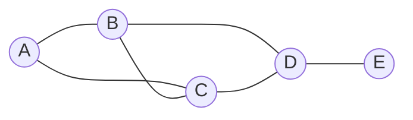

## Propositional Logic

A **proposition** is a statement that is true or false.

| Symbol | Name | Reads | True when |
|--------|------|-------|-----------|
| $$\neg p$$ | Negation | not p | p is false |
| $$p \land q$$ | Conjunction | p and q | both are true |
| $$p \lor q$$ | Disjunction | p or q | at least one is true |
| $$p \oplus q$$ | Exclusive or | p xor q | exactly one is true |
| $$p \to q$$ | Implication | if p then q | not (p true and q false) |
| $$p \leftrightarrow q$$ | Biconditional | p iff q | p and q have the same value |

| $$p$$ | $$q$$ | $$\neg p$$ | $$p \land q$$ | $$p \lor q$$ | $$p \to q$$ | $$p \leftrightarrow q$$ |
|---|---|:---:|:---:|:---:|:---:|:---:|
| T | T | F | T | T | T | T |
| T | F | F | F | T | F | F |
| F | T | T | F | T | T | F |
| F | F | T | F | F | T | T |

A false statement implies anything: $$p \to q$$ is true whenever $$p$$ is false.

### Related Statements

For $$p \to q$$:

| Name | Form | Same meaning as original? |
|------|------|:--------------------------:|
| Converse | $$q \to p$$ | No |
| Inverse | $$\neg p \to \neg q$$ | No |
| Contrapositive | $$\neg q \to \neg p$$ | **Yes** |

### Equivalences

| Law | Statement |
|-----|-----------|
| De Morgan | $$\neg(p \land q) \equiv \neg p \lor \neg q$$ and $$\neg(p \lor q) \equiv \neg p \land \neg q$$ |
| Double negation | $$\neg\neg p \equiv p$$ |
| Implication | $$p \to q \equiv \neg p \lor q$$ |
| Distributive | $$p \land (q \lor r) \equiv (p \land q) \lor (p \land r)$$ |
| Absorption | $$p \lor (p \land q) \equiv p$$ |
| Identity | $$p \land T \equiv p$$, $$p \lor F \equiv p$$ |

A **tautology** is always true, a **contradiction** is always false, and a
**contingency** is sometimes either.

## Predicate Logic and Quantifiers

| Symbol | Reads | Example |
|--------|-------|---------|
| $$\forall x\, P(x)$$ | For all x, P(x) | Every integer is even or odd |
| $$\exists x\, P(x)$$ | There exists an x with P(x) | Some prime is even |
| $$\neg \forall x\, P(x) \equiv \exists x\, \neg P(x)$$ | Negate by flipping the quantifier | Not all birds fly means some bird does not fly |
| $$\neg \exists x\, P(x) \equiv \forall x\, \neg P(x)$$ | | |

Order matters: $$\forall x\, \exists y\, (y > x)$$ is true, but $$\exists y\, \forall x\, (y > x)$$ is false.

## Sets

| Notation | Meaning |
|----------|---------|
| $$x \in A$$ | x is an element of A |
| $$A \subseteq B$$ | Every element of A is in B |
| $$A \subset B$$ | Subset and not equal |
| $$\emptyset$$ | The empty set |
| $$\lvert A \rvert$$ | Number of elements (cardinality) |
| $$\mathcal{P}(A)$$ | Power set (all subsets), size $$2^{\lvert A \rvert}$$ |
| $$A \cup B$$ | Union |
| $$A \cap B$$ | Intersection |
| $$A \setminus B$$ | Difference |
| $$\overline{A}$$ or $$A^c$$ | Complement |
| $$A \times B$$ | Cartesian product, size $$\lvert A \rvert \cdot \lvert B \rvert$$ |

```plaintext
A = {1, 2, 3}    B = {3, 4}

A ∪ B = {1, 2, 3, 4}
A ∩ B = {3}
A \ B = {1, 2}
A × B = {(1,3), (1,4), (2,3), (2,4), (3,3), (3,4)}
P(B)  = {∅, {3}, {4}, {3,4}}
```

| Law | Statement |
|-----|-----------|
| Inclusion-exclusion | $$\lvert A \cup B \rvert = \lvert A \rvert + \lvert B \rvert - \lvert A \cap B \rvert$$ |
| De Morgan | $$\overline{A \cup B} = \overline{A} \cap \overline{B}$$ |
| Distributive | $$A \cap (B \cup C) = (A \cap B) \cup (A \cap C)$$ |

Common number sets: $$\mathbb{N}$$ naturals, $$\mathbb{Z}$$ integers, $$\mathbb{Q}$$ rationals,
$$\mathbb{R}$$ reals.

## Relations

A relation on a set is a collection of ordered pairs.

| Property | Meaning |
|----------|---------|
| Reflexive | $$a R a$$ for every a |
| Symmetric | $$a R b \Rightarrow b R a$$ |
| Antisymmetric | $$a R b$$ and $$b R a \Rightarrow a = b$$ |
| Transitive | $$a R b$$ and $$b R c \Rightarrow a R c$$ |

| Type | Properties | Example |
|------|-----------|---------|
| **Equivalence relation** | Reflexive, symmetric, transitive | "Has the same remainder mod 3" |
| **Partial order** | Reflexive, antisymmetric, transitive | $$\le$$ on numbers, $$\subseteq$$ on sets |

An equivalence relation splits a set into **equivalence classes**.

## Functions

A function $$f: A \to B$$ gives each element of A exactly one element of B.

| Type | Meaning |
|------|---------|
| Injective (one-to-one) | Different inputs give different outputs |
| Surjective (onto) | Every element of B is hit |
| Bijective | Both. It has an inverse |

| Term | Meaning |
|------|---------|
| Domain, codomain, range | Inputs, allowed outputs, actual outputs |
| Composition | $$(g \circ f)(x) = g(f(x))$$ |
| Floor, ceiling | $$\lfloor 2.7 \rfloor = 2$$, $$\lceil 2.1 \rceil = 3$$ |
| Pigeonhole principle | Put $$n+1$$ items in $$n$$ boxes and some box holds at least 2 |

## Counting

| Situation | Formula |
|-----------|---------|
| Sum rule (A **or** B, disjoint) | $$m + n$$ |
| Product rule (A **then** B) | $$m \cdot n$$ |
| Permutations of n items | $$n!$$ |
| Ordered choice of r from n | $$P(n,r) = \dfrac{n!}{(n-r)!}$$ |
| Unordered choice of r from n | $$C(n,r) = \dbinom{n}{r} = \dfrac{n!}{r!\,(n-r)!}$$ |
| With repetition, ordered | $$n^r$$ |
| With repetition, unordered | $$\dbinom{n+r-1}{r}$$ |
| Arrangements with repeated items | $$\dfrac{n!}{n_1!\,n_2!\cdots n_k!}$$ |
| Circular arrangements | $$(n-1)!$$ |

```plaintext
Choose a 3-person team from 5 people:   C(5,3) = 5! / (3! 2!) = 10
Arrange 3 of 5 people in a line:        P(5,3) = 5 x 4 x 3   = 60
Letters of "BANANA":                    6! / (3! 2! 1!)      = 60
```

### Binomial Theorem and Pascal's Triangle

$$ (x+y)^n = \sum_{k=0}^{n} \binom{n}{k} x^{n-k} y^k $$

```plaintext
Row 0:            1
Row 1:          1   1
Row 2:        1   2   1
Row 3:      1   3   3   1
Row 4:    1   4   6   4   1
Row 5:  1   5  10  10   5   1

Each number is the sum of the two above it:  C(n,k) = C(n-1,k-1) + C(n-1,k)
```

Also: $$\sum_k \binom{n}{k} = 2^n$$ and $$\binom{n}{k} = \binom{n}{n-k}$$.

## Sequences, Sums, and Recurrences

| Type | Formula |
|------|---------|
| Arithmetic sum | $$\sum_{i=1}^{n} i = \dfrac{n(n+1)}{2}$$ |
| Sum of squares | $$\sum_{i=1}^{n} i^2 = \dfrac{n(n+1)(2n+1)}{6}$$ |
| Geometric sum | $$\sum_{i=0}^{n} r^i = \dfrac{r^{n+1} - 1}{r - 1}$$ |
| Infinite geometric ($$\lvert r \rvert < 1$$) | $$\dfrac{1}{1-r}$$ |

| Recurrence | Closed form |
|------------|-------------|
| $$a_n = a_{n-1} + d$$ | $$a_n = a_0 + nd$$ |
| $$a_n = r \, a_{n-1}$$ | $$a_n = a_0 r^n$$ |
| $$F_n = F_{n-1} + F_{n-2}$$ | Fibonacci: 0, 1, 1, 2, 3, 5, 8, 13, ... |
| $$T_n = 2T_{n-1} + 1$$ (Towers of Hanoi) | $$T_n = 2^n - 1$$ |

## Number Theory and Modular Arithmetic

$$a \equiv b \pmod n$$ means $$n$$ divides $$a - b$$. The clock is the picture: hours wrap at 12.

| Rule | Statement |
|------|-----------|
| Add | $$(a + b) \bmod n = ((a \bmod n) + (b \bmod n)) \bmod n$$ |
| Multiply | $$(a \cdot b) \bmod n = ((a \bmod n)(b \bmod n)) \bmod n$$ |
| Divisibility | $$a \mid b$$ means $$b = ka$$ for some integer k |
| GCD | Largest number dividing both |
| LCM | $$\operatorname{lcm}(a,b) = \dfrac{ab}{\gcd(a,b)}$$ |
| Coprime | $$\gcd(a,b) = 1$$ |

```python
def gcd(a, b):
    while b:
        a, b = b, a % b          # Euclid: gcd(a, b) = gcd(b, a mod b)
    return a

gcd(48, 18)                      # 6
pow(3, 200, 13)                  # fast modular exponentiation
pow(3, -1, 7)                    # modular inverse: 5, since 3 * 5 = 15 = 1 (mod 7)
```

| Theorem | Statement |
|---------|-----------|
| Fundamental theorem of arithmetic | Every integer above 1 is a unique product of primes |
| Fermat's little theorem | If $$p$$ is prime and $$p \nmid a$$, then $$a^{p-1} \equiv 1 \pmod p$$ |
| Euler's theorem | $$a^{\varphi(n)} \equiv 1 \pmod n$$ when $$\gcd(a,n)=1$$ |
| Chinese remainder theorem | Congruences with coprime moduli have a unique solution modulo their product |
| Bezout | $$\gcd(a,b) = ax + by$$ for some integers x, y |

A modular inverse of $$a$$ mod $$n$$ exists only when $$\gcd(a,n)=1$$. These ideas power
RSA and hashing (see the [Cryptography cheatsheet]({{ '/cryptography-security' | relative_url }})).

## Graph Theory

A graph $$G = (V, E)$$ is a set of vertices and edges.



| Term | Meaning |
|------|---------|
| Degree | Number of edges at a vertex |
| Handshake lemma | $$\sum \deg(v) = 2\lvert E \rvert$$ |
| Path, cycle | A walk without repeated vertices; a path that returns to its start |
| Connected | A path exists between every pair of vertices |
| Tree | Connected with no cycles. n vertices, n - 1 edges |
| Complete graph $$K_n$$ | Every pair joined, $$n(n-1)/2$$ edges |
| Bipartite | Vertices split into two sets with edges only between them (no odd cycles) |
| Planar | Can be drawn without crossing edges |
| Directed graph, DAG | Edges have direction; no directed cycles |
| Weighted graph | Edges carry costs |

| Concept | Meaning |
|---------|---------|
| Euler path | Uses every **edge** once. Exists if 0 or 2 vertices have odd degree |
| Hamiltonian path | Visits every **vertex** once. No simple test (hard) |
| Euler's formula (planar) | $$V - E + F = 2$$ |
| Graph colouring | Colour vertices so neighbours differ. Planar graphs need at most 4 colours |
| Spanning tree | A tree that includes every vertex |

```plaintext
Adjacency list                 Adjacency matrix
A: B, C                            A B C D E
B: A, C, D                     A   0 1 1 0 0
C: A, B, D                     B   1 0 1 1 0
D: B, C, E                     C   1 1 0 1 0
E: D                           D   0 1 1 0 1
                               E   0 0 0 1 0
```

## Trees

| Term | Meaning |
|------|---------|
| Rooted tree | One vertex chosen as the root |
| Leaf | A vertex with no children |
| Height | Longest path from the root to a leaf |
| Binary tree | At most 2 children per node |
| Full binary tree | Every node has 0 or 2 children |
| Max leaves of height h | $$2^h$$ |
| Max nodes of height h | $$2^{h+1} - 1$$ |

## Proof Techniques

| Technique | How it works |
|-----------|--------------|
| Direct proof | Assume p, show q follows |
| Contrapositive | Prove $$\neg q \to \neg p$$ instead |
| Contradiction | Assume the statement is false and reach an absurdity |
| Cases | Split into exhaustive cases and prove each |
| Counterexample | One example disproves a "for all" claim |
| Construction | Build an example to prove a "there exists" claim |
| Induction | Prove a base case, then show step $$k$$ implies step $$k+1$$ |

### Mathematical Induction

```plaintext
Claim: 1 + 2 + ... + n = n(n+1)/2

Base case (n = 1):  1 = 1(2)/2 = 1                                      ✓
Inductive step:     assume it holds for n = k.
                    1 + ... + k + (k+1) = k(k+1)/2 + (k+1)
                                        = (k+1)(k+2)/2                   ✓
So it holds for every n >= 1.
```

**Strong induction** assumes the claim for **all** values up to $$k$$, not just $$k$$.
It suits claims about divisibility and recursive structure.


## Boolean Algebra and Logic Gates

| Gate | Boolean | Output is 1 when |
|------|---------|------------------|
| AND | $$A \cdot B$$ | both inputs are 1 |
| OR | $$A + B$$ | any input is 1 |
| NOT | $$\overline{A}$$ | the input is 0 |
| NAND | $$\overline{A \cdot B}$$ | not both are 1 |
| NOR | $$\overline{A + B}$$ | both are 0 |
| XOR | $$A \oplus B$$ | inputs differ |

NAND (or NOR) alone can build every other gate, so each is **functionally complete**.

## Probability Basics (Discrete)

| Concept | Formula |
|---------|---------|
| Probability | $$P(E) = \dfrac{\text{favourable outcomes}}{\text{total outcomes}}$$ |
| Complement | $$P(\overline{E}) = 1 - P(E)$$ |
| Union | $$P(A \cup B) = P(A) + P(B) - P(A \cap B)$$ |
| Conditional | $$P(A \mid B) = \dfrac{P(A \cap B)}{P(B)}$$ |
| Independent events | $$P(A \cap B) = P(A)\,P(B)$$ |
| Expected value | $$E[X] = \sum x \, P(X = x)$$ |

See the [Probability & Statistics cheatsheet]({{ '/probability-and-statistics' | relative_url }}) for more.
