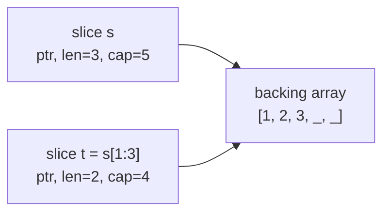
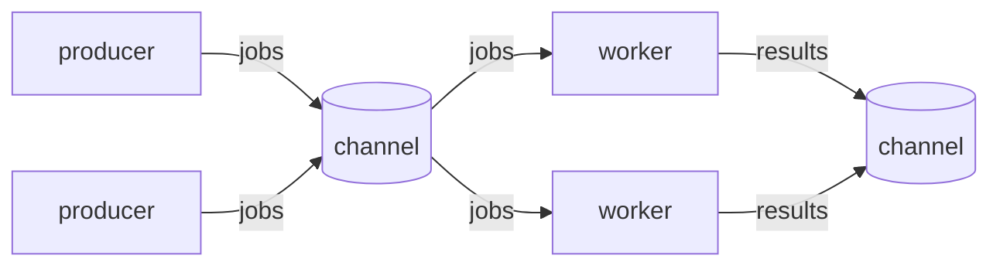

## Program Structure

```go
package main

import (
    "fmt"
    "os"
)

func main() {
    fmt.Println("hello, world")
    if len(os.Args) > 1 {
        fmt.Println("args:", os.Args[1:])
    }
}
```

| Rule | Detail |
|------|--------|
| Entry point | `package main` with `func main()` |
| Exported names | Start with a capital letter (`Println`), lowercase is package-private |
| Unused imports or variables | Compile errors |
| Formatting | `gofmt` decides, so there are no style debates |
| Semicolons | Inserted by the compiler, so you do not write them |

## Variables and Constants

```go
var name string = "Ada"     // full form
var count = 3               // type inferred
age := 36                   // short form, only inside functions
a, b := 1, "two"            // multiple assignment

var zero int                // zero values: 0, "", false, nil
const Pi = 3.14159
const (
    Low = iota              // 0
    Mid                     // 1
    High                    // 2
)
```

## Basic Types

| Type | Examples | Zero value |
|------|----------|------------|
| `bool` | `true`, `false` | `false` |
| `int`, `int8` to `int64`, `uint` | `42`, `-7` | `0` |
| `float32`, `float64` | `3.14` | `0` |
| `string` | `"hi"`, `` `raw` `` | `""` |
| `byte` (`uint8`), `rune` (`int32`) | `'a'`, `'世'` | `0` |
| pointer, slice, map, channel, func, interface | | `nil` |

Go never converts types implicitly. Write `float64(n)` or `int(f)`.

## Control Flow

```go
if x > 0 {
    fmt.Println("positive")
} else if x < 0 {
    fmt.Println("negative")
}

if v, err := strconv.Atoi(s); err == nil {   // init statement, v and err scoped here
    fmt.Println(v)
}

for i := 0; i < 3; i++ { }                   // classic loop
for x < 100 { x *= 2 }                       // like while
for { break }                                // infinite loop
for i, v := range []string{"a", "b"} { }     // index and value
for k, v := range map[string]int{"a": 1} { }

switch day {
case "sat", "sun":
    fmt.Println("weekend")
default:
    fmt.Println("weekday")
}
```

`switch` does not fall through, so there is no `break` per case. Use `fallthrough` if needed.

## Functions

```go
func add(a, b int) int {
    return a + b
}

func divide(a, b float64) (float64, error) {      // multiple returns
    if b == 0 {
        return 0, errors.New("divide by zero")
    }
    return a / b, nil
}

func sum(nums ...int) int {                       // variadic
    total := 0
    for _, n := range nums {
        total += n
    }
    return total
}

square := func(n int) int { return n * n }        // function value
```

## Arrays, Slices, and Maps

```go
arr := [3]int{1, 2, 3}          // array: fixed size, value type
s := []int{1, 2, 3}             // slice: a view onto an array
s = append(s, 4, 5)             // may allocate a new backing array
t := s[1:3]                     // [2 3], shares memory with s
u := make([]int, 0, 10)         // length 0, capacity 10
copy(u, s)                      // copy elements

m := map[string]int{"a": 1}
m["b"] = 2
v, ok := m["c"]                 // ok is false when the key is missing
delete(m, "a")
```



| Operation | Notes |
|-----------|-------|
| `len(x)`, `cap(x)` | Length and capacity |
| `append` | Always keep the result: `s = append(s, v)` |
| `s[a:b]` | Half-open range, shares the backing array |
| `for range` over a `nil` map or slice | Safe, runs zero times |
| Writing to a `nil` map | Panics. Create it with `make` first |

## Structs and Methods

```go
type User struct {
    Name  string
    Email string `json:"email"`      // struct tag
    age   int                         // unexported field
}

u := User{Name: "Ada", Email: "ada@example.com"}
p := &u                               // pointer to struct, p.Name works directly

func (u User) Greeting() string {     // value receiver: works on a copy
    return "Hi, " + u.Name
}

func (u *User) Birthday() {           // pointer receiver: can modify u
    u.age++
}
```

Use a pointer receiver when the method changes the value or the struct is large. Be
consistent: use pointer receivers for all methods of a type if any needs one.

## Interfaces

An interface is satisfied **implicitly**. A type only needs the methods.

```go
type Shape interface {
    Area() float64
}

type Rect struct{ W, H float64 }
func (r Rect) Area() float64 { return r.W * r.H }

var s Shape = Rect{3, 4}

switch v := s.(type) {                // type switch
case Rect:
    fmt.Println("rect", v.W)
}
r, ok := s.(Rect)                     // type assertion
```

- Keep interfaces small. `io.Reader` and `io.Writer` have one method each.
- "Accept interfaces, return structs."
- `any` is an alias for `interface{}`.

## Error Handling

Errors are values. Return them and check them.

```go
f, err := os.Open("data.txt")
if err != nil {
    return fmt.Errorf("open data: %w", err)    // wrap with context
}
defer f.Close()

if errors.Is(err, os.ErrNotExist) { }          // compare through wrapping
var pe *os.PathError
if errors.As(err, &pe) { }                     // extract a type
```

```go
type NotFoundError struct{ ID string }
func (e *NotFoundError) Error() string { return "not found: " + e.ID }
```

| Tool | Use |
|------|-----|
| `errors.New("msg")` | Simple error |
| `fmt.Errorf("...: %w", err)` | Wrap an error |
| `errors.Is`, `errors.As` | Inspect wrapped errors |
| `panic` / `recover` | Only for programming bugs, not normal errors |

## defer

`defer` runs when the surrounding function returns, in last-in first-out order.

```go
func read(path string) error {
    f, err := os.Open(path)
    if err != nil {
        return err
    }
    defer f.Close()              // always runs, even on early return
    // ... use f
    return nil
}
```

## Goroutines and Channels

```go
go doWork()                          // run concurrently

ch := make(chan int)                 // unbuffered: send waits for a receiver
buf := make(chan string, 3)          // buffered: send waits only when full

go func() { ch <- 42 }()
v := <-ch                            // receive
close(ch)                            // sender closes
for v := range ch { }                // receive until closed
```



```go
select {                             // wait on several channels
case msg := <-in:
    fmt.Println(msg)
case <-time.After(time.Second):
    fmt.Println("timeout")
case <-ctx.Done():
    return ctx.Err()
}
```

## sync and context

```go
var wg sync.WaitGroup
for i := 0; i < 3; i++ {
    wg.Add(1)
    go func() {
        defer wg.Done()
        work(i)
    }()
}
wg.Wait()

var mu sync.Mutex
mu.Lock()
counter++
mu.Unlock()
```

```go
ctx, cancel := context.WithTimeout(context.Background(), 2*time.Second)
defer cancel()
req, _ := http.NewRequestWithContext(ctx, "GET", url, nil)
```

| Tool | Purpose |
|------|---------|
| `sync.WaitGroup` | Wait for a group of goroutines |
| `sync.Mutex`, `RWMutex` | Protect shared data |
| `sync.Once` | Run something exactly once |
| `atomic` | Lock-free counters and flags |
| `context.Context` | Cancellation, deadlines, request values. Pass it as the first parameter |

"Do not communicate by sharing memory; share memory by communicating."

## Generics

```go
func Map[T, U any](in []T, f func(T) U) []U {
    out := make([]U, 0, len(in))
    for _, v := range in {
        out = append(out, f(v))
    }
    return out
}

type Number interface {
    ~int | ~int64 | ~float64
}

func Sum[T Number](xs []T) T {
    var total T
    for _, x := range xs {
        total += x
    }
    return total
}
```

## Common Standard Library

| Package | Use |
|---------|-----|
| `fmt` | Printing and formatting |
| `strings`, `strconv` | String helpers, number conversion |
| `os`, `io`, `bufio` | Files, streams |
| `encoding/json` | JSON encode and decode |
| `net/http` | HTTP client and server |
| `time` | Time and durations |
| `sort`, `slices`, `maps` | Sorting and collection helpers |
| `log/slog` | Structured logging |
| `testing` | Tests and benchmarks |

```go
data, _ := json.Marshal(user)                // struct to JSON
err := json.Unmarshal(data, &user)           // JSON to struct

http.HandleFunc("/hello", func(w http.ResponseWriter, r *http.Request) {
    fmt.Fprintln(w, "hello")
})
log.Fatal(http.ListenAndServe(":8080", nil))
```

## Testing

```go
// add_test.go
func TestAdd(t *testing.T) {
    cases := []struct{ a, b, want int }{
        {1, 2, 3},
        {0, 0, 0},
    }
    for _, c := range cases {
        if got := add(c.a, c.b); got != c.want {
            t.Errorf("add(%d, %d) = %d, want %d", c.a, c.b, got, c.want)
        }
    }
}
```

## The go Command

| Command | Description |
|---------|-------------|
| `go run .` | Compile and run |
| `go build` | Build a binary |
| `go test ./...` | Run all tests |
| `go test -race ./...` | Detect data races |
| `go test -bench .` | Run benchmarks |
| `go fmt ./...` | Format code |
| `go vet ./...` | Report suspicious code |
| `go mod init <module>` | Start a module |
| `go mod tidy` | Add missing and remove unused dependencies |
| `go get pkg@version` | Add or upgrade a dependency |
| `go install pkg@latest` | Install a tool |
| `GOOS=linux GOARCH=amd64 go build` | Cross-compile |
