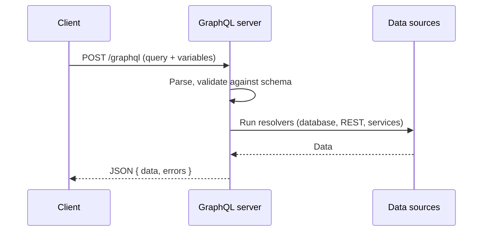
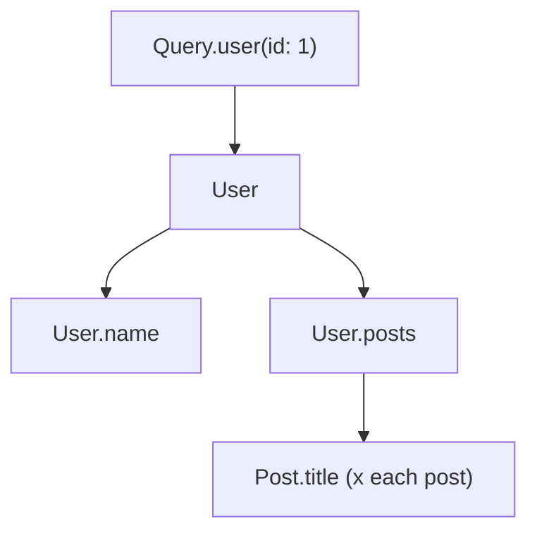

## How GraphQL Works

One endpoint, one query language. The client asks for exactly the fields it needs, and the
server returns that shape.



```http
POST /graphql
Content-Type: application/json

{ "query": "{ user(id: 1) { name } }" }
```

| Part | Role |
|------|------|
| **Schema** | The typed contract of everything the API can do |
| **Operation** | A `query`, `mutation`, or `subscription` sent by the client |
| **Resolver** | A function on the server that returns the value of one field |
| **Response** | JSON with `data` and, if something failed, `errors` |

## GraphQL vs REST

| | REST | GraphQL |
|---|------|---------|
| Endpoints | Many (`/users`, `/orders`) | One (`/graphql`) |
| Response shape | Fixed by the server | Chosen by the client |
| Over-fetching | Common | Avoided |
| Several resources in one call | Several requests | One request |
| Versioning | `/v1`, `/v2` | Evolve the schema, deprecate fields |
| Caching | HTTP caching works well | Needs extra work (persisted queries, CDN keys) |
| File upload | Native | Needs a multipart spec |
| Learning curve | Low | Higher |

## Schema Definition Language (SDL)

```graphql
type User {
  id: ID!
  name: String!
  email: String
  posts: [Post!]!
}

type Post {
  id: ID!
  title: String!
  author: User!
  status: PostStatus!
}

enum PostStatus {
  DRAFT
  PUBLISHED
}

type Query {
  user(id: ID!): User
  posts(first: Int = 10, status: PostStatus): [Post!]!
}

type Mutation {
  createPost(input: CreatePostInput!): Post!
}

input CreatePostInput {
  title: String!
  authorId: ID!
}
```

## Types

| Type | Example | Notes |
|------|---------|-------|
| Scalars | `Int`, `Float`, `String`, `Boolean`, `ID` | Built in |
| Object | `type User { ... }` | Fields that can have arguments |
| Enum | `enum Role { ADMIN USER }` | A fixed set of values |
| Input | `input NewUser { ... }` | Object used as an argument |
| Interface | `interface Node { id: ID! }` | Shared fields across types |
| Union | `union Result = User | Post` | One of several types |
| Custom scalar | `scalar DateTime` | Defined by the server |

### Nullability and Lists

| Syntax | Meaning |
|--------|---------|
| `String` | May be `null` |
| `String!` | Never `null` |
| `[String]` | Nullable list of nullable strings |
| `[String!]` | Nullable list of non-null strings |
| `[String!]!` | Non-null list of non-null strings (the usual choice) |
| `[String]!` | Non-null list of nullable strings |

Fields are nullable by default. If a `!` field fails, `null` bubbles up to the nearest
nullable parent.

## Queries

```graphql
query GetUser {
  user(id: 1) {
    id
    name
    posts {
      title
    }
  }
}
```

```json
{
  "data": {
    "user": {
      "id": "1",
      "name": "Ada",
      "posts": [{ "title": "Notes on the Engine" }]
    }
  }
}
```

### Aliases

Rename fields in the response, or query the same field twice with different arguments.

```graphql
{
  admin: user(id: 1) { name }
  guest: user(id: 2) { name }
}
```

## Variables

Never build query strings by hand. Declare variables and send them separately.

```graphql
query GetPosts($status: PostStatus = PUBLISHED, $first: Int!) {
  posts(status: $status, first: $first) {
    id
    title
  }
}
```

```json
{ "first": 5, "status": "DRAFT" }
```

## Fragments

Reuse a set of fields.

```graphql
fragment UserBasics on User {
  id
  name
}

query {
  user(id: 1) { ...UserBasics email }
  posts(first: 3) { title author { ...UserBasics } }
}
```

Use an **inline fragment** for interfaces and unions:

```graphql
{
  search(text: "ada") {
    ... on User { name }
    ... on Post { title }
    __typename
  }
}
```

## Directives

| Directive | Use |
|-----------|-----|
| `@include(if: Boolean)` | Include the field only when true |
| `@skip(if: Boolean)` | Skip the field when true |
| `@deprecated(reason: "...")` | Mark a schema field as deprecated |

```graphql
query ($withPosts: Boolean!) {
  user(id: 1) {
    name
    posts @include(if: $withPosts) { title }
  }
}
```

## Mutations

Mutations change data. Top-level mutation fields run **one after another**, queries run in
parallel.

```graphql
mutation CreatePost($input: CreatePostInput!) {
  createPost(input: $input) {
    id
    title
  }
}
```

- Name mutations as verbs: `createPost`, `deleteUser`.
- Take one `input` object and return the changed object, so the client can update its cache.
- For failures the client should handle, return a result union such as `CreatePostResult`.

## Subscriptions

A long-lived connection (usually WebSocket) that pushes events.

```graphql
subscription OnPostPublished {
  postPublished {
    id
    title
  }
}
```

## Resolvers

Each field has a resolver: `(parent, args, context, info) => value`.



```javascript
const resolvers = {
  Query: {
    user: (_parent, { id }, ctx) => ctx.db.users.findById(id),
  },
  User: {
    posts: (user, _args, ctx) => ctx.db.posts.findByAuthor(user.id),
  },
  Mutation: {
    createPost: (_p, { input }, ctx) => ctx.db.posts.create(input),
  },
};
```

| Argument | Contents |
|----------|----------|
| `parent` | Result of the parent field's resolver |
| `args` | Arguments passed to this field |
| `context` | Per-request shared data: user, database, loaders |
| `info` | Schema and query details |

## The N+1 Problem

Listing 20 posts and then loading each author runs 1 query for posts plus 20 for authors.

```plaintext
Without batching          With DataLoader
query posts               query posts
query author 1            query authors WHERE id IN (1, 2, 3, ...)
query author 2
...
query author 20
```

Use **DataLoader** (or your server's batching feature). It collects keys during one tick
and loads them in a single call, and it caches within the request.

## Pagination

| Style | Shape | Good for |
|-------|-------|----------|
| Offset | `posts(limit: 10, offset: 20)` | Simple lists |
| Cursor (Relay connections) | `posts(first: 10, after: "cursor")` | Large or changing data |

```graphql
query {
  posts(first: 10, after: "Y3Vyc29yOjEw") {
    edges {
      cursor
      node { id title }
    }
    pageInfo {
      hasNextPage
      endCursor
    }
  }
}
```

## Errors

GraphQL usually answers `200 OK`, even with errors. Check the `errors` array.

```json
{
  "data": { "user": null },
  "errors": [
    {
      "message": "User not found",
      "path": ["user"],
      "extensions": { "code": "NOT_FOUND" }
    }
  ]
}
```

- Put a machine-readable `code` in `extensions`.
- A response can have both partial `data` and `errors`.
- Return `4xx` and `5xx` only for transport or request-level failures.

## Introspection

```graphql
{
  __schema { types { name kind } }
  __type(name: "User") { fields { name type { name } } }
}
```

Tools such as GraphiQL, Apollo Sandbox, and Postman use this to autocomplete queries.
Consider turning introspection off in production for private APIs.

## Security and Performance

| Risk | Defence |
|------|---------|
| Deeply nested queries | Limit query depth |
| Expensive queries | Query cost analysis and complexity limits |
| Big result sets | Cap page size, require `first` |
| Unknown queries | Persisted queries or an allow-list |
| Unauthorised data | Check permissions in resolvers or a shared layer, per field |
| Batching abuse | Rate-limit by cost, not just request count |

## Common Tools

| Tool | Purpose |
|------|---------|
| Apollo Server, GraphQL Yoga, Mercurius | Servers |
| Apollo Client, urql, Relay | Browser clients |
| GraphiQL, Apollo Sandbox | Explore and test |
| GraphQL Code Generator | Types from schema and queries |
| Federation | Combine several GraphQL services into one graph |
