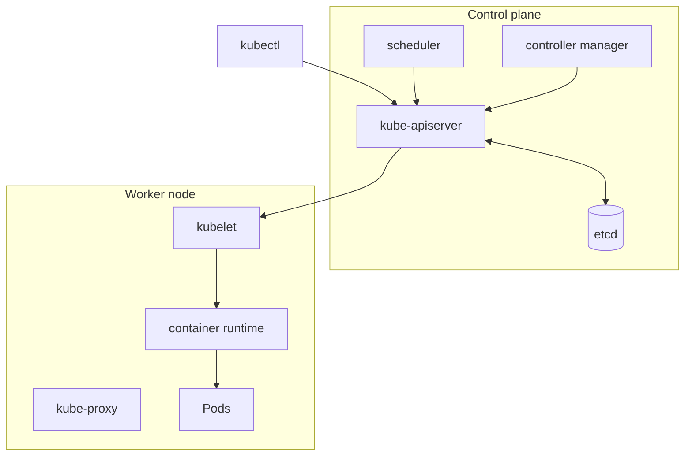
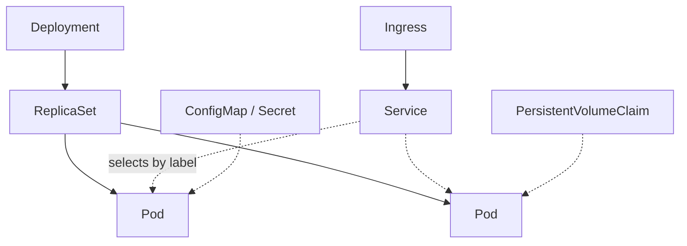
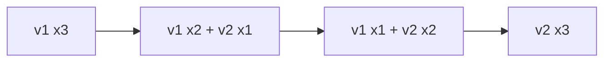
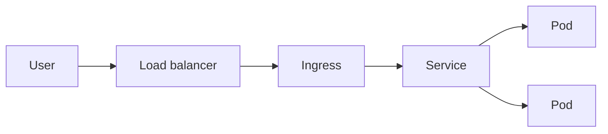
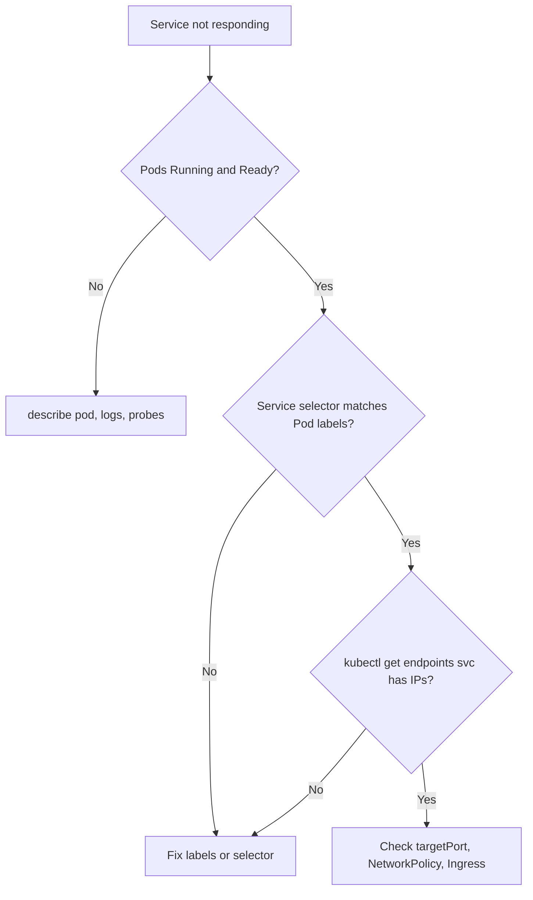

## Architecture



| Component | Role |
|-----------|------|
| `kube-apiserver` | The front door. Every request goes through it |
| `etcd` | Key-value store holding all cluster state |
| `scheduler` | Chooses a node for each new Pod |
| `controller manager` | Runs loops that make real state match desired state |
| `kubelet` | Agent on each node that runs the Pods assigned to it |
| `kube-proxy` | Programs Service networking rules on each node |
| Container runtime | Runs containers (`containerd`, `CRI-O`) |

Kubernetes works by **declaring** the state you want. Controllers keep reconciling reality
toward it.

## Core Objects



| Object | Purpose |
|--------|---------|
| `Pod` | Smallest unit. One or more containers sharing network and storage |
| `ReplicaSet` | Keeps N identical Pods running |
| `Deployment` | Manages ReplicaSets, rolling updates, and rollbacks |
| `StatefulSet` | Pods with stable names and storage (databases) |
| `DaemonSet` | One Pod on every node (log or monitoring agents) |
| `Job` / `CronJob` | Run to completion, once or on a schedule |
| `Service` | Stable address and load balancing for a set of Pods |
| `Ingress` | HTTP routing into the cluster |
| `ConfigMap` / `Secret` | Configuration and sensitive data |
| `Namespace` | Virtual cluster for grouping and isolation |
| `PersistentVolume` / `PersistentVolumeClaim` | Storage and a request for it |

## kubectl Basics

```bash
kubectl config get-contexts                  # list clusters
kubectl config use-context my-cluster        # switch cluster
kubectl config set-context --current --namespace=dev   # default namespace

kubectl get pods                             # list in current namespace
kubectl get pods -A                          # all namespaces
kubectl get pods -o wide                     # more columns (node, IP)
kubectl get pods -l app=web                  # filter by label
kubectl get pod web-1 -o yaml                # full object
kubectl describe pod web-1                   # details and events
```

| Flag | Meaning |
|------|---------|
| `-n <ns>` | Namespace |
| `-A` | All namespaces |
| `-o wide\|yaml\|json\|name` | Output format |
| `-l key=value` | Label selector |
| `-w` | Watch for changes |
| `--dry-run=client -o yaml` | Print what would be created |

## Create and Change Things

```bash
kubectl apply -f app.yaml                    # create or update from a file
kubectl apply -f ./manifests/                # a whole folder
kubectl delete -f app.yaml                   # delete what the file defines
kubectl delete pod web-1                     # delete one object

kubectl create deployment web --image=nginx --replicas=3
kubectl expose deployment web --port=80 --type=ClusterIP
kubectl scale deployment web --replicas=5
kubectl set image deployment/web nginx=nginx:1.27
kubectl label pod web-1 tier=frontend
kubectl edit deployment web                  # open in your editor

kubectl create deployment web --image=nginx --dry-run=client -o yaml > web.yaml
```

## Deployment Manifest

```yaml
apiVersion: apps/v1
kind: Deployment
metadata:
  name: web
  labels:
    app: web
spec:
  replicas: 3
  selector:
    matchLabels:
      app: web
  template:
    metadata:
      labels:
        app: web
    spec:
      containers:
        - name: web
          image: nginx:1.27
          ports:
            - containerPort: 80
          resources:
            requests: { cpu: "100m", memory: "128Mi" }
            limits: { cpu: "500m", memory: "256Mi" }
          readinessProbe:
            httpGet: { path: /, port: 80 }
          livenessProbe:
            httpGet: { path: /, port: 80 }
            initialDelaySeconds: 10
```

Every manifest has `apiVersion`, `kind`, `metadata`, and (for most kinds) `spec`.

## Rolling Updates and Rollbacks



```bash
kubectl rollout status deployment/web        # watch the rollout
kubectl rollout history deployment/web       # past revisions
kubectl rollout undo deployment/web          # go back one revision
kubectl rollout undo deployment/web --to-revision=2
kubectl rollout restart deployment/web       # restart all Pods
kubectl rollout pause deployment/web
```

## Services and Networking



| Service type | Reachable from | Use |
|--------------|----------------|-----|
| `ClusterIP` (default) | Inside the cluster | Internal services |
| `NodePort` | `<node-ip>:30000-32767` | Simple external access, testing |
| `LoadBalancer` | A cloud load balancer | Production external access |
| `ExternalName` | DNS alias | Point at an outside service |
| Headless (`clusterIP: None`) | Pod IPs via DNS | `StatefulSet`, direct Pod access |

```yaml
apiVersion: v1
kind: Service
metadata:
  name: web
spec:
  selector:
    app: web          # matches Pod labels
  ports:
    - port: 80        # Service port
      targetPort: 80  # container port
```

Inside the cluster, Services get DNS names: `web.dev.svc.cluster.local`, or just `web`
within the same namespace.

```yaml
apiVersion: networking.k8s.io/v1
kind: Ingress
metadata:
  name: web
spec:
  rules:
    - host: app.example.com
      http:
        paths:
          - path: /
            pathType: Prefix
            backend:
              service: { name: web, port: { number: 80 } }
```

## Configuration and Secrets

```bash
kubectl create configmap app-config --from-literal=LOG_LEVEL=info
kubectl create secret generic db-pass --from-literal=password=s3cret
```

```yaml
containers:
  - name: web
    image: myapp:1.0
    envFrom:
      - configMapRef: { name: app-config }
    env:
      - name: DB_PASSWORD
        valueFrom:
          secretKeyRef: { name: db-pass, key: password }
    volumeMounts:
      - { name: cfg, mountPath: /etc/app }
volumes:
  - name: cfg
    configMap: { name: app-config }
```

`Secret` values are only base64-encoded by default, not encrypted. Turn on encryption at
rest and restrict access with RBAC.

## Storage

```yaml
apiVersion: v1
kind: PersistentVolumeClaim
metadata:
  name: data
spec:
  accessModes: ["ReadWriteOnce"]
  resources:
    requests:
      storage: 10Gi
```

| Access mode | Meaning |
|-------------|---------|
| `ReadWriteOnce` | Read-write by one node |
| `ReadOnlyMany` | Read-only by many nodes |
| `ReadWriteMany` | Read-write by many nodes |
| `ReadWriteOncePod` | Read-write by a single Pod |

A `StorageClass` creates volumes on demand when a claim asks for one.

## Logs, Exec, and Port Forward

```bash
kubectl logs web-1                           # logs of a Pod
kubectl logs -f web-1 -c sidecar             # follow a specific container
kubectl logs web-1 --previous                # logs from the crashed container
kubectl logs -l app=web --tail=50            # logs by label

kubectl exec -it web-1 -- sh                 # shell inside a Pod
kubectl exec web-1 -- env                    # run one command
kubectl port-forward pod/web-1 8080:80       # localhost:8080 -> Pod port 80
kubectl port-forward svc/web 8080:80
kubectl cp web-1:/app/log.txt ./log.txt      # copy files out
kubectl top pods                             # CPU and memory (needs metrics-server)
```

## Troubleshooting Pods

| Status | Usual cause | Check |
|--------|-------------|-------|
| `Pending` | No node fits (resources, taints, unbound volume) | `kubectl describe pod`, Events |
| `ImagePullBackOff` / `ErrImagePull` | Wrong image name or tag, or no registry access | Image name, pull secret |
| `CrashLoopBackOff` | The container starts and exits repeatedly | `kubectl logs --previous` |
| `OOMKilled` | Exceeded the memory limit | Raise `limits.memory`, fix leak |
| `CreateContainerConfigError` | Missing `ConfigMap` or `Secret` | `describe pod` |
| `Running` but not ready | Readiness probe failing | Probe path and port |
| `Terminating` for ages | Finalizer or stuck process | `kubectl delete pod --force` as a last resort |

```bash
kubectl get events --sort-by=.lastTimestamp  # recent cluster events
kubectl describe node worker-1               # capacity, taints, conditions
kubectl get pod web-1 -o jsonpath='{.status.phase}'
```

Debug flow when a Service does not respond:



## Scheduling and Resources

| Setting | Purpose |
|---------|---------|
| `requests` | What the scheduler reserves for the container |
| `limits` | The maximum before throttling (CPU) or killing (memory) |
| `nodeSelector` | Run only on nodes with given labels |
| `affinity` / `antiAffinity` | Prefer or avoid nodes or other Pods |
| `taints` and `tolerations` | Keep Pods off nodes unless they tolerate the taint |
| `HorizontalPodAutoscaler` | Scale replicas on CPU or custom metrics |

```bash
kubectl autoscale deployment web --min=2 --max=10 --cpu-percent=70
kubectl cordon worker-1          # stop scheduling new Pods
kubectl drain worker-1 --ignore-daemonsets --delete-emptydir-data
kubectl uncordon worker-1
```

## RBAC and Access

```bash
kubectl auth can-i create pods -n dev                # can I do this?
kubectl auth can-i list secrets --as=alice           # check another user
kubectl create role pod-reader --verb=get,list --resource=pods -n dev
kubectl create rolebinding alice-reads --role=pod-reader --user=alice -n dev
```

| Object | Scope |
|--------|-------|
| `Role` / `RoleBinding` | One namespace |
| `ClusterRole` / `ClusterRoleBinding` | Whole cluster |
| `ServiceAccount` | An identity for Pods |

## Handy Shortcuts

| Short name | Resource |
|------------|----------|
| `po` | pods |
| `svc` | services |
| `deploy` | deployments |
| `rs` | replicasets |
| `ns` | namespaces |
| `cm` | configmaps |
| `pv`, `pvc` | persistent volumes and claims |
| `ing` | ingresses |
| `sts` | statefulsets |

```bash
alias k=kubectl
source <(kubectl completion zsh)         # tab completion
kubectl explain deployment.spec.strategy # built-in field docs
kubectl api-resources                    # every resource kind
```
