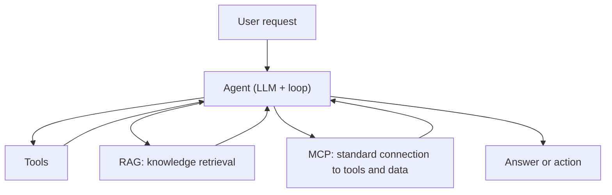
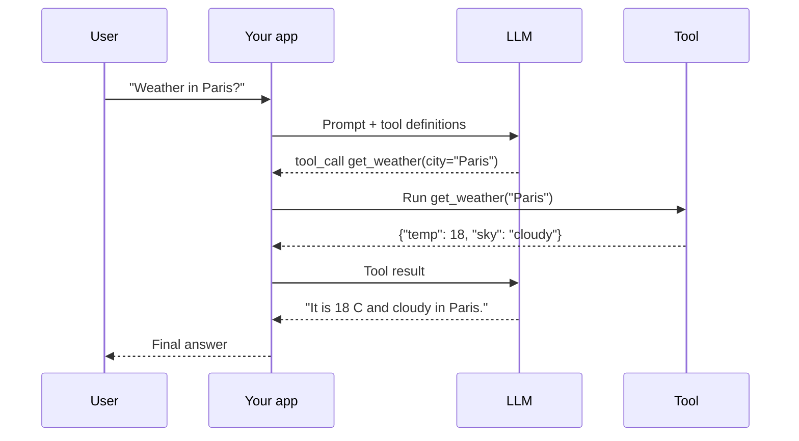
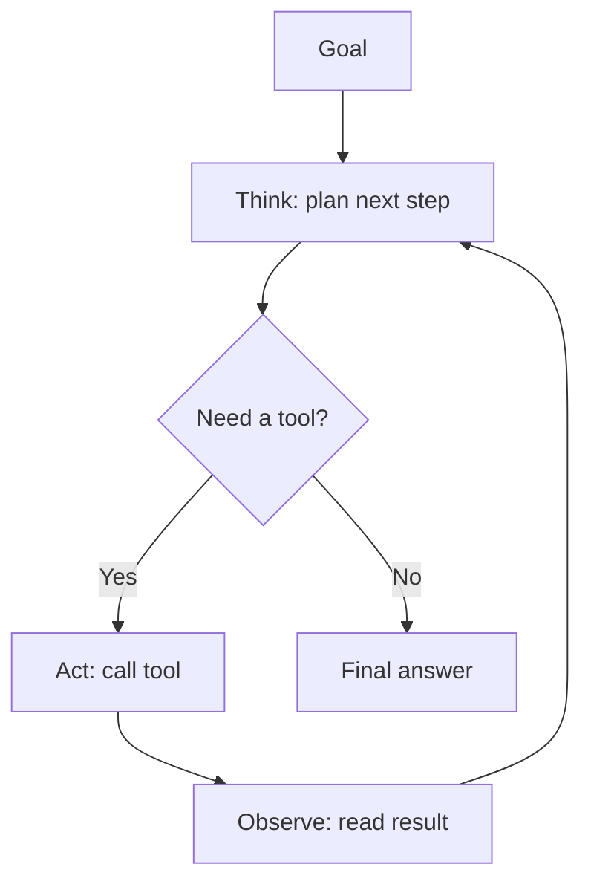
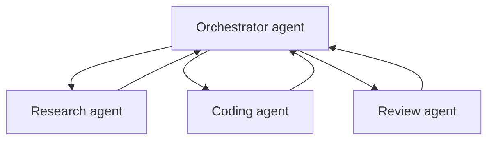
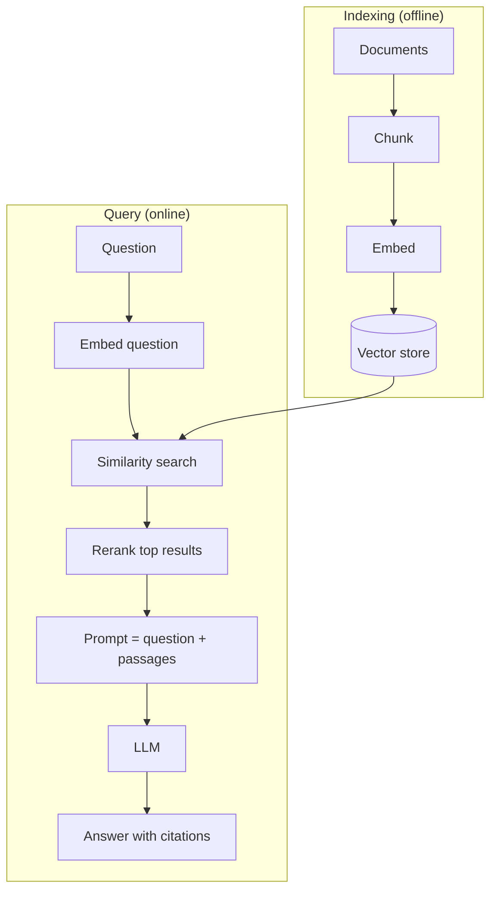
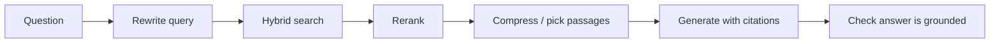
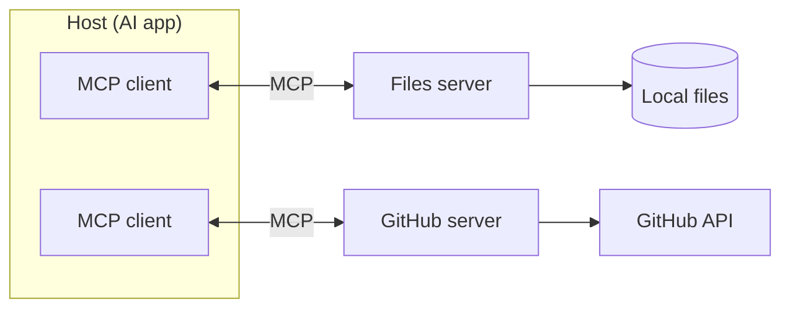
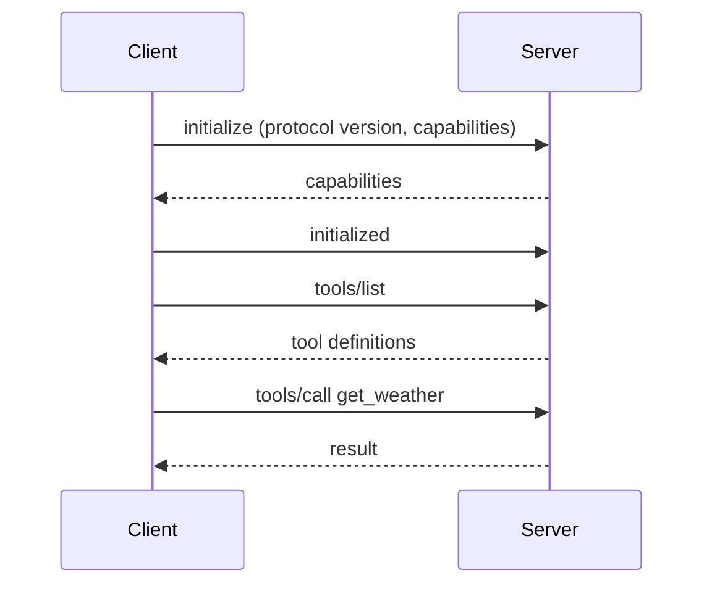

## The Big Picture



| Idea | What it adds to a plain LLM |
|------|-----------------------------|
| **Tool calling** | The model can request actions (search, run code, call an API) |
| **Agent** | A loop where the model plans, acts, and checks results until done |
| **RAG** | Fresh or private knowledge is looked up and put in the prompt |
| **MCP** | One open standard for plugging tools and data into any AI app |

## Tool Calling

The model does not run tools. It returns a structured request, **your code** runs it, and
you send the result back.



```json
{
  "name": "get_weather",
  "description": "Get the current weather for a city. Use when the user asks about weather.",
  "input_schema": {
    "type": "object",
    "properties": {
      "city": { "type": "string", "description": "City name, e.g. Paris" },
      "unit": { "type": "string", "enum": ["celsius", "fahrenheit"] }
    },
    "required": ["city"]
  }
}
```

| Tip | Why |
|-----|-----|
| Write a clear `description` | The model picks tools from it |
| Keep parameters few and typed | Fewer wrong calls |
| Return short, useful results | Long output wastes context |
| Return errors as text | The model can read them and retry |
| Validate arguments on your side | Never trust model output blindly |

## The Agent Loop

An agent is a loop: the model decides, a tool acts, the result goes back in.



```python
messages = [{"role": "user", "content": goal}]

for step in range(MAX_STEPS):                    # always cap the loop
    reply = llm(messages, tools=TOOLS)
    messages.append(reply)

    if not reply.tool_calls:                     # model is done
        return reply.text

    for call in reply.tool_calls:
        result = run_tool(call.name, call.arguments)
        messages.append({"role": "tool", "id": call.id, "content": result})

raise RuntimeError("Agent did not finish")
```

| Pattern | Idea |
|---------|------|
| ReAct | Alternate reasoning and acting, with each result informing the next step |
| Plan and execute | Write a full plan first, then run the steps |
| Reflection | The model critiques its own output and revises |
| Routing | A first step picks which specialist or prompt handles the request |
| Parallel tool calls | Run independent calls at the same time |

## Agent Design Principles

- **Start simple.** A single prompt, or a fixed workflow, beats an agent when the steps are known.
- Use an agent only when the path depends on what the model finds along the way.
- Give each agent the **fewest tools and permissions** it needs.
- Set a **step limit, time limit, and budget**.
- Keep a **human in the loop** for risky actions (payments, deletes, sending messages).
- Log every step so failures can be replayed.
- Evaluate on real tasks, and measure success rate, cost, and latency.

## Multi-Agent Patterns



| Pattern | When to use |
|---------|-------------|
| Orchestrator and workers | One agent splits the task and merges the results |
| Pipeline | Fixed stages: draft, review, polish |
| Debate or critic | One agent proposes, another challenges |
| Parallel workers | Independent sub-tasks run at once |

More agents means more cost and more ways to fail. Add them only when one agent cannot
hold the context or the specialisation helps.

## Memory and Context

| Kind | What it holds | Typical store |
|------|---------------|---------------|
| Working memory | The current conversation | The context window |
| Summaries | A compressed history | Text in the prompt |
| Long-term memory | Facts and preferences across sessions | Database or vector store |
| Scratchpad / notes | Plans and progress the agent writes itself | A file or state object |

Context is limited and costs tokens. Trim old tool output, summarise long threads, and put
the most important instructions where they will not be lost.

## What is RAG?

**Retrieval-Augmented Generation** finds relevant text first, then asks the model to answer
from it. It gives the model facts it was never trained on, with fewer made-up answers.



| Use RAG when | Use something else when |
|--------------|-------------------------|
| Knowledge changes often | The task is about style or format (prompting or fine-tuning) |
| Data is private or large | The data is small (put it all in the prompt) |
| You need citations | You need new skills, not new facts (fine-tuning) |

## Embeddings and Similarity

An **embedding** turns text into a vector of numbers so that similar meanings sit close
together.

| Measure | Formula idea | Notes |
|---------|--------------|-------|
| Cosine similarity | Angle between vectors | The usual choice, from -1 to 1 |
| Dot product | Sum of products | Same as cosine if vectors are normalised |
| Euclidean distance | Straight-line distance | Smaller means closer |

```python
import numpy as np

def cosine(a, b):
    return float(np.dot(a, b) / (np.linalg.norm(a) * np.linalg.norm(b)))

query_vec = embed("How do I reset my password?")
scores = [cosine(query_vec, v) for v in doc_vectors]
top = np.argsort(scores)[::-1][:5]               # indexes of the 5 best matches
```

- Embed the query and the documents with the **same model**.
- Changing the embedding model means re-indexing everything.

## Chunking

Split documents into pieces small enough to be specific, big enough to make sense.

| Strategy | Notes |
|----------|-------|
| Fixed size with overlap | Easy. Typical: 200 to 500 tokens, 10 to 20% overlap |
| By structure (headings, paragraphs) | Keeps meaning together |
| Semantic | Split where the topic changes |
| Parent and child | Search small chunks, return the larger parent for context |

```plaintext
Chunk 1: [ tokens 1 ..... 300 ]
Chunk 2:             [ tokens 260 ..... 560 ]    <- 40 tokens of overlap
Chunk 3:                         [ tokens 520 ..... 820 ]
```

Store **metadata** with each chunk (source, title, date, section). It enables filtering
and citations.

## Vector Search

| Type | Idea | Trade-off |
|------|------|-----------|
| Exact (flat) | Compare with every vector | Exact, slow at scale |
| ANN (HNSW, IVF) | Approximate nearest neighbours | Much faster, tiny accuracy loss |
| Hybrid | Vector search plus keyword search (BM25) | Best recall, catches exact terms |
| Filtered | Search within a metadata filter | Needs filter-aware index |

Common stores: `pgvector`, Pinecone, Qdrant, Weaviate, Milvus, Chroma, and the vector
features in Elasticsearch and Redis.

## Improving RAG Quality



| Technique | What it fixes |
|-----------|---------------|
| Query rewriting | Vague or follow-up questions |
| Hybrid search | Missed exact names, IDs, codes |
| Reranking (cross-encoder) | Right passage found but ranked low |
| Retrieve more, then trim | Missed context |
| Metadata filters | Wrong product, date, or tenant |
| Better chunking | Passages cut in the middle of an idea |
| "Answer only from the context" prompt | Made-up answers |
| Citations | Trust and checking |

## Evaluating RAG

| Metric | Question it answers |
|--------|---------------------|
| Recall@k | Was the right passage in the top k? |
| Precision@k | How much of the top k was relevant? |
| MRR | How high was the first relevant result? |
| Faithfulness | Is the answer supported by the passages? |
| Answer relevance | Does the answer address the question? |

Build a test set of real questions with known answers and source passages. Test retrieval
and generation **separately** to find which one is failing.

## RAG Prompt Template

```plaintext
Answer the question using only the context below.
If the context does not contain the answer, say "I don't know."
Cite sources as [1], [2].

<context>
[1] [passage one]
[2] [passage two]
</context>

Question: [the user's question]
```

## Model Context Protocol (MCP)

**MCP** is an open standard for connecting AI apps to tools and data. Instead of writing
one integration per app and per service, you write one MCP server that any MCP client can use.



| Role | Description |
|------|-------------|
| **Host** | The AI app (an IDE, a chat app, an agent) |
| **Client** | Lives in the host and keeps one connection to one server |
| **Server** | A program that exposes tools, data, and prompts |

Messages use **JSON-RPC 2.0**.

## What an MCP Server Offers

| Primitive | Controlled by | Purpose | Example |
|-----------|---------------|---------|---------|
| **Tools** | The model | Actions with side effects or computation | `create_issue`, `run_query` |
| **Resources** | The app | Read-only data and context | A file, a database row, a document |
| **Prompts** | The user | Reusable prompt templates | "Summarise this PR" |

Clients can also offer **sampling** (the server asks the host's model for a completion)
and **roots** (which folders the server may see).

## Transports

| Transport | Use |
|-----------|-----|
| `stdio` | The host starts the server as a local process and talks over stdin and stdout |
| Streamable HTTP | A remote server over HTTP, with optional streaming and auth |

## MCP Lifecycle and Messages



| Method | Purpose |
|--------|---------|
| `initialize` | Agree on version and capabilities |
| `tools/list`, `tools/call` | Discover and run tools |
| `resources/list`, `resources/read` | List and read resources |
| `prompts/list`, `prompts/get` | List and fetch prompts |

```json
{
  "jsonrpc": "2.0",
  "id": 1,
  "method": "tools/call",
  "params": {
    "name": "get_weather",
    "arguments": { "city": "Paris" }
  }
}
```

## A Minimal MCP Server (Python)

```python
from mcp.server.fastmcp import FastMCP

mcp = FastMCP("weather")

@mcp.tool()
def get_weather(city: str) -> str:
    """Get the current weather for a city."""
    return f"18 C and cloudy in {city}"

@mcp.resource("config://units")
def units() -> str:
    """The units this server uses."""
    return "metric"

if __name__ == "__main__":
    mcp.run()                     # stdio transport by default
```

## Connecting a Server to a Client

Most hosts read a JSON config that tells them how to start each server.

```json
{
  "mcpServers": {
    "weather": {
      "command": "python",
      "args": ["/path/to/weather_server.py"]
    },
    "github": {
      "command": "npx",
      "args": ["-y", "@modelcontextprotocol/server-github"],
      "env": { "GITHUB_PERSONAL_ACCESS_TOKEN": "<token>" }
    }
  }
}
```

## MCP Security

- Treat **tool descriptions and results as untrusted input**. They can carry prompt injection.
- Ask the user to **approve** sensitive tool calls.
- Give servers the least access they need: scoped tokens, limited folders.
- Only install servers you trust, and pin their versions.
- For remote servers, use **OAuth** and HTTPS, and never log secrets.
- Do not let one server's output trigger another server's powerful tool without a check.

## Choosing the Right Tool

| You want to... | Use |
|----------------|-----|
| Give the model fresh or private facts | RAG |
| Let the model do things in the world | Tool calling |
| Handle open-ended, multi-step goals | An agent loop |
| Reuse integrations across many AI apps | MCP |
| Change style or learn a task | Prompting, then fine-tuning |
| Run a known sequence of steps | A plain workflow, no agent |
