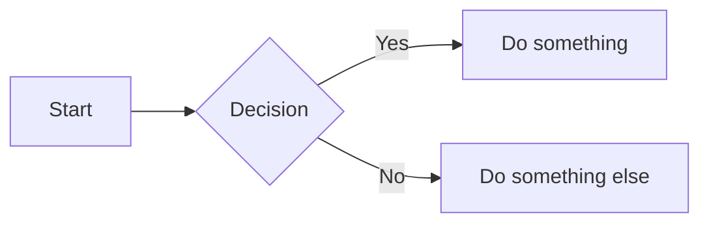

## Headings

Standard ATX-style headings use `#` symbols. The number of `#` symbols determines the heading level (1 through 6).

```markdown
# Heading 1
## Heading 2
### Heading 3
#### Heading 4
##### Heading 5
###### Heading 6
```

Alternate (Setext) syntax is available for H1 and H2 only. Underline the text with `=` for H1 or `-` for H2.

```markdown
Heading 1
=========

Heading 2
---------
```

Both produce identical output. The Setext style can be more readable in raw form for top-level headings.


## Text Formatting

### Bold

```markdown
**bold text**
__also bold__
```

Renders as strong/bold text. The `**` form is preferred since `__` can behave unexpectedly mid-word.

### Italic

```markdown
*italic text*
_also italic_
```

Renders as emphasized/italic text.

### Bold and Italic

```markdown
***bold and italic***
___bold and italic___
**_bold and italic_**
*__bold and italic__*
```

All four produce text that is both bold and italic.

### Strikethrough

```markdown
~~struck through~~
```

Renders as ~~struck through~~ text. This is a GFM extension, not standard Markdown.

### Subscript and Superscript

```markdown
H~2~O        <!-- subscript (some parsers / GFM) -->
X^2^         <!-- superscript (some parsers) -->
```

Support varies by renderer. When unsupported, fall back to HTML:

```html
H<sub>2</sub>O
X<sup>2</sup>
```

### Highlight / Mark

```markdown
==highlighted text==
```

Supported by some parsers (not standard Markdown or GFM). HTML fallback:

```html
<mark>highlighted text</mark>
```


## Lists

### Unordered Lists

Use `*`, `-`, or `+` as bullet markers. Pick one and stay consistent.

```markdown
- Item one
- Item two
- Item three
```

### Ordered Lists

```markdown
1. First item
2. Second item
3. Third item
```

The actual numbers do not matter in most parsers. This also produces a 1-2-3 list:

```markdown
1. First item
1. Second item
1. Third item
```

### Nested Lists

Indent by two or four spaces (depending on the parser) to create sub-lists.

```markdown
- Fruits
  - Apple
  - Banana
- Vegetables
  1. Carrot
  2. Broccoli
```

### Task Lists (Checkboxes)

A GFM extension. Use `- [ ]` for unchecked and `- [x]` for checked items.

```markdown
- [x] Write the draft
- [x] Review the draft
- [ ] Publish the post
```


## Links

### Inline Links

```markdown
[Link text](https://example.com)
[Link with title](https://example.com "Title on hover")
```

### Reference Links

Define the URL elsewhere in the document. Useful when the same URL appears multiple times.

```markdown
[Link text][ref-id]

<!-- anywhere else in the file -->
[ref-id]: https://example.com "Optional Title"
```

You can also use the link text itself as the reference ID:

```markdown
[example.com][]

[example.com]: https://example.com
```

### Autolinks

Wrap a bare URL or email in angle brackets to make it clickable.

```markdown
<https://example.com>
<user@example.com>
```

GFM also auto-links bare URLs without angle brackets (e.g., `https://example.com`).

### Relative Links

Useful inside repositories to link to other files.

```markdown
[Contributing guide](./CONTRIBUTING.md)
[Source code](../src/main.js)
```

### Anchor Links (Within-Page)

Link to any heading in the same document. The anchor is the heading text, lowercased, with spaces replaced by hyphens and special characters removed.

```markdown
[Jump to Lists](#lists)
[Jump to Bold and Italic](#bold-and-italic)
```


## Images

### Inline Images

```markdown


```

### Reference Images

```markdown
![Alt text][img-ref]

[img-ref]: https://example.com/image.png "Optional title"
```

### Linked Images

Wrap an image in a link by nesting the image syntax inside link syntax.

```markdown
[](https://example.com)
```

### Image Sizing

Standard Markdown has no size control. Use HTML when you need it.

```html

```

Some extended parsers support a non-standard size suffix:

```markdown

```


## Code

### Inline Code

Wrap text in single backticks.

```markdown
Use the `printf()` function.
```

To include a literal backtick inside inline code, use double backticks.

```markdown
``There is a literal ` backtick here.``
```

### Fenced Code Blocks

Use triple backticks (or triple tildes) with an optional language identifier for syntax highlighting.

````markdown
```python
def greet(name):
    return f"Hello, {name}!"
```
````

````markdown
~~~javascript
console.log("Hello, world!");
~~~
````

### Indented Code Blocks

Indent every line by four spaces (or one tab). No syntax highlighting is available with this method.

```markdown
    function hello() {
        console.log("Hello");
    }
```


## Blockquotes

### Basic Blockquotes

```markdown
> This is a blockquote.
> It can span multiple lines.
```

### Nested Blockquotes

```markdown
> Outer quote
>
>> Nested quote
>>
>>> Deeply nested quote
```

### Blockquotes with Other Elements

```markdown
> #### A heading inside a quote
>
> - Item one
> - Item two
>
> **Bold** and *italic* work inside quotes too.
>
> ```python
> print("code inside a quote")
> ```
```


## Tables

### Basic Table

```markdown
| Name    | Age | Role       |
|---------|-----|------------|
| Alice   | 30  | Engineer   |
| Bob     | 25  | Designer   |
| Charlie | 35  | Manager    |
```

### Column Alignment

Use colons in the separator row to control alignment.

```markdown
| Left-aligned | Center-aligned | Right-aligned |
|:-------------|:--------------:|--------------:|
| left         |     center     |         right |
| text         |      text      |          text |
```

- `:---` or `---` aligns left (default).
- `:---:` aligns center.
- `---:` aligns right.


## Horizontal Rules

Any of these produce a horizontal line. Use a blank line above and below.

```markdown
---

***

___
```

Three or more hyphens, asterisks, or underscores on a line by themselves.


## Line Breaks and Paragraphs

### Paragraphs

Separate paragraphs with a blank line.

```markdown
This is the first paragraph.

This is the second paragraph.
```

### Line Breaks

End a line with two or more spaces (a trailing-space line break) or use a `<br>` tag.

```markdown
First line.
Second line (note the two trailing spaces above).

Or use HTML:<br>
Next line.
```

A backslash at the end of a line also produces a line break in some parsers:

```markdown
First line.\
Second line.
```


## Escaping Characters

Prefix a special character with a backslash to display it literally.

```markdown
\*not italic\*
\# not a heading
\[not a link\]
\`not code\`
```

Characters that can be escaped: `` \ ` * _ { } [ ] ( ) # + - . ! | ~ ``


## HTML in Markdown

Most Markdown renderers allow inline HTML. This is useful for features Markdown does not cover.

```markdown
This has a <kbd>Ctrl</kbd>+<kbd>C</kbd> shortcut.

<details>
<summary>Click to expand</summary>

Hidden content goes here. **Markdown works** inside HTML blocks
if you leave blank lines around it.

</details>

<dl>
  <dt>Term</dt>
  <dd>Definition of the term.</dd>
</dl>
```


## GitHub Flavored Markdown Extras

### Emoji

Use shortcodes between colons.

```markdown
:thumbsup: :rocket: :warning: :white_check_mark:
```

### Footnotes

```markdown
Here is a sentence with a footnote.[^1]

[^1]: This is the footnote content.
```

The footnote content is rendered at the bottom of the page regardless of where it is defined.

### Alerts / Admonitions

GFM supports callout blocks using a special blockquote syntax.

```markdown
> [!NOTE]
> Useful information the reader should know.

> [!TIP]
> Helpful advice for doing things better.

> [!IMPORTANT]
> Key information the reader needs to know.

> [!WARNING]
> Urgent info that needs immediate attention.

> [!CAUTION]
> Potential negative outcomes of an action.
```

### Collapsed Sections

Use HTML `<details>` and `<summary>` tags.

```markdown
<details>
<summary>Click to expand</summary>

This content is hidden by default.

- You can use **Markdown** inside.
- Leave blank lines after `<summary>` and before `</details>`.

</details>
```

### Mermaid Diagrams

GitHub renders fenced code blocks with the `mermaid` language tag as diagrams.

````markdown

````


## Useful Tips

### Linking to Headings

Every heading automatically gets an anchor ID. Link to it with `#` followed by the slugified heading.

```markdown
## My Great Section

<!-- elsewhere in the document -->
[Go to section](#my-great-section)
```

Rules for the slug: lowercase, spaces become hyphens, special characters are removed.

### Relative Links in Repositories

Reference other files in the repo using relative paths. GitHub resolves them based on the current file's location.

```markdown
See the [setup guide](docs/setup.md) for details.
Check the [source](../src/index.js).
```

### Badge Syntax

Badges are images wrapped in links. Common in README files.

```markdown
[](https://github.com/user/repo/actions)
[](LICENSE)
[](https://www.npmjs.com/package/package-name)
```

The general pattern is:

```markdown
[](link-url)
```


## Reference

1. [Basic Syntax - Markdown Guide](https://www.markdownguide.org/basic-syntax/)
2. [Extended Syntax - Markdown Guide](https://www.markdownguide.org/extended-syntax/)
3. [GitHub Flavored Markdown Spec](https://github.github.com/gfm/)
4. [GitHub - Basic Writing and Formatting Syntax](https://docs.github.com/en/get-started/writing-on-github/getting-started-with-writing-and-formatting-syntax/basic-writing-and-formatting-syntax)
