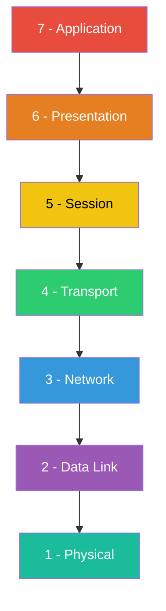
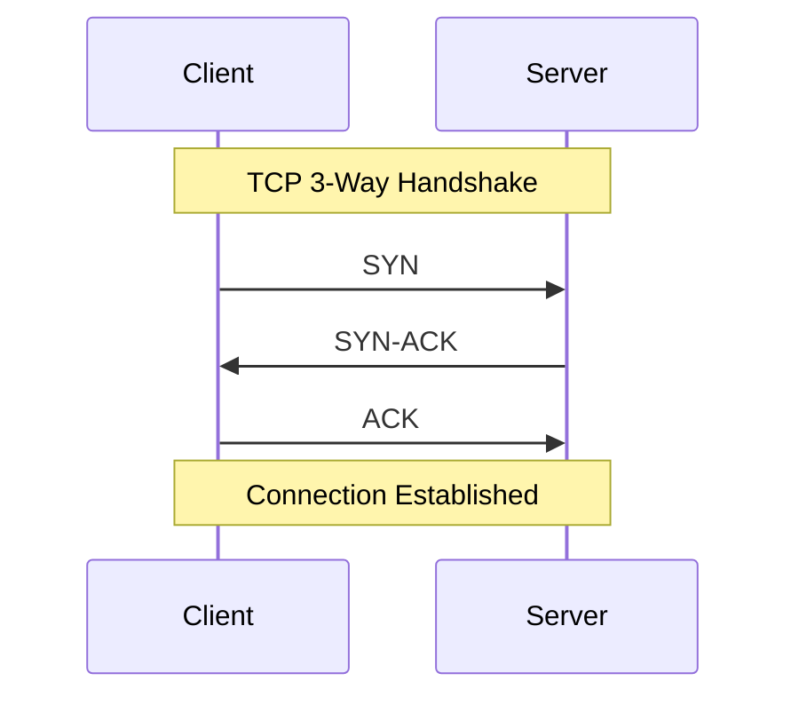
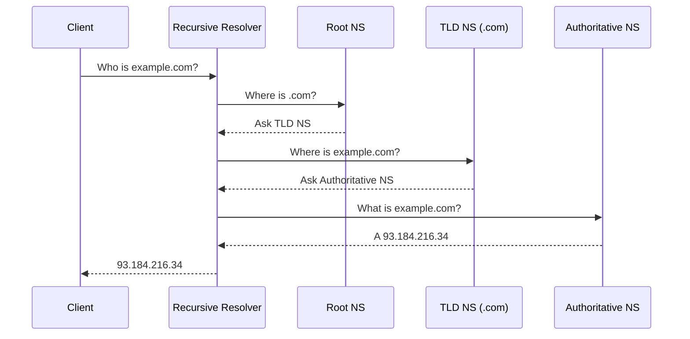

## OSI Model (7 Layers)

| Layer | Name | Function | Key Protocols | Devices |
|-------|------|----------|---------------|---------|
| 7 | Application | User-facing services and APIs | HTTP, FTP, SMTP, DNS, SSH | Firewalls (L7), load balancers |
| 6 | Presentation | Data translation, encryption, compression | TLS/SSL, JPEG, ASCII, MIME | — |
| 5 | Session | Manage connections/sessions | NetBIOS, RPC, PPTP | — |
| 4 | Transport | End-to-end delivery, flow control | TCP, UDP, QUIC | — |
| 3 | Network | Logical addressing and routing | IP, ICMP, IPsec, ARP | Routers, L3 switches |
| 2 | Data Link | Framing, MAC addressing, error detection | Ethernet, Wi-Fi (802.11), PPP | Switches, bridges |
| 1 | Physical | Bit transmission over physical media | USB, Bluetooth, DSL, Ethernet physical | Hubs, repeaters, cables |

---

## TCP/IP Model (4 Layers)

| TCP/IP Layer | OSI Equivalent | Key Protocols |
|--------------|----------------|---------------|
| Application | 7 - Application, 6 - Presentation, 5 - Session | HTTP, HTTPS, FTP, SSH, DNS, SMTP, DHCP, TLS |
| Transport | 4 - Transport | TCP, UDP, QUIC |
| Internet | 3 - Network | IP (v4/v6), ICMP, ARP, IPsec |
| Network Access | 2 - Data Link, 1 - Physical | Ethernet, Wi-Fi, PPP |

---

## Common Protocols

| Protocol | Port(s) | Transport | Description |
|----------|---------|-----------|-------------|
| HTTP | 80 | TCP | Hypertext transfer (web) |
| HTTPS | 443 | TCP | HTTP over TLS (encrypted web) |
| FTP | 20 (data), 21 (control) | TCP | File transfer |
| SFTP | 22 | TCP | File transfer over SSH |
| SSH | 22 | TCP | Secure remote shell access |
| DNS | 53 | UDP/TCP | Domain name resolution |
| DHCP | 67 (server), 68 (client) | UDP | Dynamic IP address assignment |
| SMTP | 25, 465, 587 | TCP | Sending email |
| IMAP | 143, 993 (TLS) | TCP | Retrieving email (server-synced) |
| POP3 | 110, 995 (TLS) | TCP | Retrieving email (download & delete) |
| TCP | — | — | Reliable, connection-oriented transport |
| UDP | — | — | Lightweight, connectionless transport |
| ICMP | — | IP | Network diagnostics (ping, traceroute) |
| ARP | — | Link | Maps IP addresses to MAC addresses |
| TLS/SSL | — | TCP | Encrypts transport layer connections |
| WebSocket | 80/443 | TCP | Full-duplex communication over HTTP upgrade |
| MQTT | 1883, 8883 (TLS) | TCP | Lightweight pub/sub messaging (IoT) |

---

## TCP vs UDP

| Feature | TCP | UDP |
|---------|-----|-----|
| Connection | Connection-oriented (3-way handshake) | Connectionless |
| Reliability | Guaranteed delivery (ACKs, retransmission) | Best-effort, no guarantee |
| Ordering | Ordered (sequence numbers) | No ordering |
| Speed | Slower (overhead) | Faster (minimal overhead) |
| Header Size | 20–60 bytes | 8 bytes |
| Flow Control | Yes (sliding window) | No |
| Use Cases | Web, email, file transfer, SSH | DNS, streaming, gaming, VoIP |

---

## IP Addressing

**IPv4**: 32-bit, dotted decimal — `192.168.1.1` (4 octets, 0–255 each)
**IPv6**: 128-bit, colon-separated hex — `2001:0db8:85a3::8a2e:0370:7334`

### Public vs Private

- **Public**: Routable on the internet, assigned by ISPs
- **Private**: Internal networks only, require NAT for internet access

### Private Address Ranges (RFC 1918)

| Range | CIDR | Class | Addresses |
|-------|------|-------|-----------|
| `10.0.0.0` – `10.255.255.255` | `10.0.0.0/8` | A | 16,777,216 |
| `172.16.0.0` – `172.31.255.255` | `172.16.0.0/12` | B | 1,048,576 |
| `192.168.0.0` – `192.168.255.255` | `192.168.0.0/16` | C | 65,536 |

### Special Addresses

| Address | Purpose |
|---------|---------|
| `127.0.0.1` | Loopback (localhost) |
| `0.0.0.0` | All interfaces / default route |
| `255.255.255.255` | Broadcast (local network) |
| `::1` | IPv6 loopback |
| `169.254.0.0/16` | Link-local (APIPA, no DHCP) |

---

## Subnetting

**CIDR Notation**: `192.168.1.0/24` — the `/24` indicates 24 bits for the network, 8 bits for hosts.

### Common Subnet Masks

| CIDR | Subnet Mask | Usable Hosts | Networks (/24 parent) |
|------|-------------|--------------|----------------------|
| /8 | 255.0.0.0 | 16,777,214 | — |
| /16 | 255.255.0.0 | 65,534 | — |
| /24 | 255.255.255.0 | 254 | 1 |
| /25 | 255.255.255.128 | 126 | 2 |
| /26 | 255.255.255.192 | 62 | 4 |
| /27 | 255.255.255.224 | 30 | 8 |
| /28 | 255.255.255.240 | 14 | 16 |
| /30 | 255.255.255.252 | 2 | 64 |
| /32 | 255.255.255.255 | 1 (host route) | 256 |

> **Formula**: Usable hosts = 2^(32 − prefix) − 2 (subtract network and broadcast addresses).

---

## DNS

### How It Works

1. Client queries **recursive resolver** (usually ISP or `8.8.8.8`)
2. Resolver checks cache, then queries **root** → **TLD** → **authoritative** nameservers
3. Authoritative server returns the record; resolver caches and responds to client

### DNS Record Types

| Type | Purpose | Example |
|------|---------|---------|
| A | IPv4 address | `example.com → 93.184.216.34` |
| AAAA | IPv6 address | `example.com → 2606:2800:220:1:…` |
| CNAME | Alias to another domain | `www.example.com → example.com` |
| MX | Mail server (with priority) | `example.com → 10 mail.example.com` |
| TXT | Arbitrary text (SPF, DKIM, verification) | `"v=spf1 include:_spf.google.com ~all"` |
| NS | Authoritative nameserver | `example.com → ns1.example.com` |
| SOA | Zone authority info (serial, refresh, retry) | Primary NS, admin email, timers |
| PTR | Reverse lookup (IP → domain) | `34.216.184.93.in-addr.arpa → example.com` |
| SRV | Service location (host, port, priority, weight) | `_sip._tcp.example.com → 5060 sip.example.com` |
| CAA | Certificate authority authorization | `example.com → 0 issue "letsencrypt.org"` |

---

## HTTP

### Methods

| Method | Description | Safe | Idempotent | Has Body |
|--------|-------------|------|------------|----------|
| GET | Retrieve resource | Yes | Yes | No |
| POST | Create resource / submit data | No | No | Yes |
| PUT | Replace resource entirely | No | Yes | Yes |
| PATCH | Partial update | No | No | Yes |
| DELETE | Remove resource | No | Yes | No |
| HEAD | GET without response body | Yes | Yes | No |
| OPTIONS | Query supported methods / CORS preflight | Yes | Yes | No |

### Common Headers

| Header | Direction | Purpose |
|--------|-----------|---------|
| `Content-Type` | Both | Media type of the body (`application/json`, `text/html`) |
| `Authorization` | Request | Credentials (`Bearer <token>`, `Basic <b64>`) |
| `Accept` | Request | Acceptable response media types |
| `Cache-Control` | Both | Caching directives (`no-cache`, `max-age=3600`) |
| `Cookie` | Request | Send stored cookies to server |
| `Set-Cookie` | Response | Store cookies on client |
| `Access-Control-Allow-Origin` | Response | CORS: allowed origins (`*` or specific) |
| `Access-Control-Allow-Methods` | Response | CORS: allowed HTTP methods |
| `Access-Control-Allow-Headers` | Response | CORS: allowed request headers |

---

## Common Ports

| Port | Protocol / Service | Transport |
|------|--------------------|-----------|
| 20, 21 | FTP (data, control) | TCP |
| 22 | SSH / SFTP | TCP |
| 23 | Telnet | TCP |
| 25 | SMTP (unencrypted) | TCP |
| 53 | DNS | UDP/TCP |
| 67, 68 | DHCP (server, client) | UDP |
| 80 | HTTP | TCP |
| 110 | POP3 | TCP |
| 143 | IMAP | TCP |
| 443 | HTTPS | TCP |
| 465 | SMTPS (implicit TLS) | TCP |
| 587 | SMTP (STARTTLS submission) | TCP |
| 993 | IMAPS | TCP |
| 995 | POP3S | TCP |
| 3306 | MySQL | TCP |
| 5432 | PostgreSQL | TCP |
| 6379 | Redis | TCP |
| 8080 | HTTP (alternate / proxy) | TCP |
| 27017 | MongoDB | TCP |

> **Well-known ports**: 0–1023. **Registered**: 1024–49151. **Dynamic/ephemeral**: 49152–65535.

---

## Network Troubleshooting Commands

| Command | Purpose | Example |
|---------|---------|---------|
| `ping` | Test reachability and round-trip time (ICMP) | `ping -c 4 google.com` |
| `traceroute` / `tracert` | Show route hops to destination | `traceroute google.com` |
| `nslookup` | Query DNS records (interactive/non-interactive) | `nslookup example.com` |
| `dig` | Detailed DNS lookup | `dig example.com A +short` |
| `netstat` / `ss` | Show active connections, listening ports | `ss -tulnp` |
| `curl` | Transfer data via URL (HTTP testing) | `curl -I https://example.com` |
| `wget` | Download files from the web | `wget https://example.com/file.tar.gz` |
| `ifconfig` / `ip` | Show/configure network interfaces | `ip addr show` |
| `arp` | View/manage ARP cache (IP→MAC) | `arp -a` |
| `nmap` | Network scanning and port discovery | `nmap -sV 192.168.1.0/24` |
| `tcpdump` | Capture and analyze packets | `tcpdump -i eth0 port 80` |
| `mtr` | Combined ping + traceroute (continuous) | `mtr google.com` |

---

## Key Concepts

| Concept | Description |
|---------|-------------|
| **NAT** | Network Address Translation — maps private IPs to a public IP for internet access |
| **Firewall** | Filters traffic based on rules (port, IP, protocol); stateful or stateless |
| **Load Balancer** | Distributes traffic across multiple servers (round-robin, least connections, etc.) |
| **Proxy** | Intermediary acting on behalf of the **client** (forward proxy); hides client identity |
| **Reverse Proxy** | Intermediary acting on behalf of the **server**; handles TLS, caching, routing (e.g., Nginx) |
| **VPN** | Virtual Private Network — encrypted tunnel between client and remote network |
| **CDN** | Content Delivery Network — caches content at edge locations near users |
| **Latency** | Time for a packet to travel from source to destination (measured in ms) |
| **Bandwidth** | Maximum data transfer capacity of a link (measured in Mbps/Gbps) |
| **Throughput** | Actual data transfer rate achieved (always ≤ bandwidth) |
