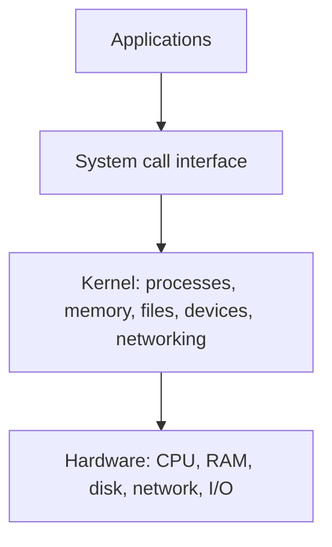
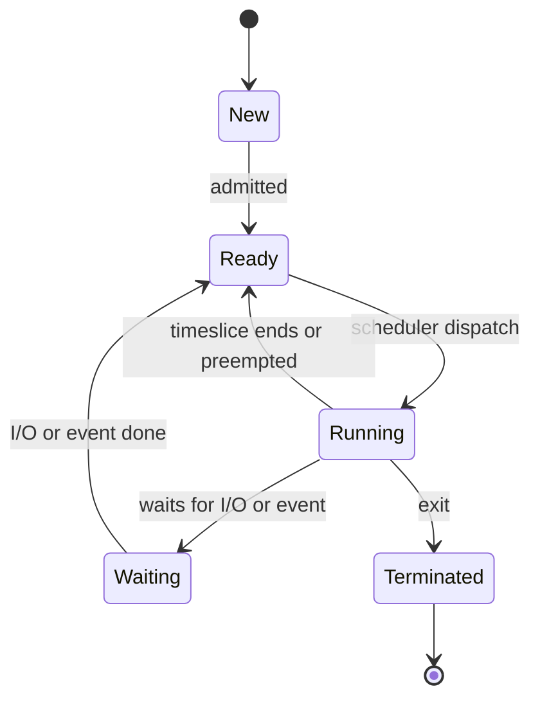
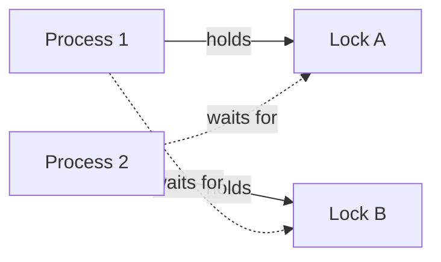
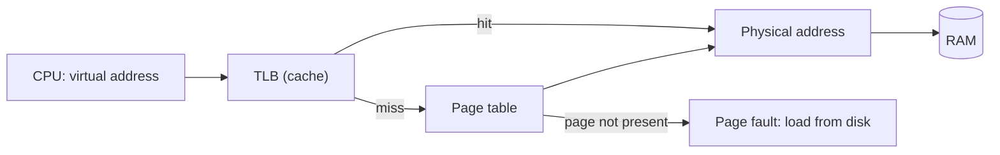

## What an OS Does



| Job | Meaning |
|-----|---------|
| Process management | Create, schedule, and stop programs |
| Memory management | Give each process its own address space |
| File systems | Organise data on storage |
| Device management | Drivers and I/O |
| Protection and security | Isolate processes and users |
| Networking | Sockets and protocols |

## User Mode and Kernel Mode

| Mode | Can do | Used by |
|------|--------|---------|
| User mode | Run normal instructions, no direct hardware access | Applications |
| Kernel mode | Everything, including privileged instructions | The OS |

A **system call** moves a program into the kernel: `open`, `read`, `write`, `fork`, `exec`,
`mmap`, `socket`. An **interrupt** (hardware) or **trap** (error, syscall) does the same.

## Processes

A process is a running program: code, data, heap, stack, and OS state.

```plaintext
High address   ┌───────────────┐
               │     Stack     │  ← grows down (locals, return addresses)
               │       ↓       │
               │               │
               │       ↑       │
               │     Heap      │  ← grows up (malloc, new)
               ├───────────────┤
               │  Data / BSS   │  ← globals and statics
               ├───────────────┤
Low address    │     Code      │  ← program instructions (read-only)
               └───────────────┘
```

### Process States



| Term | Meaning |
|------|---------|
| PCB (process control block) | Kernel record of a process: ID, state, registers, memory, open files |
| Context switch | Save one process's state and load another's. Costs time |
| Zombie | Finished, but the parent has not read its exit status |
| Orphan | Parent died first, so `init` adopts it |

### Creating Processes (Unix)

```c
pid_t pid = fork();            // copy this process
if (pid == 0) {
    execvp("ls", args);        // child: replace itself with a new program
} else {
    wait(NULL);                // parent: wait for the child
}
```

## Threads

A thread is a unit of execution **inside** a process. Threads share code, heap, and files,
but each has its own stack and registers.

| | Process | Thread |
|---|---------|--------|
| Memory | Separate | Shared with siblings |
| Creation cost | High | Low |
| Communication | IPC (pipes, sockets) | Shared memory |
| Crash effect | Isolated | Can take down the whole process |
| Context switch | Slower | Faster |

## CPU Scheduling

| Algorithm | Idea | Pros and cons |
|-----------|------|---------------|
| FCFS | First come, first served | Simple, long jobs block short ones (convoy effect) |
| SJF | Shortest job first | Best average wait, needs run-time estimates, can starve long jobs |
| SRTF | Preemptive SJF | Optimal wait, high overhead |
| Round robin | Fixed time quantum, then next | Fair, good response. Too small a quantum wastes time on switches |
| Priority | Highest priority first | Can starve low priority (fix with **aging**) |
| MLFQ | Several queues, jobs move between them | Adapts to behaviour. Used in real OSes |

Example, round robin with quantum 2 and jobs `A=5`, `B=3`, `C=1`:

```plaintext
Time:   0  1  2  3  4  5  6  7  8  9
CPU:    A  A  B  B  C  A  A  B  A  .
        └──┘  └──┘  │  └──┘  │  │
         A     B    C   A    B  A (finishes at 9)
```

| Metric | Meaning |
|--------|---------|
| Turnaround time | Finish minus arrival |
| Waiting time | Time spent in the ready queue |
| Response time | First run minus arrival |
| Throughput | Jobs finished per unit time |
| CPU utilisation | Share of time the CPU is busy |

## Synchronisation Basics

| Term | Meaning |
|------|---------|
| Race condition | Result depends on timing of threads |
| Critical section | Code that touches shared data and must not run concurrently |
| Mutex | Lock: one holder at a time |
| Semaphore | Counter allowing up to N holders |
| Monitor / condition variable | Wait for a condition, with a lock |

See the [Concurrency cheatsheet]({{ '/concurrency' | relative_url }}) for patterns and bugs.

## Deadlock

Processes wait for each other forever.



All four **Coffman conditions** must hold:

| Condition | Meaning | Break it by |
|-----------|---------|-------------|
| Mutual exclusion | A resource has one holder | Allow sharing where possible |
| Hold and wait | Hold one resource while waiting for another | Request everything at once |
| No preemption | Resources cannot be taken away | Allow preemption |
| Circular wait | A cycle of waiting processes | Order the resources and always lock in that order |

Strategies: **prevention**, **avoidance** (Banker's algorithm), **detection and recovery**, or
**ignore it** (the "ostrich" approach most general-purpose OSes use).

## Memory Management

### Virtual Memory

Each process sees its own **virtual** address space. The OS and hardware (MMU) map it to
**physical** memory.



### Paging

Memory is split into fixed-size **pages** (virtual) and **frames** (physical), often 4 KB.

```plaintext
Virtual address = [ page number | offset ]

with 4 KB pages: offset = 12 bits, page number = the remaining high bits

Page table:  page 0 -> frame 5
             page 1 -> frame 2
             page 2 -> (not in memory) → page fault
```

| Term | Meaning |
|------|---------|
| Page table | Maps pages to frames, one per process |
| TLB | Small, fast cache of recent translations |
| Page fault | The page is not in RAM, so the OS loads it |
| Swapping | Moving pages to disk when RAM is short |
| Thrashing | So much paging that little real work gets done |
| Copy-on-write | Share pages after `fork` until one side writes |
| `mmap` | Map a file or memory into the address space |

### Page Replacement

| Algorithm | Evicts | Notes |
|-----------|--------|-------|
| FIFO | Oldest page | Simple, can get worse with more frames (Belady's anomaly) |
| LRU | Least recently used | Good, costly to track exactly |
| Clock | Approximates LRU with a reference bit | Common in practice |
| Optimal | Page used furthest in the future | Impossible, used as a benchmark |

### Fragmentation

| Type | Where | Cause |
|------|-------|-------|
| Internal | Inside an allocated block | Block bigger than needed (paging) |
| External | Between allocated blocks | Free space split into small gaps (segmentation) |

## File Systems

```plaintext
Path /home/ada/notes.txt
   │
   ▼
Directory entry  ──►  inode  ──►  data blocks on disk
(name → inode #)      (size, owner, permissions, timestamps, block pointers)
```

| Concept | Meaning |
|---------|---------|
| Inode | Metadata of a file. The name lives in the directory |
| Hard link | Another name for the same inode |
| Symbolic link | A file that stores a path |
| Journaling | Log changes first so a crash can be recovered |
| Mount | Attach a file system to a directory |
| Page cache | RAM cache of file data |

| File system | Used by |
|-------------|---------|
| ext4, XFS, Btrfs | Linux |
| APFS | macOS |
| NTFS | Windows |
| FAT32, exFAT | Removable drives |

## I/O and Devices

| Method | How it works |
|--------|--------------|
| Polling | CPU repeatedly asks the device |
| Interrupts | Device signals when ready |
| DMA | Device moves data to memory without the CPU |
| Memory-mapped I/O | Device registers appear as memory addresses |

| I/O model | Behaviour |
|-----------|-----------|
| Blocking | The call waits until done |
| Non-blocking | Returns at once, maybe "not ready" |
| Multiplexing (`select`, `poll`, `epoll`, `kqueue`) | Wait on many descriptors |
| Async (`io_uring`, IOCP) | The OS completes the work and notifies you |

## Inter-Process Communication

| Method | Notes |
|--------|-------|
| Pipe | One-way byte stream, between related processes |
| Named pipe (FIFO) | A pipe with a file name |
| Signal | A small notification (`SIGINT`, `SIGTERM`, `SIGKILL`) |
| Shared memory | Fastest, needs synchronisation |
| Message queue | Structured messages |
| Socket | Local (Unix domain) or network |

## Useful Commands (Linux)

| Command | Shows |
|---------|-------|
| `ps aux`, `top`, `htop` | Processes and CPU use |
| `kill -15 PID`, `kill -9 PID` | Ask to stop, force stop |
| `free -h` | Memory use |
| `vmstat 1` | Memory, swap, CPU over time |
| `lsof -p PID` | Open files of a process |
| `strace -p PID` | System calls of a process |
| `df -h`, `du -sh` | Disk space |
| `iostat -x 1` | Disk activity |
