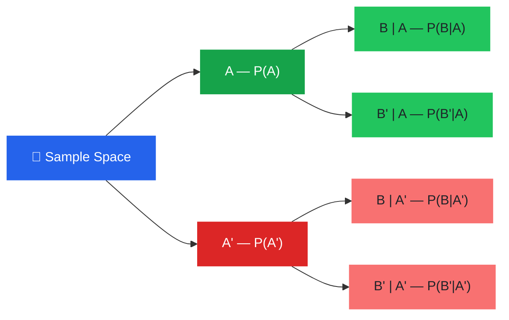
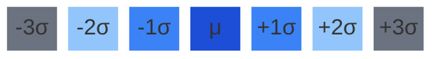
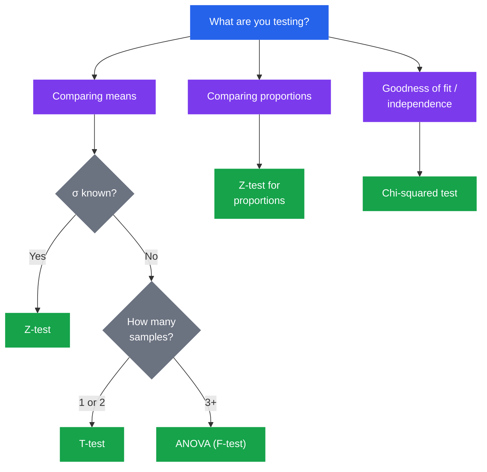

# Probability & Statistics Cheatsheet

Essential formulas and concepts for probability theory and statistics.

## Probability Basics

### Set Operations

<figure style="text-align: center; margin: 0;">
<svg width="180" height="120" viewBox="0 0 180 120" xmlns="http://www.w3.org/2000/svg">
  <rect width="180" height="120" rx="8" fill="var(--bg-secondary)" stroke="var(--border)"/>
  <circle cx="68" cy="60" r="38" fill="#58a6ff" opacity="0.45"/>
  <circle cx="112" cy="60" r="38" fill="#3fb950" opacity="0.45"/>
  <text x="55" y="64" font-size="14" font-weight="600" fill="var(--text-primary)" font-family="var(--font-sans)">A</text>
  <text x="118" y="64" font-size="14" font-weight="600" fill="var(--text-primary)" font-family="var(--font-sans)">B</text>
</svg>
<figcaption style="font-size: 0.8rem; color: var(--text-secondary); margin-top: 0.25rem;"><strong>A ∪ B</strong> — Union (all shaded)</figcaption>
</figure>

<figure style="text-align: center; margin: 0;">
<svg width="180" height="120" viewBox="0 0 180 120" xmlns="http://www.w3.org/2000/svg">
  <rect width="180" height="120" rx="8" fill="var(--bg-secondary)" stroke="var(--border)"/>
  <defs>
    <clipPath id="clipB"><circle cx="112" cy="60" r="38"/></clipPath>
  </defs>
  <circle cx="68" cy="60" r="38" fill="none" stroke="var(--text-muted)" stroke-width="1.5"/>
  <circle cx="112" cy="60" r="38" fill="none" stroke="var(--text-muted)" stroke-width="1.5"/>
  <circle cx="68" cy="60" r="38" fill="#d2a8ff" opacity="0.6" clip-path="url(#clipB)"/>
  <text x="55" y="64" font-size="14" font-weight="600" fill="var(--text-primary)" font-family="var(--font-sans)">A</text>
  <text x="118" y="64" font-size="14" font-weight="600" fill="var(--text-primary)" font-family="var(--font-sans)">B</text>
</svg>
<figcaption style="font-size: 0.8rem; color: var(--text-secondary); margin-top: 0.25rem;"><strong>A ∩ B</strong> — Intersection (overlap)</figcaption>
</figure>

<figure style="text-align: center; margin: 0;">
<svg width="180" height="120" viewBox="0 0 180 120" xmlns="http://www.w3.org/2000/svg">
  <rect width="180" height="120" rx="8" fill="#f8514933" stroke="var(--border)"/>
  <circle cx="90" cy="60" r="38" fill="var(--bg-secondary)" stroke="var(--text-muted)" stroke-width="1.5"/>
  <text x="83" y="64" font-size="14" font-weight="600" fill="var(--text-primary)" font-family="var(--font-sans)">A</text>
  <text x="148" y="20" font-size="12" font-weight="600" fill="var(--text-secondary)" font-family="var(--font-sans)">Aᶜ</text>
</svg>
<figcaption style="font-size: 0.8rem; color: var(--text-secondary); margin-top: 0.25rem;"><strong>Aᶜ</strong> — Complement (red area)</figcaption>
</figure>

### Fundamental Rules

- **Complement**: $$ P(A^c) = 1 - P(A) $$
- **Union**: $$ P(A \cup B) = P(A) + P(B) - P(A \cap B) $$
- **Intersection (independent)**: $$ P(A \cap B) = P(A) \cdot P(B) $$
- **Conditional Probability**: $$ P(A \mid B) = \frac{P(A \cap B)}{P(B)} $$

### Bayes' Theorem

$$ P(A \mid B) = \frac{P(B \mid A) \cdot P(A)}{P(B)} $$

> To find $$ P(A \mid B) $$: follow the branch through A to B, then divide by total probability of B across all branches.

Generalized form:

$$ P(A_i \mid B) = \frac{P(B \mid A_i) \cdot P(A_i)}{\sum_{j} P(B \mid A_j) \cdot P(A_j)} $$

### Law of Total Probability

$$ P(B) = \sum_{i} P(B \mid A_i) \cdot P(A_i) $$

### Counting

- **Permutations** (order matters): $$ P(n, r) = \frac{n!}{(n-r)!} $$
- **Combinations** (order doesn't matter): $$ \binom{n}{r} = \frac{n!}{r!(n-r)!} $$

## Descriptive Statistics

### Measures of Central Tendency

- **Mean**: $$ \bar{x} = \frac{1}{n} \sum_{i=1}^{n} x_i $$
- **Median**: Middle value when data is sorted
- **Mode**: Most frequently occurring value

### Measures of Spread

- **Variance** (population): $$ \sigma^2 = \frac{1}{N} \sum_{i=1}^{N} (x_i - \mu)^2 $$
- **Variance** (sample): $$ s^2 = \frac{1}{n-1} \sum_{i=1}^{n} (x_i - \bar{x})^2 $$
- **Standard Deviation**: $$ \sigma = \sqrt{\sigma^2} $$
- **Interquartile Range**: $$ \text{IQR} = Q_3 - Q_1 $$

### Covariance & Correlation

- **Covariance**: $$ \text{Cov}(X, Y) = E[(X - \mu_X)(Y - \mu_Y)] $$
- **Pearson Correlation**: $$ r = \frac{\text{Cov}(X, Y)}{\sigma_X \sigma_Y} $$ where $$ -1 \leq r \leq 1 $$

## Common Distributions

### Discrete Distributions

| Distribution | PMF | Mean | Variance |
|---|---|---|---|
| Bernoulli | $$ P(X=k) = p^k(1-p)^{1-k} $$ | $$ p $$ | $$ p(1-p) $$ |
| Binomial | $$ P(X=k) = \binom{n}{k} p^k (1-p)^{n-k} $$ | $$ np $$ | $$ np(1-p) $$ |
| Poisson | $$ P(X=k) = \frac{\lambda^k e^{-\lambda}}{k!} $$ | $$ \lambda $$ | $$ \lambda $$ |
| Geometric | $$ P(X=k) = (1-p)^{k-1}p $$ | $$ \frac{1}{p} $$ | $$ \frac{1-p}{p^2} $$ |

### Continuous Distributions

| Distribution | PDF | Mean | Variance |
|---|---|---|---|
| Uniform | $$ f(x) = \frac{1}{b-a} $$ | $$ \frac{a+b}{2} $$ | $$ \frac{(b-a)^2}{12} $$ |
| Normal | $$ f(x) = \frac{1}{\sigma\sqrt{2\pi}} e^{-\frac{(x-\mu)^2}{2\sigma^2}} $$ | $$ \mu $$ | $$ \sigma^2 $$ |
| Exponential | $$ f(x) = \lambda e^{-\lambda x} $$ | $$ \frac{1}{\lambda} $$ | $$ \frac{1}{\lambda^2} $$ |

### Standard Normal Distribution

$$ Z = \frac{X - \mu}{\sigma} $$

The **68-95-99.7 rule** (empirical rule):

| Range | Coverage |
|---|---|
| $$ \mu \pm 1\sigma $$ | **68%** of data |
| $$ \mu \pm 2\sigma $$ | **95%** of data |
| $$ \mu \pm 3\sigma $$ | **99.7%** of data |

## Expected Value & Moments

- **Expected Value**: $$ E[X] = \sum_{i} x_i P(x_i) $$ (discrete), $$ E[X] = \int_{-\infty}^{\infty} x f(x) \,dx $$ (continuous)
- **Linearity**: $$ E[aX + bY] = aE[X] + bE[Y] $$
- **Variance via Expectation**: $$ \text{Var}(X) = E[X^2] - (E[X])^2 $$
- **Variance of Sum** (independent): $$ \text{Var}(X + Y) = \text{Var}(X) + \text{Var}(Y) $$

## Inference

### Confidence Intervals

- **For population mean** (known $$ \sigma $$): $$ \bar{x} \pm z_{\alpha/2} \cdot \frac{\sigma}{\sqrt{n}} $$
- **For population mean** (unknown $$ \sigma $$): $$ \bar{x} \pm t_{\alpha/2, \, n-1} \cdot \frac{s}{\sqrt{n}} $$

| Confidence Level | $$ z_{\alpha/2} $$ |
|---|---|
| 90% | 1.645 |
| 95% | 1.960 |
| 99% | 2.576 |

### Hypothesis Testing

1. State null $$ H_0 $$ and alternative $$ H_a $$
2. Choose significance level $$ \alpha $$ (commonly 0.05)
3. Compute test statistic
4. Find p-value or compare to critical value
5. Reject $$ H_0 $$ if p-value $$ < \alpha $$

### Choosing a Test

### Common Tests

- **Z-test**: $$ z = \frac{\bar{x} - \mu_0}{\sigma / \sqrt{n}} $$ — known population variance
- **T-test**: $$ t = \frac{\bar{x} - \mu_0}{s / \sqrt{n}} $$ — unknown population variance, small sample
- **Chi-squared test**: $$ \chi^2 = \sum \frac{(O_i - E_i)^2}{E_i} $$ — goodness of fit, independence

### Type I & Type II Errors

| | $$ H_0 $$ True | $$ H_0 $$ False |
|---|---|---|
| **Reject** $$ H_0 $$ | Type I Error ($$ \alpha $$) | Correct |
| **Fail to reject** $$ H_0 $$ | Correct | Type II Error ($$ \beta $$) |

- **Power**: $$ 1 - \beta $$ — probability of correctly rejecting a false $$ H_0 $$

## Central Limit Theorem

For a sample of size $$ n $$ drawn from a population with mean $$ \mu $$ and standard deviation $$ \sigma $$:

$$ \bar{X} \sim N\left(\mu, \frac{\sigma^2}{n}\right) \text{ as } n \to \infty $$

The sampling distribution of $$ \bar{X} $$ approaches normal regardless of the population distribution, provided $$ n $$ is sufficiently large (typically $$ n \geq 30 $$).

---

This cheatsheet covers probability fundamentals, descriptive statistics, common distributions, expected values, confidence intervals, hypothesis testing, and the central limit theorem.
