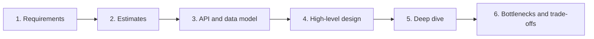
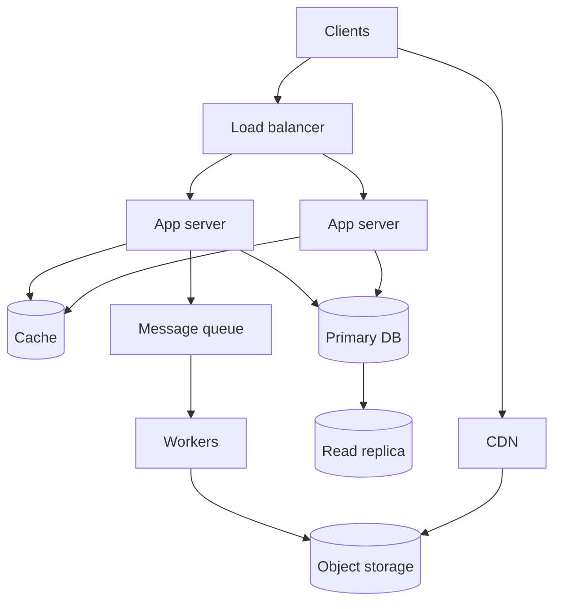
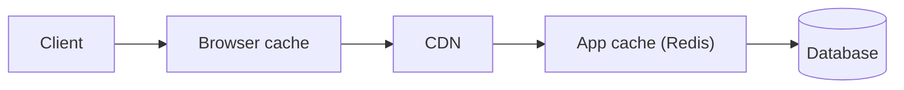
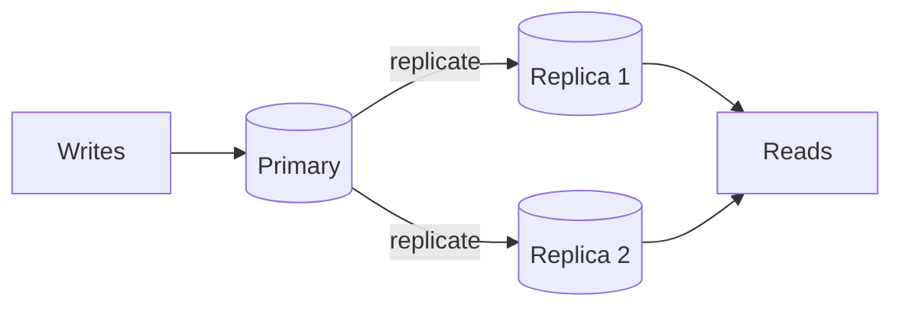
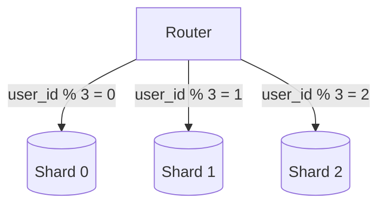
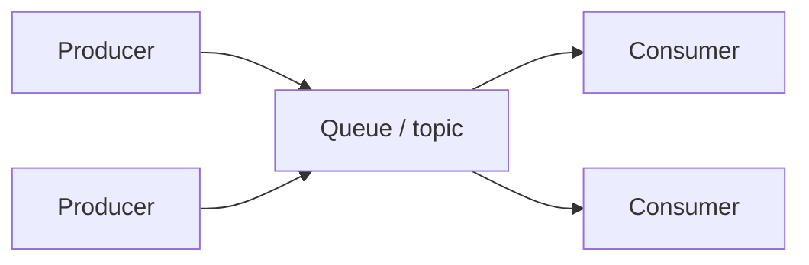

## A Framework for Design Questions



| Step | Ask or do |
|------|-----------|
| Requirements | What must it do (functional)? How fast, available, and consistent (non-functional)? |
| Estimates | Users, requests per second, storage per year, read to write ratio |
| API and data | Main endpoints and the key tables or objects |
| High-level design | Boxes and arrows: clients, services, data stores |
| Deep dive | Pick the hardest part and design it properly |
| Trade-offs | Name what you gave up, and how it would grow |

State your assumptions out loud. There is rarely one right answer.

## Non-Functional Requirements

| Term | Meaning | Typical target |
|------|---------|----------------|
| Latency | Time for one request | p99 under a few hundred ms |
| Throughput | Requests handled per second | Depends on load |
| Availability | Share of time the system works | 99.9% to 99.99% |
| Durability | Data is not lost | 11 nines for object stores |
| Scalability | Handles growth by adding resources | Horizontal if possible |
| Consistency | All readers see the same data | Strong or eventual |

| Availability | Downtime per year | Per month |
|-------------:|------------------:|----------:|
| 99% | 3.65 days | 7.3 hours |
| 99.9% | 8.8 hours | 43.8 minutes |
| 99.99% | 52.6 minutes | 4.4 minutes |
| 99.999% | 5.3 minutes | 26 seconds |

## Numbers Worth Knowing

| Operation | Approximate time |
|-----------|-----------------:|
| CPU cache or L1 reference | 1 ns |
| Main memory reference | 100 ns |
| SSD random read | 100 microseconds |
| Read 1 MB from memory | 250 microseconds |
| Round trip inside a datacenter | 500 microseconds |
| Read 1 MB from SSD | 1 ms |
| Disk seek | 10 ms |
| Round trip across continents | 150 ms |

Memory is about 1000x faster than SSD, and SSD is about 100x faster than a network hop
across regions. Avoid network and disk where you can.

| Unit | Value |
|------|-------|
| 1 day | about 100,000 seconds (86,400) |
| 1 million requests per day | about 12 per second |
| 1 billion requests per day | about 12,000 per second |
| 1 KB, 1 MB, 1 GB, 1 TB | 10^3, 10^6, 10^9, 10^12 bytes |

## Back-of-the-Envelope Example

Design a photo service: 10 million daily users, each uploads 1 photo (2 MB) and views 20.

```plaintext
Writes:   10M uploads / 86,400 s      ~ 120 uploads per second
Reads:    10M x 20 views / 86,400 s   ~ 2,300 reads per second
Storage:  10M x 2 MB                  = 20 TB per day  ->  ~7 PB per year
Egress:   2,300 reads/s x 200 KB      ~ 460 MB/s (thumbnails, via CDN)
```

Reads outnumber writes about 20 to 1, so cache and CDN first.

## Reference Architecture



## Scaling

| | Vertical (scale up) | Horizontal (scale out) |
|---|---------------------|------------------------|
| How | A bigger machine | More machines |
| Limit | Hardware ceiling | Practically none |
| Failure | Single point of failure | Survives losing nodes |
| Complexity | Low | Needs load balancing, shared state |

- Keep app servers **stateless** (sessions in a cache or token), so any server can answer.
- Scale reads with caches and replicas, and writes with sharding.
- Start simple. Add each component only when a number says you need it.

## Load Balancing

| Algorithm | How it picks | Notes |
|-----------|--------------|-------|
| Round robin | Next server in turn | Simple, ignores load |
| Weighted round robin | Turns by capacity | For uneven servers |
| Least connections | Fewest active connections | Good for long requests |
| IP hash | Hash of the client address | Sticky without cookies |
| Consistent hashing | Hash ring | Little reshuffling when nodes change |

| Layer | Sees | Use |
|-------|------|-----|
| L4 (TCP/UDP) | IP and port | Fast, simple |
| L7 (HTTP) | Path, headers, cookies | Routing, TLS termination, auth |

Use health checks to take failed servers out of rotation, and run at least two load
balancers so it is not a single point of failure.

## Caching



| Pattern | How it works | Trade-off |
|---------|--------------|-----------|
| Cache-aside | App checks cache, on miss reads DB and fills cache | Most common, can serve stale data |
| Read-through | Cache loads from DB itself | Simpler app code |
| Write-through | Write to cache and DB together | Safe, slower writes |
| Write-back | Write to cache, flush to DB later | Fast, risk of data loss |
| Write-around | Write to DB only, cache fills on read | Avoids caching rarely read data |

| Eviction | Removes |
|----------|---------|
| LRU | Least recently used |
| LFU | Least frequently used |
| FIFO | Oldest entry |
| TTL | Anything past its expiry time |

Hard parts: **invalidation** (when to drop or refresh), **cache stampede** (many misses at
once, so use locks or request coalescing), and **hot keys**.

## Databases

| | SQL (relational) | NoSQL |
|---|------------------|-------|
| Model | Tables and joins | Key-value, document, wide-column, graph |
| Schema | Fixed | Flexible |
| Transactions | Strong ACID | Varies, often per item |
| Scale | Vertical, then replicas and shards | Built to scale out |
| Use for | Money, orders, anything relational | Huge scale, flexible data, simple access patterns |

| NoSQL type | Examples | Good for |
|------------|----------|----------|
| Key-value | Redis, DynamoDB | Sessions, caches, counters |
| Document | MongoDB, Firestore | Content, profiles |
| Wide-column | Cassandra, HBase | Time series, write-heavy data |
| Graph | Neo4j | Relationships, recommendations |
| Search | Elasticsearch, OpenSearch | Full-text search |

Add **indexes** for the queries you run. They speed reads and slow writes.

## Replication



| Style | Description | Trade-off |
|-------|-------------|-----------|
| Primary and replicas | One writer, many readers | Replicas can lag behind |
| Multi-primary | Several writers | Conflicts must be resolved |
| Synchronous | Wait for replica to confirm | Safer, slower |
| Asynchronous | Do not wait | Faster, may lose recent writes on failover |

## Sharding (Partitioning)

Split data across machines so no single one holds it all.



| Strategy | How | Drawback |
|----------|-----|----------|
| Range | Ranges of the key (A-F, G-M) | Hot spots |
| Hash | `hash(key) % N` | Resharding moves much data |
| Consistent hashing | Hash ring with virtual nodes | More moving parts |
| Directory | A lookup table for each key | The lookup is a bottleneck |

Pick a shard key with high cardinality and even load. Cross-shard joins and transactions
are costly, so design queries around the shard key.

## CAP Theorem and Consistency

During a **network partition** you choose between consistency and availability.

| Choice | Behaviour | Examples |
|--------|-----------|----------|
| CP | Reject requests rather than return stale data | HBase, MongoDB (default), etcd |
| AP | Always answer, maybe with stale data | Cassandra, DynamoDB, DNS |

| Consistency model | Guarantee |
|-------------------|-----------|
| Strong | A read sees the latest write |
| Eventual | Replicas converge given time |
| Read-your-writes | You see your own writes at once |
| Causal | Related events are seen in order |

PACELC adds: when there is **no** partition, you still trade latency against consistency.

## Message Queues and Streams



| Use | Why |
|-----|-----|
| Decouple services | The producer does not wait for the consumer |
| Smooth spikes | The queue absorbs bursts |
| Retry safely | Failed work stays in the queue |
| Fan out | One event, many subscribers |

| Concept | Meaning |
|---------|---------|
| At-most-once | May lose messages, never repeats |
| At-least-once | Never loses, may repeat. Make consumers **idempotent** |
| Exactly-once | Hard. Usually at-least-once plus idempotency |
| Dead-letter queue | Where messages go after repeated failure |
| Ordering | Usually guaranteed only within a partition |

Examples: RabbitMQ, SQS (queues), Kafka, Kinesis (logs and streams).

## API Styles

| Style | Best for |
|-------|----------|
| REST | Public, resource-based APIs |
| GraphQL | Flexible clients, many UIs |
| gRPC | Fast service-to-service calls |
| WebSocket | Two-way real-time updates |
| Webhooks | Server pushes events to your URL |

## Rate Limiting

| Algorithm | Idea |
|-----------|------|
| Token bucket | A bucket refills at a steady rate. Each request takes a token. Allows bursts |
| Leaky bucket | Requests drain at a fixed rate |
| Fixed window | Count per time window. Simple, but allows a burst at the boundary |
| Sliding window | Smooth count over the last N seconds |

Store counters in a shared cache such as Redis, and return `429 Too Many Requests` with a
`Retry-After` header.

## Reliability Patterns

| Pattern | Purpose |
|---------|---------|
| Retry with exponential backoff and jitter | Survive brief failures without stampedes |
| Timeout | Never wait forever |
| Circuit breaker | Stop calling a failing service for a while |
| Bulkhead | Isolate resources so one failure does not spread |
| Idempotency keys | Make retries safe |
| Graceful degradation | Serve a reduced result instead of an error |
| Redundancy and failover | No single point of failure |

## Observability

| Signal | Tells you | Tools |
|--------|-----------|-------|
| Metrics | Is it healthy, and how much load | Prometheus, Grafana |
| Logs | What happened | ELK, Loki |
| Traces | Where time went across services | OpenTelemetry, Jaeger |

Watch the four golden signals: **latency, traffic, errors, saturation**.

## Common Design Problems

| Problem | Key ideas |
|---------|-----------|
| URL shortener | Base62 IDs, key-value store, cache, read-heavy |
| Chat app | WebSocket, message queue, per-user inbox, presence |
| News feed | Fan-out on write or read, cache, ranking |
| Rate limiter | Token bucket, Redis, per-user and per-IP keys |
| File storage | Chunking, object store, metadata DB, CDN |
| Search | Inverted index, sharding, ranking |
| Notification system | Queue, retries, templates, per-channel workers |
